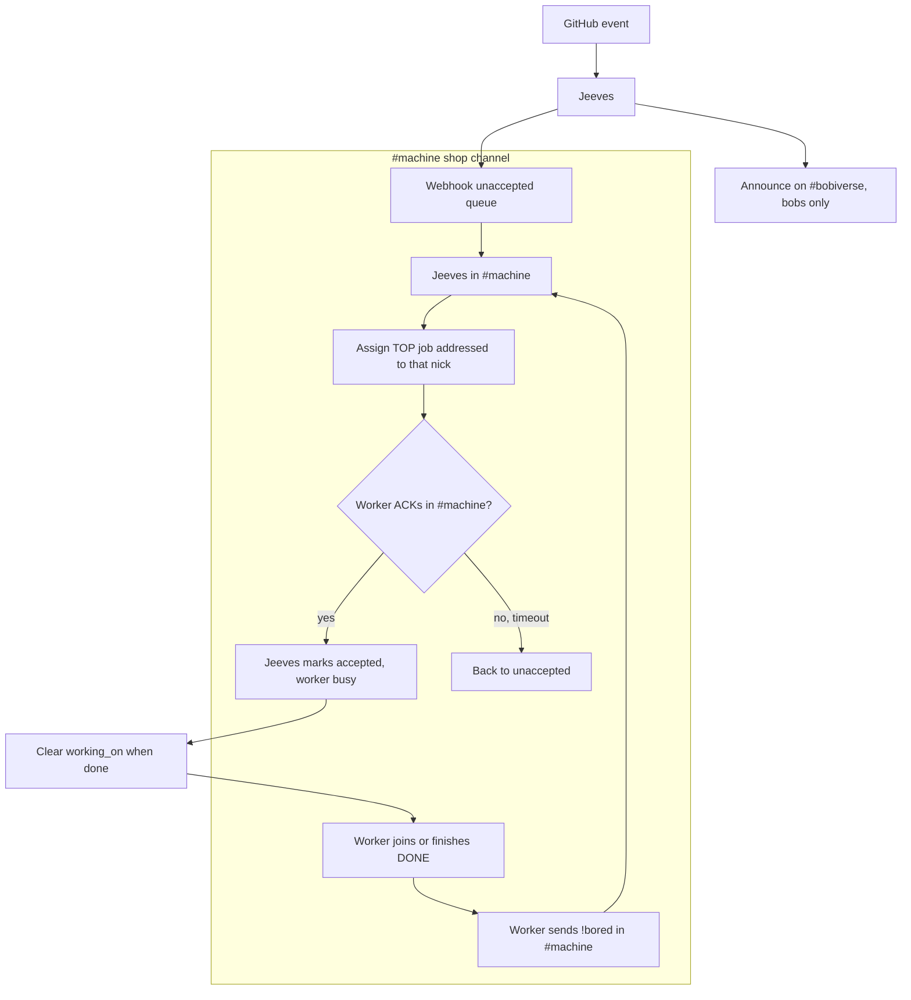

# Bob GIT claim (webhook queue + shop !bored)

## Purpose
Deterministic claim path (especially when Sand is empty): workers take GIT work without Bob LLM reasoning. Jeeves is **100% scripts**.

## Source of truth
The **digest webhook** `https://irc.ntsa.uk/bob/v1/report` owns the **unaccepted** list (and the accepted side-effects). An on-disk mirror is optional crash recovery only.

## CAST IRON: where things happen
- **Jeeves** announces GIT work **only on `#bobiverse`, to the bobs**, and appends claimable jobs to the webhook **unaccepted** queue.
- **`!bored` is issued ONLY by workers, ONLY in their own `#{machine}` shop channel.** Never on #bobiverse, never in chat or other channels.
- **Jeeves** (auto-joined to every `#{machine}`) answers `!bored` and assigns the next job (CAST IRON, Simon 25 Sep 22:06 BST, gh-Jeeves #106). The bob-{machine} ear **no longer offers** (agentic_irc #232 closed as superseded).

## CAST IRON: workers MUST !bored on join and after DONE
Any **worker process** (Cursor, Grok, Aider, free seats) MUST send **`!bored`** in `#{machine}` **when it joins** and **when it finishes a task (right after its DONE)**. It also retries every few minutes while idle (never while busy); Jeeves accepts `!bored` any time, and sends `nothing queued` at most once per idle stretch, but assigns as soon as a job exists (Simon 22:10 BST). The monitor sends it deterministically (AgentMonitor #100); watchers and start packs must enforce this.

## Flow
1. A GitHub webhook event reaches Jeeves. Jeeves announces it on `#bobiverse` (bobs only) and appends it to the webhook **unaccepted** list.
2. A worker that has just joined or just sent DONE sends **`!bored`** in **`#{machine}`**.
3. **Jeeves** takes the **top** unaccepted job (`!focus` order, skipping accepted jobs and live offers to other nicks, and not an MRB to its PR author if another seat is live) and assigns it in `#{machine}` as one ACK-able line addressed to that nick, e.g. `<nick>: MRB owner/repo#104 <url>`. With an empty queue it replies `<nick>: nothing queued`. An un-ACKed offer times out back to the queue.
4. The worker **acknowledges receipt in `#{machine}`**.
5. **Jeeves**, listening in `#{machine}`, sees that ACK and fires the webhook: job **accepted**, worker **busy** with activity `<MODE> <repo>#<n> <title>` (TipForm START tile). On the worker's DONE, Jeeves marks it completed, clears the activity, sets the worker idle and applies supersede. With no ack, the offer times out and the job returns to unaccepted.
6. That worker runs **FR**, **MRB** or **UAT**, and reports its **agent** and **model**. On finishing it sends DONE (clearing `working_on`), then the next `!bored`.

## Commands
- `!bored`: mandatory on join and after DONE, worker only, in `#{machine}` only. Jeeves's assignment (or `nothing queued`) addresses the requesting nick.
- Receipt ack: required before the job is marked accepted.
- Legacy `!ACCEPT`: optional and idempotent, during the transition only.

## Task fields
- `{repo}` = `owner/repo`
- `{task}` = `FR` | `MRB` | `UAT`
- `{id}` = issue/PR number or job id

## Harvest
Fold this into the **Cursor and Grok** worker instruction packs, AgentMonitor and the shop watchers in agentic_build, not only Aider.

## Related
Bob Jeeves chair; Bob token-efficient handoff; Bob worker activity webhook.
