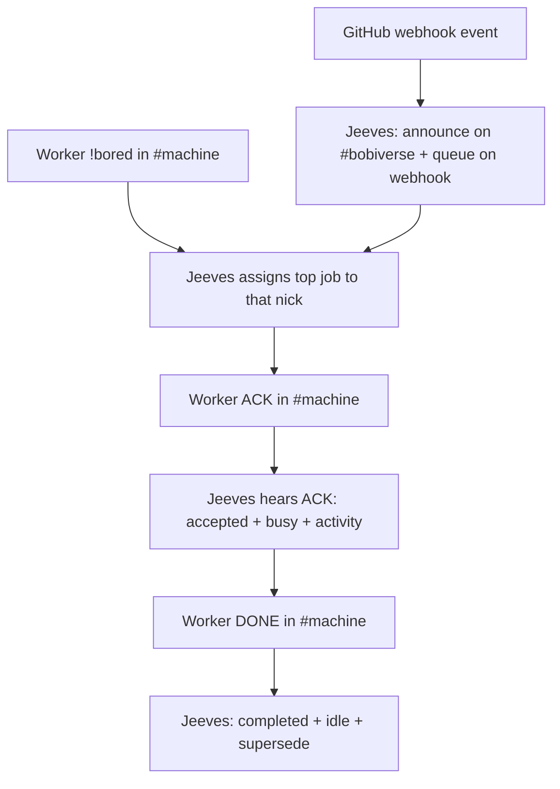

# Jeeves + BobIrcd (fleet chair)

Home skill book: `https://github.com/SimonBarnett/gh-Jeeves` (`skills/`). Harvest gaps there.

## Role
Jeeves is the `#bobiverse` digest/GIT chair (nick **Jeeves**). It uses **no LLM**: it is 100% deterministic scripts.

**CAST IRON announce:** Jeeves announces GIT work **only on `#bobiverse`** and keeps the queue on the digest webhook. It does not announce in shop channels.

**CAST IRON shop listener:** Jeeves sits in every `#{machine}` shop channel and listens for worker **`!bored`**, **ACK** and **DONE**. It trusts only `{machine}-<pid>` nicks in **their own** `#{machine}`.
- **ACK** (`ACK <TYPE> <owner/repo>#<n>`) → fire the webhook: job **accepted**, worker **busy**, activity `<MODE> <repo>#<n> <title>` (shown on the TipForm START tile).
- **DONE** (`DONE <TYPE> <owner/repo>#<n> <result> <url>`) → job **completed**, activity **cleared**, worker **idle**, apply supersede.
- **`!bored`** → assign the top unaccepted job (`!focus` order) as one line addressed to that nick, e.g. `<nick>: MRB owner/repo#104 <url>`; empty queue → `<nick>: nothing queued`. Offers time out back to the queue.
- QUIT / DONE timeout / GIVEUP → back to unaccepted, worker idle.

**CAST IRON assign (Simon 25 Sep 22:06 BST, gh-Jeeves #106; replaces the ear-offers rule):** workers send `!bored` **only in their own `#{machine}`**, on join and after DONE; **Jeeves** assigns. Its only shop output is that assignment line or `nothing queued`. The bob-{machine} ear no longer offers. See [Bob GIT ACCEPT claim](sand-workflow:bob-git-accept-claim).

## Supersede (on GitHub events and DONE)
- PR referencing an FR → **MRB**.
- Merge after MRB PASS → **UAT** (only Bob stamps UAT).
- PR closed unmerged → **FR** restored.
- Issue closed → task removed; issue reopened → **FR** re-added.
- Queue rebuilt from GitHub on start, quiet resync every 15 min (gh-Jeeves #25). `!list` by PM (capped, paced); `!help` from the command registry (#27).

## Ops
- Target: **bob-{machine}** is op in its own `#{machine}`, and Jeeves is op in `#bobiverse`. It needs Ergo channel registration to survive reconnects.
- The **simon** account gets ops **only** when connecting from a fleet machine `{machinename}`. Masked hosts are shared per public IP, so identify the machine by a per-machine client certificate, not by host.
- bob-{machine} kicks invalid workers (no live pid, leaked test nicks, or a worker that doesn't answer) from its own shop channel only, and never kicks itself, Jeeves or another bob.

## Flow

_Caption: Jeeves announces, assigns on !bored, and turns shop ACK/DONE into webhook state; its only shop output is the assignment line._

## Homes (do not merge)
- Identity `--home`: `~/.agentic-irc-jeeves`
- Digest drain `BOB_DIGEST_HOME`: `~/.agentic-irc-bobiverse` (webhook outbox).

## Running Jeeves
- If the chair's sealed identity only decrypts as the owning user, run Jeeves from a scheduled task as that user (at logon, restarting on exit) rather than as a LocalSystem service (target: `BobJeeves` service with a dedicated account, gh-Jeeves #17).
- Clear a stale quit file before starting the chair.
- Kill any prior Jeeves/`--chair` process before starting (deterministic).
- `config/bobiverse.json`: `chairNick` = `Jeeves`, `chairHome` = the chair host.
