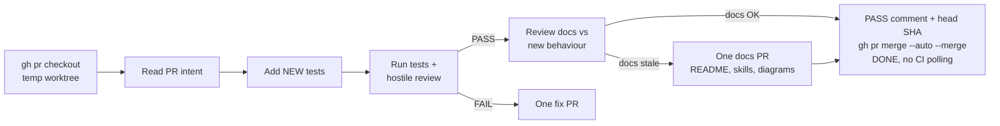

# Bob MRB worker (standard)

Home skill book: `https://github.com/SimonBarnett/agentic_build`. Foundation: harvest-agent-skills (honesty box).

Applies to **every** worker that does MRB (Cursor, Grok, Aider, and any free-trial seat). Prefer a different worker than the PR author **when 2+ workers are available**; if only one seat is free, that seat may continue into MRB.

One of three Bob Fleet modes: **FR / MRB / UAT**. This skill is MRB only. After MRB PASS, Jeeves announces and bob assigns a **separate UAT worker process** — MRB must not stamp UAT.

## Process

1. Get the MRB job (repo + PR URL) on the shop channel (`#{machine}` only) — assigned after Jeeves announce by `bob-{machine}` (or deterministic `!BORED` when Sand is empty).
2. Use `gh pr checkout` in a temporary worktree.
3. Read the PR: intent and changed files. Note the **source issue/FR** that generated this PR (it stays open until PASS).
   - **Vision / drift check:** read the repo's vision source (`VISION.md` or the visionary `*_BRIEF.md`, the README purpose, CAST IRON rules and the Three Laws) and the FR's intent. Judge whether the PR serves the vision and success metric, contradicts no CAST IRON rule, adds no unasked scope, and actually delivers the intent (wired into production, not just code that exists). Drift is a FAIL reason. Quote the vision lines judged against in the MRB comment. If the vision itself should change, file a `vision` FR for Simon instead of drifting. If there's no vision source, say so and file one FR asking for `VISION.md`.
4. **Before testing:** add any **new** tests appropriate to this PR.
5. Run existing + new tests; do a hostile review of the change.
6. After a PASS, review README, skills, `docs/`, mermaid diagrams, and usage/help text for anything made stale by the new behavior.
7. Verdict:
   - **PASS** → if docs are stale, open exactly **one** docs PR against `main` with the corrections and merge it together with the original; if docs are fine, merge as before. **Merge = auto-merge, never CI polling (bobiverse#3948):** post the MRB PASS comment with the head SHA, run `gh pr merge <n> --auto --merge` (on the docs PR too, if there is one), and send DONE within about 1 minute of your last push. GitHub merges once the repo's `required-ci-3948` checks go green. Never poll or watch CI, and never loop on folding `main` in (at most one `gh pr update-branch`). A held PR (hold label/comment, #3928) never gets `--auto`. If the repo has `allow_auto_merge=false`, comment `merge-on-green pending`, send DONE, and report that the repo needs auto-merge. Then **always close the issue/FR that generated it**. Jeeves announces → triggers separate **UAT** assign (not this process); only Bob stamps UAT.
   - **FAIL** → open **exactly one** fix PR with the fix, then merge **both** (original + fix). Jeeves announces. **Do not close** the source issue/FR on FAIL — it stays open until an MRB PASS. No UAT on FAIL.
8. Report `working_on` (with `agent` + `model`) on the digest webhook while busy; clear when idle.
9. Do **not** stamp UAT (Bob only, after UAT worker). Shop channel only — not `#bobiverse`, not issue-number channels.

**CAST IRON:** Close the source issue/FR **only** on MRB PASS. Leaving it open until then is required so earliest-open FR workers do not re-pick a finished ask after PASS; closing on FAIL would be wrong, and never closing on PASS would stick the queue on the same issue forever.

_After a PASS, check whether any documentation still describes the old behaviour; if so, open one docs PR and auto-merge it with the original. PASS = `gh pr merge --auto --merge` + DONE; never poll CI (bobiverse#3948)._

## Free-agent setup
When standing up a free agent, copy this skill (or link it) into that agent’s IRC/instruction pack so MRB behaviour matches Cursor/Grok seats. Keep steps inline — do not bulk-read skill trees on wake. Harvest gaps back to agentic_build.
