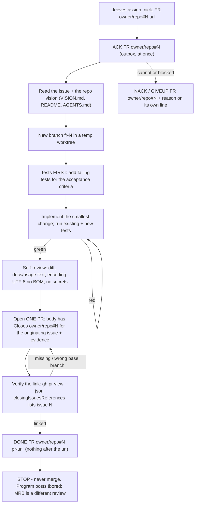

# bobiverse bob - FR job (implement)

> **CAST IRON RULE - HARVEST AND FILE EVERYTHING (read this first, every time).**
> 1. ALWAYS harvest skills you learn and file EVERY issue / FR / bug / gap you find to the intake webhook in the
>    SAME turn. Never leave a finding unfiled, never "note it for later", never skip it because it is small.
> 2. File with the intake webhook (no secret or login needed; `POST https://bob.ntsa.uk/bob/v1/intake`; offline it is
>    queued locally and retried):
>    `.\scripts\Report-BobiverseIntakeIssue.ps1 -Repo SimonBarnett/bobiverse -Kind issue -Title "short title" -Body "what / where / evidence / fix"`
>    (`-Kind issue|fr|skill|harvest`; always pass an explicit `-Repo owner/name`).
> 3. BEFORE finishing ANY debugging session run the harvest step:
>    `.\scripts\Invoke-BobiverseHarvest.ps1 -Summary "what broke / what fixed it" -Lesson "one learned playbook line"`
>    then `.\scripts\Invoke-BobiverseHarvest.ps1 -Flush` to resend anything that was queued while offline.
> 4. Never put a token, password, SASL/NickServ secret, key or private hostname in a filing, a skill or a log.

**Job type `FR`** - implement a feature request or fix a bug. Wire format, channel and timing: `bobiverse-bob-job-irc` (read it first). You implement and open ONE pull request; you never merge it.

## Process



## Steps

1. **ACK** the assign line (exact id). 2. Read the issue, linked FRs and the vision/README so you serve the intent, not just the letter. 3. Work in a temporary worktree/branch, never on `main`.
4. **Tests first**: new tests that fail for the right reason, then the implementation. 5. Run the whole suite (not just yours). 6. Update docs/usage/skills your change makes stale.
7. Open exactly **one** PR against the repo's default branch, title referencing the FR, body containing the line **`Closes <owner>/<repo>#N`** (the full form, the originating issue - not just `#N`, not only in a comment) plus the evidence block below. A PR that targets a non-default branch does not auto-close the issue: say so in the body so the MRB closes it by hand.
8. **Verify the link before DONE**: `gh pr view <pr> --repo <owner>/<repo> --json body,baseRefName,closingIssuesReferences` must list issue N in `closingIssuesReferences` (or, for a non-default base, the body must carry the `Closes` line and say it needs a manual close). Fix the body and re-check if not. 9. Send **DONE** (PR url last, nothing after it). 10. Stop.


## CAST IRON - never job-git the install root (FR #4843)

The live install (<ai root>\bob, --install-root) must stay on main. FR/FIX/MRB seats **must not** git checkout / switch / commit / merge / rebase in that checkout. Always:

1. git -C <install> worktree add -b fr-N <job-wt> origin/main — **FR #4988:** `<job-wt>` = `Get-BobiverseJobWorktreePath -Repo owner/name -Job fr-N` (default `<data drive>\ai\worktrees\<repo>\fr-N`; override `BOB_JOB_WORKTREE_BASE` / `BOB_BRIDGE_HOME\worktrees`; never a drive root)
2. Write .bobiverse-seat immediately, then git sparse-checkout disable **once**
3. Commit/push from the job worktree only


rrefuse_job_git / install_root_branch_warning in common/scripts/bob_install_root_guard.py are the programmatic guard; bob-worker logs a WARN at seat start when the install root is off main. Related: #4842 (replayed assign), #2727 / #3641 (worktree reclaim).


## Duplicates: find and close them before DONE (t857u)

Harvest receipt rule: any receipt whose title or body says DONE, twin, duplicate, filed, or merged is closed by the worker/MRB as soon as it is filed; a receipt is never left open.

One issue per issue: when MRB (or any worker) finds a twin/duplicate issue, close the later one and comment a reference to the first; never leave both open; done issues are closed too.

An FR worker who finds the assigned issue is a duplicate/twin or already done must comment the reference to the first issue or covering PR and close the issue itself before sending DONE; never merely report it.

When your PR fixes something, **search the repo's open issues/FRs for duplicates of what the PR fixes** before you send DONE
(`gh issue list --repo <owner>/<repo> --state open --search "<keywords>" --json number,title,labels`; also the harvest/CRITICAL re-offer
records that describe the same defect). For every duplicate (never the originating issue itself, never `needs-human` / `board` issues):

* comment on it **`Duplicate of #N / fixed by PR #M`** (N = the originating issue, M = your PR) and close it as not planned:
  `gh issue close <dup> --repo <owner>/<repo> --reason "not planned" --comment "Duplicate of #N / fixed by PR #M"`;
* list every one in the PR body under **`Duplicates closed:`** (`- owner/repo#D duplicate of #N`). A *real* separate issue the PR also fixes gets its own
  full-form **`Closes <owner>/<repo>#D`** line in the body (so merging closes it); a pure duplicate is closed now with the comment above, not left for the merge.
* No duplicate found: write `Duplicates closed: none (searched: <keywords>)` in the PR body. The MRB checks this line.

## Install work tree / sparse exclude (FR #132)

Skill-intake consolidation: when a worker takes an FR from skill intake (label:skill / harvest), it must close all open issues for that skill book (every harvest/skill issue targeting the same book), open one consolidated PR for them, and cite every issue it closes (Closes #N for each); no per-issue PRs for the same skill book; the worker closes the issues itself as part of DONE.

Fleet installs (`C:\ai\bob`, etc.) are sparse git work trees. `.git/info/exclude` starts with `/*` so composed flat runtime files stay invisible. Linked `git worktree add` FR trees **share that exclude**.

* **CAST IRON (FR #4925):** never `gh pr checkout --repo <other>` from the bob install CWD (`C:\ai\bob` / worker). That detaches the install tree onto a foreign `intake/...` branch. Job trees live under `%TEMP%\bobiverse-*` / roomy drive via `git worktree add` from a **product** clone. Guard: `Assert-BobiverseForeignPrCheckout.ps1`.
* Prefer: `git -C <install> worktree add -b fr-N <temp> origin/main` then `git sparse-checkout disable` in the temp tree.
* **CAST IRON (FR #4029 / MRB #4035):** run `git sparse-checkout disable` **once** right after `worktree add` (and after writing `.bobiverse-seat`). Do **not** re-run it on an already-full FR tree --- a second disable can detach `.git` and wipe uncommitted work. If the tree is destroyed mid-job: recreate from `origin/main`, restore from session compaction if needed, and file intake.
* **FR #3641 — write `.bobiverse-seat` immediately after `worktree add`:** before any edit, write `{"nick":"<seat>","pid":$PID,"issue":N,"repo":"owner/repo"}` (UTF-8) at the job tree root. Soft-cap (`MaxExtraJobTrees=0`) and sibling Clear runs skip a **fresh** marker even when the recorded pid is dead; live pid always protects; `-Force` may reclaim only markers older than `-StaleSeatHours` (default 48h) with a dead pid. Mid-FR trees without a marker can vanish (class of #3639 / #3641).
* New untracked files under paths still masked by exclude are skipped by plain `git add` - use **`git add -f`** (or `git check-ignore -v` to confirm).
* Bootstrap exclude un-ignores `/$Product/`, `/common/`, `/airc/`, `/jeeves/`; paths outside those still need `-f`.

* **FR #963 / pytest ``repo_layout``:** canonical helper is ``common/scripts/repo_layout.py``. Prefer ``git sparse-checkout disable`` in the temp tree. If you keep a partial sparse set, always include ``common/scripts`` (and root ``conftest.py`` / ``pytest.ini`` when running from repo root). Service ``*/tests/conftest.py`` also puts ``common/scripts`` on ``sys.path``, so ``python -m pytest jeeves/tests/...`` works without ``PYTHONPATH=common/tests``.

## Job worktree cleanup (FR #877 / FR #2727 / FR #3641)

* **StrictMode `.Count`:** wrap `Sort-Object`/`Where-Object` results with `@()` before `.Count` (FR #1664 / Clear-BobiverseJobWorktrees). FreeGB capacity shortfalls are separate FRs - do not close them as duplicates of the StrictMode fix (harvest #1689).
Leftover `%TEMP%\bobiverse-*` / `fr-*` / `mrb-*` linked worktrees fill `C:` until `git worktree add` fails with **No space left on device**.

* **Before** creating a new job tree, and **after DONE** (once the PR is up): run
  `..\scripts\Clear-BobiverseJobWorktrees.ps1 -RepoRoot <ai root>\bob -KeepPath <current-job-wt>`
  (or `-Force` for full reclaim even when FreeGB ≥ 2).
* Default gates (FR #877 / **FR #1661**):
  * **Low disk:** prune when **FreeGB < 2** (`-MinFreeGB 2`) - removes all job trees + orphan `%TEMP%\bobiverse-*`.
  * **Earlier prune / soft cap:** even when FreeGB ≥ MinFreeGB, remove extras beyond `-MaxExtraJobTrees` (default **0** = keep only `-KeepPath` + install root). Do not wait until FreeGB is critical.
* **CAST IRON (FR #2727 / FR #3641):** `Clear-BobiverseJobWorktrees.ps1` is the **only** sanctioned reclaim path. Never `Remove-Item` or `git worktree remove` a path that Clear did not select. Never hand-delete arbitrary `C:\ai\*` / `wt-*` / operator build trees (`wt-bob-main-*`, `wt-airc-*`, `wt-main`) when Clear prints `removed=0`. Prefer durable job trees on a roomy drive (e.g. `D:\…\job-fr-N`) and write `.bobiverse-seat` **immediately after** `git worktree add` so Clear skips the tree under soft-cap (fresh marker) and under `-Force` while the pid is live.
* **FR #3698:** Clear measures FreeGB on the **RepoRoot drive**; D: job trees do not raise C: free space. Live seat pids protect only when process CommandLine cites that worktree; heed `WARN FR #3698` / `FR #4192`.
* **FR #4945:** product job trees like `C:\ai\a-search-*` and `%TEMP%\a-search-*` are listed by the a-search install, not `C:\ai\bob`. Pass `-RepoRoot <ai root>\a-search` so Clear sees them. Same leaf shape for bobiverse/airc (`product-wt-fr-N` / `product-fr-N` / `product-mrb-N` / `product-fix-N`). Never hand-delete those leaves (FR #2727).
* **FR #4192 (after JobWorktrees still low):** when Clear prints `removed=0` (or FreeGB still under MinFreeGB), run non-worktree reclaim **before** filing intake:
  `..\scripts\Clear-BobiverseSeatDisk.ps1 -Reclaim -KeepSessionId <this-session-guid> -IncludeAiBackups`
  (aged `~/.grok` sessions/downloads, pip/npm, aged user-`%TEMP%` `bobiverse-*`/`fr-*`/`mrb-*`/`pytest-of-*`). Pair with JobWorktrees; never invent a `C:\ai\*` delete list (FR #2727).
* **FR #4212 (SeatDisk still low / cursor chats):** SeatDisk also reclaims aged .cursor/chats (-KeepCursorHours, default 24). After reclaim, if FreeGB is still under MinFreeGB it prints a CRITICAL ranked size report (live ~/.grok/sessions and ~/.grok/bin often dominate). Prefer D:\...\job-fr-N; never hand-delete C:\ai\* wt trees (FR #2727).
* **FR #4226 (nested grok sessions):** Grok nests UUID session dirs under cwd-encoded buckets (`~/.grok/sessions/<cwd-encoded>/<guid>/`). SeatDisk must reclaim **aged nested** UUID dirs (keep `-KeepSessionId`, keep fresh), not only top-level session folders --- a fresh cwd bucket must not shield days-old UUID children that fill C:.
* **FR #4864 (nested cursor chats + bin *.old):** Cursor nests UUID chat dirs under project buckets (~/.cursor/chats/<project>/<guid>/). SeatDisk must reclaim **aged nested** chat UUIDs (keep -KeepSessionId, keep fresh) the same way as FR #4226 --- a fresh project bucket must not shield days-old UUID children. On reclaim also drop ~/.grok/bin/*.old / *.bak backup binaries. If FreeGB stays under MinFreeGB after that, file capacity intake or use a roomy drive; never hand-delete C:\ai\* wt trees (FR #2727).
* **FR #4883 (low FreeGB second pass):** when SeatDisk still reports FreeGB under MinFreeGB after FR #4864 reclaim, hardlink-dedupe identical ~/.grok/bin/agent.exe + grok.exe twins and reclaim nested .cursor/chats with KeepCursorHoursLow (default 6). Prefer D: job trees; never hand-delete C:\ai\* wt trees (FR #2727).
* **FR #5154 (TEMP third pass):** when FreeGB is still under MinFreeGB after FR #4883, SeatDisk reclaims known user-%TEMP% leftovers with KeepTempHoursLow (default 6) plus pip/pytest dir names. Never wipe vscode/Outlook/NVIDIA TEMP trees or invent a `C:\ai\*` delete list (FR #2727). Prefer D: job trees; expand C: only if CRITICAL remaining consumers are live session/bin.
* If FreeGB is still under 2 **after** JobWorktrees **and** SeatDisk: **file an intake issue** for disk capacity and continue with a tree on a roomy drive, or **GIVEUP** — do not invent a delete list.
* Manual remove **only on your own job tree** (the `-KeepPath` / current FR tree you created this seat): `git -C <install> worktree remove --force <your-own-job-wt>; git -C <install> worktree prune`. Never a guessed list of sibling `C:\ai\*` dirs.
* **FR #4197:** Clear must not abort when one registered worktree path or .git is missing (git worktree remove NativeCommandError under StrictMode). Warn, rmdir leftovers, git worktree prune, and continue reclaiming the rest.
* **a-search CDK trees (FR #3717):** before your own `git worktree remove`, `cmd /c rmdir /s /q <wt>\cdk.out*` (and prefer Clear). Deep `cdk.out` / Lambda asset hashes hit Windows **Filename too long**; git deregisters then leaves the directory; `Remove-Item -Recurse` fails the same way — `cmd rmdir /s /q` clears leftovers. Clear does this pre-rmdir automatically.
* Never delete the install root (`C:\ai\bob`) or Ergo.

## Issue still open before `gh pr create` (FR #4851)

Before `gh pr create`, confirm the assigned issue is still **open**:

```powershell
$st = (gh issue view N --repo owner/name --json state -q .state)
if ($st -ne 'OPEN') { throw 'issue closed; NACK instead of opening a PR' }
```

If the issue is closed (duplicate, operator close, superseded), **do not** open or push a PR. Send `NACK FR owner/repo#N` (reason on a separate line, e.g. `issue closed upstream`) so the program releases `!bored`. A shop `CANCEL FR ... (closed by ...)` from Jeeves is the same stop: abandon, NACK, stop.

## DONE URL - capture `gh pr create` output (FR #108)

Never guess the next pull number and never draft `DONE ... pull/N` before `gh pr create` returns. Capture `$url` first; append DONE as **its own short command** afterward (FR #2876 — never check the outbox first).

```powershell
$url = (gh pr create --repo owner/name --base main --head fr-N --title '...' --body-file $pr 2>&1 |
  Select-String -Pattern 'https://github.com/\S+/pull/\d+').Matches.Value |
  Select-Object -First 1
if (-not $url) { throw 'gh pr create did not print a pull URL' }
```

```powershell
Add-Content -LiteralPath $outbox -Value "PRIVMSG #shop :DONE FR owner/repo#N $url" -Encoding utf8
```

On Windows PowerShell 5.1, keep the PR body in `--body-file` (multiline `--body` argv splits). If a bad DONE already went out, append a corrected `DONE` line with the real URL immediately.

**FR #791 / gh issue close:** `gh issue close N --body-file` is an **unknown flag** on current `gh` - it does not accept `--body-file`. Close with a comment via `-c` / `--comment` only, e.g. `gh issue close <dup> --repo <owner>/<repo> --reason "not planned" --comment "Duplicate of #N / fixed by PR #M"`. Use `--body-file` for `gh pr create` / `gh pr edit` / `gh issue create`, never for `gh issue close`.

## Evidence required (in the PR body)

* The line `Closes <owner>/<repo>#N` for the originating issue. * What changed and why (one paragraph) and the files touched. * The new tests (names) and the full-suite result (`N passed`). * How you verified it for real (command + short output) and **what you could not test live**.
* Assumptions and risks. * Links: the FR, related issues. No secrets, tokens, private hosts or credential files in the body, the diff or the logs.

## Who owns what

| Who | Owns |
|---|---|
| You (implementer) | the PR, its tests and its evidence. You open it and stop - **no merge, no self-approve, no closing the FR after your own push**. |
| The originating agent (whoever raised/requested the FR) | the hostile MRB (`bobiverse-bob-job-mrb`, done by a different seat/session than yours) and the UAT (`bobiverse-bob-job-uat`). |
| Jeeves | the queue: assigns in `!focus` order, marks ACK busy and DONE idle. |
| The program | `!bored`, `pong`, restarts. |

## Rules
* **Never `Closes` a `label:skill` / `harvest:` intake from an unrelated product/docs/vendor PR** (harvest #1674 / MRB #1660). Use `Refs SimonBarnett/bobiverse#N` only. Close the harvest record separately when lessons are already on main (`Duplicate of #N / fixed by PR #M` / harvest-complete), or via a dedicated skill-promote PR that actually absorbs that receipt.
* Before merge/MRB: `python common/scripts/check_conflict_markers.py` must be clean (FR #1634); merge `origin/main` into behind branches first.

* **Never stamp `needs-mrb1`/`mrb1` (harvest #1717 / FR #1526):** CAST IRON. Do not open that label, do not apply it, do not wait on it. `needs-human` is the only human gate. Operator deleted the label; leftover references in old docs are stale.
* **Every FR PR body contains `Closes <owner>/<repo>#N`** and you verified it (step 8) before DONE. * One FR = one PR. A fix that needs more work goes to a new FR through intake, not into this PR. * Never touch Ergo config, never restart `BobIrcd`, never disturb other seats, PowerShell only.
* Do not rebuild/release/bump the version unless the FR says so.
* **WinPS UTF-8 skill edits (FR #3935):** WinPS 5.1: never Get-Content -Raw (or Set-Content -Encoding utf8) round-trip of UTF-8 SKILL.md / docs; em-dashes (U+2014) mojibake. Edit with Python open(..., encoding="utf-8") / Path.write_text(..., encoding="utf-8"); prefer ASCII --- in new prose when possible (FR #3935).
* CAST IRON harvest rule at the top: file every issue, FR, bug and learned playbook in the same turn.

## Machine pin / ionos-only FRs (FR #587 / #852 / #1550)

Chair stamps `require_machine` from labels (`needs-ionos`, `machine:ionos`) and title/body cues. After FR #852 / #1550 / #1559 (PR #1574), cues include:

* **recycle/recompose (irc)Jeeves** and **prune queue.json**
* Title: **ircJeeves↔StartPending**, **idle seats↔ungated offerable**
* Body (ops context only): `Invoke-JeevesMonitorCheck` near idle_seats/StartPending/offerable/no shop OFFER

* **FR #5030 redqueen (a-search ops):** dedicated body `require_machine: redqueen`; title/soft cues for a-hasresults-monitor / Register-HasresultsMonitorService, redeploy live workers|walrus near a-search, FilterLogEvents near a-search/provider-*-live/a-sqlsearch/walrus. Bare host-name "redqueen" alone does not pin. Meta "without/missing require_machine=redqueen" offer-gap titles do not self-pin (FR #4422-class). Do not soft-pin redeploy+live-workers without an a-search window (MRB #5033). Hard-pin a-search#5221. Non-redqueen seats ACK then GIVEUP require_machine=redqueen and file offer-gap intake when unpinned.

Chair lives on ionos (folds to win-mpre*). Non-matching seats must **GIVEUP** (or never receive the offer once the live chair has the gates).

* Marchhare / flamingo / other non-ionos seats cannot bounce ionos `ircJeeves`, edit ionos `queue.json`, or diagnose StartPending/idle+ungated on the chair host — those FRs are ionos-only.
* **Honor `require_machine=<mid>` literally** (harvest #1688): if the assign body, title, labels, or queue stamp pins a machine you are not on, **ACK then GIVEUP** with `require_machine=<mid>` (or `needs-ionos`) in the reason line. Do not attempt the work.
* If the chair **offered a pinned FR to a non-matching seat** (stamp present, wrong shop): GIVEUP as above **and file intake** for the offer gap (class of #1687). File intake also when the stamp was missing but cues clearly demand ionos.
* Skill-promote jobs (FR #1682 / #1684) are **not** a reason to ignore a real `require_machine` pin — if the skill/harvest issue itself is pinned ionos and you are not on ionos, still GIVEUP.
* **CAST IRON (live multi-machine privilege / ops matrices):** when acceptance needs live IRC privilege proof across several machines (ops/+h/not-op command matrix, class of #4016), do **not** invent remote results. Stamp/confirm `needs-human`, comment a per-machine checklist on the issue, then **ACK then GIVEUP** with `reason=needs_human` (or `needs-human live privilege matrix`). Never DONE PASS with fabricated evidence. Durable home is this skill + job-irc — not `harvest/SKILL.md`.
* **Skill-promote / harvest-backlog assigns (FR #1682 / FR #1684)** - chair **offers** `label:skill` / `harvest:` / `skill:` intakes as FR promote jobs (not product code FRs). Do **not** GIVEUP. Consolidate open skill receipts **by owner skill book**, close duplicate skill-book requests, open **one** `harvest/…` promote PR (`Closes` / `Duplicates closed:`), then DONE with the PR URL for hostile MRB. Full steps: `harvest-agent-skills` -> **Worker: consolidate open skill receipts -> promote PR**. Never one PR per receipt; never merge yourself. Skill/harvest still do **not** block repo UAT.

## Product repo not created yet (plan STATUS gate)

When the assigned FR’s **Fix** (or Goal) says work starts **after repo create**, and the plan pack `STATUS.md` still forbids `plan-git-from-plan` / says **Do not create the repo until** the human says so:

1. **ACK** the FR.
2. Confirm the product repo is missing (`gh repo view` GraphQL not found) and STATUS still blocks create.
3. Comment the block on the issue (leave prior research intact).
4. **GIVEUP** with a short reason (`blocked: product repo missing; STATUS waits plan-git-from-plan`).
5. Leave the issue **OPEN** — do **not** create the repo from an FR seat; do **not** DONE with a bobiverse stub PR for product work that belongs in the missing repo.

Repo create is Plan-seat `plan-git-from-plan` after explicit human go. Class of bobiverse#3096 (iphone-text-bridge).

## Twin / already-fixed FRs (FR #751 / #905 harvest)

Older open FRs that **restate a defect already fixed** on main (e.g. closed-PR-as-FR twins of #838/#846 after #854+#867 merged) must **not** be re-implemented:

1. ACK.
2. Find the merged fix PR (`gh pr list --state merged --search "…"`, or the FR body / related issues).
3. Confirm the fix is on `main` and covers this issue’s acceptance.
4. **DONE** with that **existing merged PR URL** (or the open PR that already `Closes` this issue). Comment on the issue: no duplicate.
5. If GitHub did not auto-close this twin, close it with a comment pointing at the fix PR (`Duplicate of #N / fixed by PR #M` when it is a pure duplicate).

Never open a second PR that re-lands the same gates.

## DONE FR must not re-offer while implement PR is open (FR #2617 / MRB #2621)

After `DONE FR owner/repo#N https://github.com/…/pull/M`, chair `resync_from_github` must **keep** that DONE row in `done[]` while pull `M` is still open (or the PR repo was not fetched). Stripping premature-DONE for still-open issues (FR #1150) without this keep broke `fr_superseded_by_done_pr` and re-offered the FR to a sibling seat (~1 min after DONE; live #2612 / #2615). When the Closes PR is gone unmerged, FR #2389 still re-queues the open issue as FR.

## Harvest digest (lessons audit 2026-10-06)

Generalised from 73 harvested lessons that never reached this book (audit for FR #2705). The per-lesson table is in `common/docs/harvest-lessons-audit-2026-10-06.md`.

- **FIX after MRB FAIL (invented values):** when MRB FAIL cites invented acceptance (e.g. qty 1000), push the correction onto the **assigned PR tip**; close any standalone fix PR as superseded. Do not leave a second open fix tip. (hrsmith session / MRB light-triage MOVED from SimonBarnett/hrsmith#7)
- **Re-offered or already-covered FR:** if an open or merged PR already `Closes` the FR (yours or another seat's), ACK, verify the Closes link and the claimed tests, and DONE with that PR URL every time it is re-offered. Never open a second implement PR. If the covering PR lacks `Closes #N`, edit its body (the FR seat never merges). For a CLOSED-unmerged fix, rebase it onto main as a successor PR. Repeated re-offers are a chair supersede gap: comment on the existing gap issue rather than filing a new one. (63 lessons: harvest #2210, #2206, #2201, #2190, #2064, #2193 +81 more, 4 held intake rows)
- When an FR names a skill book in another repo, land only the assigned repo in the one PR and file the other book through intake in the same turn. Do not open a second implement PR from the FR seat.
- **Greenfield product FRs:** ship the VISION and a foundation with a testable gate (for example DNS ownership) first, then file child FRs. Children wait for the foundation PR. Never store customer keys in project infrastructure (device-only), never log secrets, and make no live vendor calls in a foundation PR. (5 lessons: harvest #1179, #1168, #1155, #1152, #1133)
- **Closes vs Refs:** living or multi-WP FRs get `Refs` only, so after `gh pr create` verify that `closingIssuesReferences` is empty. Never write `Closes` next to an unrelated issue number, even in prose. If an unrelated PR closed a harvest/skill issue, strip the link and reopen the issue. (2 lessons: harvest #2253, #1919)
- **Test harness gotchas:** register seat machines (registered_machines plus a cleared roster cache) in sibling and author-block tests. Fixture real queue/digest shapes, use `repo_layout.ROOT`, and give sparse worktrees `common/tests` or PYTHONPATH. Grep existing gate ids before adding a new one. Stub the cap-refusal in queue tests on a live two-agent box. After policy merges (#3289/#3311 and kin), update stale pins to the new shapes before claiming suite-green (FR #3396 / PR #3448). Pack stage tests that would rebuild exes need `-SkipEarExe`/`-SkipAircExe`. `Path.exists` can raise `OSError` on stale mapped drive letters — tolerate it in ai-root probes. Keep changed `*.md` ASCII/UTF-8 no-BOM (no mojibake) so airc fr3391-style gates stay green. (FR #3396 + harvest #964, #129, #141)
