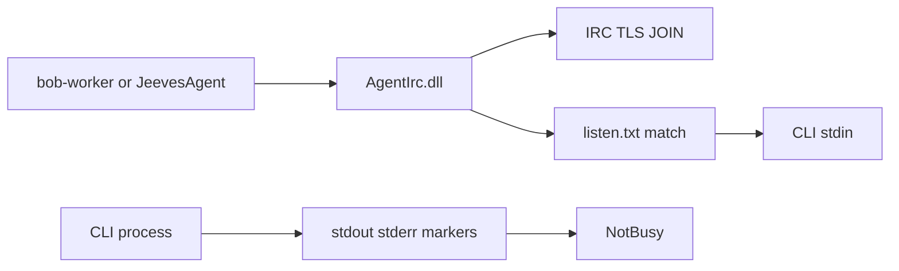
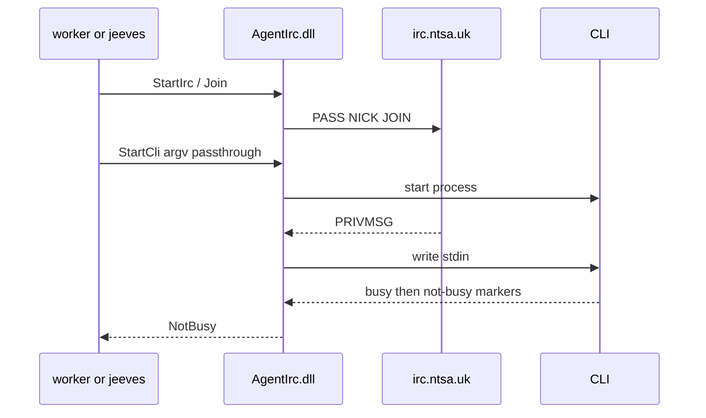

# Feature request: AgentIRC shared IRC host wrapper

**Target repo:** SimonBarnett/bobiverse (existing product)  
**Theme:** **AgentIrc.dll** under `bob/dotnet/AgentIrc` — a .NET 8 class library **called from** bob-worker and Jeeves/Priority agents. Owns seat IRC APIs: JOIN before CLI start, `listen.txt` → CLI stdin, NotBusy (edge + 1/min), argv passthrough. No clipboard inject. Not a separate wrapping EXE.

## Ultimate objective

bob-worker and Jeeves/Priority call one shared **AgentIrc.dll**: IRC is up before the CLI starts, matching traffic reaches the CLI only via stdin, argv is passed through, and NotBusy fires immediately when not busy then once per minute while still not busy.

## Success

| id | metric | target | how measured | fail-when |
|---|---|---|---|---|
| S1 | IRC-before-CLI | JOIN completes before CLI process start | unit/integration gate in `bob/dotnet/AgentIrc` tests | CLI can start while IRC disconnected |
| S2 | stdin inject | Matching listen lines appear on CLI stdin; inject path has no clipboard/SendKeys APIs | `dotnet test` + static guard in CI | Clipboard/keys remain the inject implementation |
| S3 | listen `{nick}` | `{nick}` in `listen.txt` is substituted for the live IRC nick before match | pure function tests with nick swap | Literal `{nick}` left unmatched or wrong nick accepted |
| S4 | NotBusy | Fire `NotBusy` immediately on busy→not-busy; while still not busy fire `NotBusy` once per minute; stop heartbeat when busy | fake stream + `FakeTimeProvider` tests | No immediate edge fire; or no 60s heartbeat while idle; or heartbeat while Busy |
| S5 | shared vendor | #9793 and jeeves-mcp#2 Depend-on AgentIRC digest; package path documented | issue Depends-on stamps + Pack/docs path | Each agent re-implements IRC with no shared package |
| S6 | argv passthrough | Wrapper forwards caller CLI arguments to the wrapped process (AgentIRC host flags stripped) | ProcessStartInfo / argv composition tests | Host swallows or rewrites CLI argv; tray flags never reach the agent |
| S7 | Send API | Host can PRIVMSG/NOTICE via AgentIrc.Send | unit tests on fake IRC wire | Outbox-only with no programmatic Send |
| S8 | host join callback | DLL calls host-supplied function for channel list; no hard-coded shop list in DLL | callback stub tests | DLL hard-codes #machine / monitor channels |

## Shape

LOCKED

Primary: service

.NET 8 **class library DLL**. Callers (bob-worker / JeevesAgent / PriorityAgent) own the process and reference the DLL. No product website UI. Console wireframe stubs only.

## Stack

- C# / .NET 8 (`net8.0`) **class library** → `AgentIrc.dll`
- Package path: `bob/dotnet/AgentIrc` (vendored from bobiverse)
- Consumers call the DLL: bob-worker-net (#9793), JeevesAgent / PriorityAgent (jeeves-mcp#2)
- Modern `SslStream` IRC TLS
- Airc Framework 4 / no-SDK floor does **not** apply

## Architecture

Caller loads **AgentIrc.dll**, asks it to JOIN IRC, loads `listen.txt`, starts the CLI (argv passthrough), and writes matching lines to CLI stdin. Markers on CLI stdout/stderr drive Busy/NotBusy; **NotBusy** fires immediately on busy→not-busy and once per minute while still not busy.

Caption: Worker/Jeeves call AgentIrc.dll for IRC and stdin.

Caption: Start order is IRC then CLI via the DLL.

## Depends-on

Held digest `Digest: AgentIRC` on bobiverse; children FR-A…F Depend-on that digest. Epic #9793 and jeeves-mcp#2 Depend-on the AgentIRC digest. Phase digests #9796/#9797 stamp AgentIRC explicitly. #9807 rewritten to stdin via AgentIRC (no clipboard).

## Out of scope

- Fuel selection / tray menus / plan-mode IRC
- Reopening closed #9804 (AgentIRC is the shared successor)
- PyInstaller retirement (stays under #9793 Phase 5)
- Implementing full JeevesAgent lifecycle (jeeves-mcp#9 consumes the package)

## Screens / mocks

No product web UI. Stub wireframes: `docs/mocks/agentirc/home.html`, `empty.html`, `error.html`.
