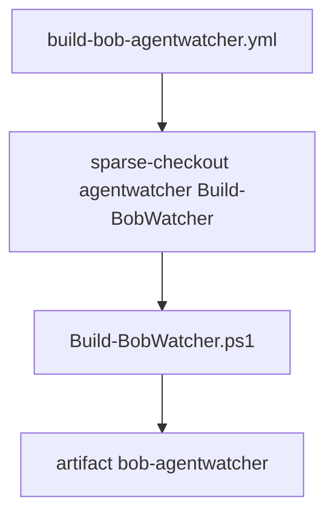

# FR-C: Agent watcher sparse CI workflow + artifact

**Repo:** `SimonBarnett/bobiverse`  
**Date:** 2026-11-24  
**Theme:** docs/feature-request-bob-ci-split-packaging-2026-11-24.md  
**Depends-on:** #9762

## Goal

New `build-bob-agentwatcher.yml` sparse-builds `Watch-AgentHealth.exe` via existing `Build-BobWatcher.ps1`.

## Success

| id | metric | target | how measured | fail-when |
| --- | --- | --- | --- | --- |
| S1 | Watcher CI | Workflow builds `Watch-AgentHealth.exe` and uploads artifact `bob-agentwatcher` | GHA job `build-bob-agentwatcher` + `python -m pytest -q bob/tests/test_fr9765_agentwatcher_build_ci.py` | No workflow, or only Pack rebuilds watcher |
| S2 | Sparse checkout | Workflow uses `sparse-checkout` for `bob/agentwatcher` + build script | file content `.github/workflows/build-bob-agentwatcher.yml` | Full-tree checkout |
| S3 | Docs | `bob/agentwatcher/README.md` (or bob docs) names the workflow | docs assert / file content | Undocumented CI surface |

LOCKED

## Shape

Primary: **app**

Reuse repo primary: **app**

LOCKED

## Stack

PyInstaller via `bob/scripts/Build-BobWatcher.ps1`; GHA `windows-latest` + setup-python as needed (mirror `build-bob-worker.yml`).

LOCKED

## Architecture

Watcher is first-class `bob/agentwatcher` sources. CI produces a hotpatchable artifact; Pack (FR-D) consumes it.

LOCKED

## Screens

Stubs: `docs/mocks/bob-ci-split-packaging/`

## Deliverables

1. `.github/workflows/build-bob-agentwatcher.yml`
2. Artifact with `Watch-AgentHealth.exe` + sha256 (+ provenance if matching worker style)
3. `bob/tests/test_fr9765_agentwatcher_build_ci.py`
4. README/docs note

## Testable

- CI: `python -m pytest -q bob/tests/test_fr9765_agentwatcher_build_ci.py`
- GHA job name: `build-bob-agentwatcher`
- Workflow has `sparse-checkout` + `Build-BobWatcher.ps1`; artifact contains `Watch-AgentHealth.exe`
