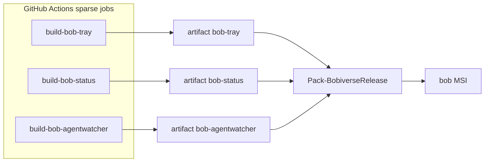
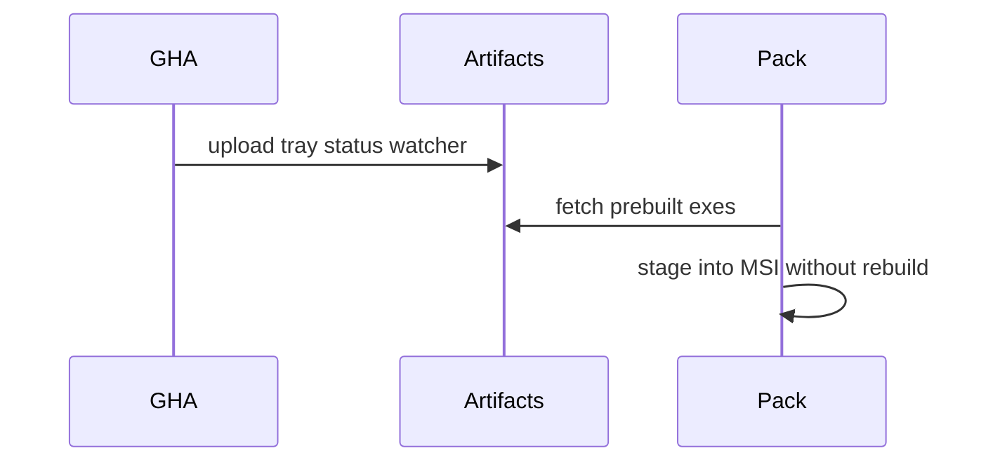

# Feature request: bob tray / status / agentwatcher sparse CI split + Pack consumes artifacts

**Primary repo:** `SimonBarnett/bobiverse`  
**Date:** 2026-11-24  
**Plan folder:** `bob/plan/work/plan-20261124-174217`  
**Depends-on:** (none) — theme pack; children Depend on digest after filing

## Ultimate objective

Fleet CI and Pack treat **systray**, **usage-pool Status**, and **agent watcher** as three independently sparse-built artifacts; Pack ships those built binaries without recompiling them.

## Success

| id | metric | target | how measured | fail-when |
| --- | --- | --- | --- | --- |
| S1 | Tray CI independence | `build-bob-tray` greens with sparse checkout and builds tray+about only | GHA job `build-bob-tray` + `python -m pytest -q bob/tests/test_fr6285_tray_build_ci.py` | Status-only path change forces tray job failure, or checkout is full-tree |
| S2 | Status CI independence | `build-bob-status` greens with sparse checkout and builds `bob-status.exe` only | GHA job `build-bob-status` + `python -m pytest -q bob/tests/test_frXXXX_status_build_ci.py` | Tray display-script change required to green status, or no status artifact |
| S3 | Watcher CI independence | `build-bob-agentwatcher` greens with sparse checkout and builds `Watch-AgentHealth.exe` | GHA job `build-bob-agentwatcher` + `python -m pytest -q bob/tests/test_frXXXX_agentwatcher_build_ci.py` | Pack/CI still only builds watcher inside Pack, or full-tree checkout |
| S4 | Pack consumes artifacts | Pack stages tray/status/about/watcher from artifact inputs; does not invoke dialog/watcher rebuild scripts | `python -m pytest -q bob/tests/test_frXXXX_pack_consumes_tray_status_watcher_artifacts.py` | Pack still calls `Build-BobDialogs.ps1` / `Build-BobWatcher.ps1` on release path |
| S5 | Docs + path filters | `bob/docs/bob-tray-dialogs.md` (+ watcher README) list each workflow path filters and sparse roots | docs assert tests / file content | Docs still describe one omnibus `build-bob-tray` building all three |

LOCKED

## Shape

Primary: **app**

Hybrid note: workflows + Pack are delivery; product remains ircBob + TipForm + watcher tools.

LOCKED

## Stack

- GitHub Actions `windows-latest`
- `actions/checkout@v4` with `sparse-checkout`
- Tray/Status: `csc.exe` via `Build-BobDialogs.ps1 -Targets`
- Watcher: PyInstaller via `Build-BobWatcher.ps1`
- Pack: PowerShell artifact stage (no csc/PyInstaller rebuild on release path)
- Pytest pins under `bob/tests/`

LOCKED

## Architecture

CI/packaging only — TipForm still hosts Status/About in-process.

Sparse CI jobs produce artifacts that Pack stages into the bob MSI.

Tray CI and status CI build ownership diagram:

Pack consume path:

LOCKED

## Screens

No product UI change. Mocks stubs (CI/packaging only):

| id | file | state |
| --- | --- | --- |
| M1 | docs/mocks/bob-ci-split-packaging/home.html | key |
| M2 | docs/mocks/bob-ci-split-packaging/empty.html | empty |
| M3 | docs/mocks/bob-ci-split-packaging/error.html | error |

## Gap vs current

- One `build-bob-tray.yml` builds tray+status+about together with full checkout
- No `build-bob-status.yml` / `build-bob-agentwatcher.yml`
- `Build-BobDialogs.ps1` always builds all three exes
- `Pack-BobiverseRelease.ps1` calls `Build-BobDialogs` + `Build-BobWatcher`

## Anti-omnibus children

| Code | Slice |
| --- | --- |
| FR-A | Tray sparse + `-Targets tray,about` |
| FR-B | Status sparse workflow + artifact |
| FR-C | Agentwatcher sparse workflow + artifact |
| FR-D | Pack consumes prebuilt artifacts |

## Out of scope

- Stopping TipForm in-process Status host
- Separate `.bobiverse` !build recipes
- Local sparse worktrees
- Changing `Build-BobEar.ps1` freeze contents
