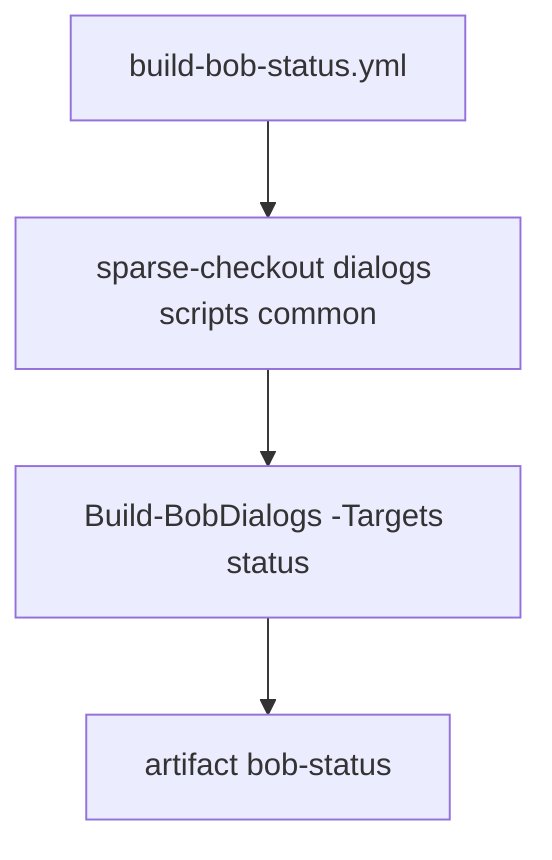

# FR-B: Status (usage pool) sparse CI workflow + artifact

**Repo:** `SimonBarnett/bobiverse`  
**Date:** 2026-11-24  
**Theme:** docs/feature-request-bob-ci-split-packaging-2026-11-24.md  
**Depends-on:** #9762 #9763

## Goal

New `build-bob-status.yml` sparse-builds `bob-status.exe` only with its own tests and artifact.

## Success

| id | metric | target | how measured | fail-when |
| --- | --- | --- | --- | --- |
| S1 | Status-only build | Workflow runs `Build-BobDialogs.ps1 -Targets status` | GHA job `build-bob-status` + `python -m pytest -q bob/tests/test_fr9764_status_build_ci.py` | Builds tray/about or lacks artifact `bob-status` |
| S2 | Sparse checkout | Workflow uses `sparse-checkout` for status roots | file content `.github/workflows/build-bob-status.yml` | Full-tree checkout |
| S3 | Heading smoke | Built PE embeds UTF-16LE `xAI weekly` | pytest / workflow smoke | Missing heading or stale `Cursor / xAI weekly` |

LOCKED

## Shape

Primary: **app**

Reuse repo primary: **app**

LOCKED

## Stack

Same csc / Build-BobDialogs path as tray; separate workflow path filters.

LOCKED

## Architecture

Status CI owns the standalone usage-pool dialog PE. TipForm in-process Status remains a tray compile concern (FR-A).

LOCKED

## Screens

Stubs: `docs/mocks/bob-ci-split-packaging/`

## Deliverables

1. `.github/workflows/build-bob-status.yml` (path filters + sparse-checkout + artifact upload)
2. `bob/tests/test_fr9764_status_build_ci.py` (replace XXXX with issue number at implement)
3. Docs section in `bob-tray-dialogs.md` for status CI
4. Heading smoke assert on `bob-status.exe`

## Testable

- CI: `python -m pytest -q bob/tests/test_fr9764_status_build_ci.py`
- GHA job name: `build-bob-status`
- Workflow has `sparse-checkout`; artifact name `bob-status`
