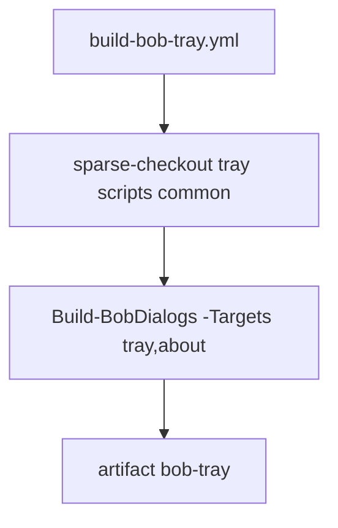

# FR-A: Tray workflow sparse checkout + Build-BobDialogs -Targets tray,about

**Repo:** `SimonBarnett/bobiverse`  
**Date:** 2026-11-24  
**Theme:** docs/feature-request-bob-ci-split-packaging-2026-11-24.md  
**Depends-on:** #9762

## Goal

`build-bob-tray.yml` sparse-checkouts tray paths and builds only `bob-tray.exe` + `bob-about.exe`.

## Success

| id | metric | target | how measured | fail-when |
| --- | --- | --- | --- | --- |
| S1 | Selective build | `-Targets tray,about` produces those two exes only | `python -m pytest -q bob/tests/test_fr6285_tray_build_ci.py` + local Build-BobDialogs | Default/CI still requires `bob-status.exe` in tray artifact |
| S2 | Sparse checkout | Workflow uses `actions/checkout` `sparse-checkout` | file content `.github/workflows/build-bob-tray.yml` | Full-tree checkout only |
| S3 | Docs filters | `bob/docs/bob-tray-dialogs.md` lists tray path filters + sparse roots | docs assert in pytest | Docs still say tray CI builds all three dialogs |

LOCKED

## Shape

Primary: **app**

Reuse repo primary: **app** (bob TipForm / CI packaging).

LOCKED

## Stack

PowerShell `Build-BobDialogs.ps1`, GHA `windows-latest`, csc.exe — same as today.

LOCKED

## Architecture

Tray job owns TipForm host + Acknowledge. Status PE moves to FR-B artifact. TipForm may still compile `BobStatus.cs` into `bob-tray.exe` for in-process host.

LOCKED

## Screens

Stubs: `docs/mocks/bob-ci-split-packaging/` (no TipForm UX change).

## Deliverables

1. `Build-BobDialogs.ps1` `-Targets` (`tray`, `about`, `status`, `all`; default `all`)
2. Rewrite `build-bob-tray.yml`: sparse-checkout; `-Targets tray,about`; tray hotpatch staging without requiring `bob-status.exe`
3. Update `bob/tests/test_fr6285_tray_build_ci.py` (+ siblings that assert three exes in tray CI)
4. Update `bob/docs/bob-tray-dialogs.md` path filters

## Testable

- CI: `python -m pytest -q bob/tests/test_fr6285_tray_build_ci.py`
- GHA job name: `build-bob-tray`
- Workflow contains `sparse-checkout` and must not require `bob-status.exe` in the tray artifact
