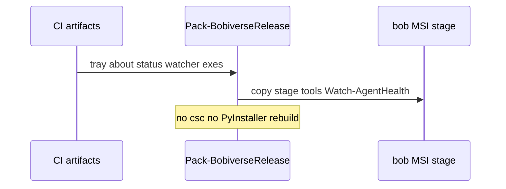

# FR-D: Pack consumes prebuilt tray/status/watcher CI artifacts (no rebuild)

**Repo:** `SimonBarnett/bobiverse`  
**Date:** 2026-11-24  
**Theme:** docs/feature-request-bob-ci-split-packaging-2026-11-24.md  
**Depends-on:** #9762 #9763 #9764 #9765

## Goal

`Pack-BobiverseRelease.ps1` stages `bob-tray.exe`, `bob-about.exe`, `bob-status.exe`, and `Watch-AgentHealth.exe` from prebuilt artifact inputs; the release Pack path does not call `Build-BobDialogs.ps1` or `Build-BobWatcher.ps1`.

## Success

| id | metric | target | how measured | fail-when |
| --- | --- | --- | --- | --- |
| S1 | No rebuild on Pack | Release path has no unguarded Build-BobDialogs / Build-BobWatcher invoke | `python -m pytest -q bob/tests/test_fr9766_pack_consumes_tray_status_watcher_artifacts.py` | Pack still rebuilds by default |
| S2 | Artifact inputs | Pack accepts dirs/params for tray, status, watcher artifacts and fails loud on missing exe | pytest fixture dry-pack + script contract | Silent skip or invent rebuild |
| S3 | Docs | Pack / tray docs state Pack consumes CI artifacts | file content docs | Docs still say Pack compiles dialogs/watcher |

LOCKED

## Shape

Primary: **app**

Reuse repo primary: **app**

LOCKED

## Stack

Existing `common/scripts/Pack-BobiverseRelease.ps1`; optional env/params for artifact roots; flamingo recipe may pass those paths without changing product shape.

LOCKED

## Architecture

Local Sync missing-exe heal may still compile for operator boxes; that is out of S1 scope unless Pack release path is involved.

LOCKED

## Screens

Stubs: `docs/mocks/bob-ci-split-packaging/`

## Deliverables

1. Pack parameters or env for artifact dirs (tray / status / watcher)
2. Remove/guard release-path rebuilds of dialogs and watcher
3. Fail with named missing exe if inputs absent
4. `bob/tests/test_fr9766_pack_consumes_tray_status_watcher_artifacts.py`
5. Docs updates (`bob-tray-dialogs.md` / pack notes); minimal `.bobiverse/build.yml` wiring only if required

## Testable

- CI: `python -m pytest -q bob/tests/test_fr9766_pack_consumes_tray_status_watcher_artifacts.py`
- Assert Pack source has no unguarded `Build-BobDialogs.ps1` / `Build-BobWatcher.ps1` on release path
- Fail-when Pack still rebuilds by default
