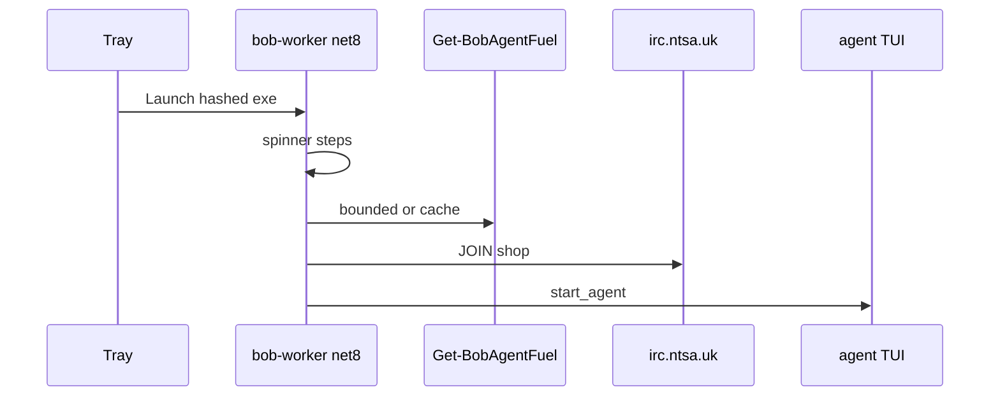

# Feature request: .NET bob-worker seat host (progress + speed)

**Target repo:** SimonBarnett/bobiverse (existing product)  
**Theme:** Replace PyInstaller Python `bob-worker.exe` with a .NET 8 console seat host that shows startup steps with a spinner and owns fuel/IRC/spawn without the 30–90s quiet gap after `INFO crash-report=on`.

## Ultimate objective

Fleet Agents/Plan seats run on a .NET 8 `bob-worker.exe` with the same shop wire contract as today, with visible start progress and Automatic start that does not sit quiet for 30–90s on a healthy box.

## Success

| id | metric | target | how measured | fail-when |
|---|---|---|---|---|
| S1 | Host language cutover | Tray Agents/Plan launch the .NET `bob-worker.exe`; PyInstaller worker retired from Pack/MSI default path | Pack manifest + tray launch path + `--version` / PE evidence in CI | Tray still starts PyInstaller worker as product default |
| S2 | Startup progress | Pre-TUI steps show spinner + label on console; stop before agent TUI | Manual start + unit tests on progress writer (`tests/` / worker CI) | Quiet console after crash-report while work continues >2s |
| S3 | Fuel owned by .NET | Automatic fuel uses cache (≤45s TTL) or bounded parallel provider reads; no single 90s blocking call on happy path | Unit tests + `startup-step fuel source=… duration_ms=` in worker.log | .NET host shells to old Python `_choose`/`read_fuel` 90s path |
| S4 | Wire parity (agent mode) | IRC JOIN `#<machine>` before agent; `!bored`; ACK/DONE/NACK/GIVEUP outbox; hard cap 2; always-new session | Contract tests + live smoke | Seat online without JOIN, invents DONE, or resumes sessions |
| S5 | Healthy Automatic start | Crash-report/progress start → agent process create p95 ≤ 25s when IRC up and fuel cache warm | Timed step log on fleet box | Healthy starts still regularly >60s before spawn |

## Shape

LOCKED

Primary: app

Windows console seat host launched by existing TipForm Agents/Plan. Not a website. Not Watch-AgentHealth.

## Stack

- C# / .NET 8 SDK-style project (`net8.0` Windows console)
- `dotnet publish` (prefer self-contained win-x64 unless FR-A records otherwise)
- GHA `setup-dotnet` + `Build-BobWorkerNet.ps1`
- PowerShell 5.1 fuel readers called with short timeouts first
- Modern `SslStream` IRC TLS
- **Airc / tray Framework 4 + in-box `csc` / no-SDK floor does not apply** to this host (operator 2026-11-24). Tray stays Framework 4 in this epic.

## Architecture

Tray `bob-tray.exe` launches hashed run-copy of .NET `bob-worker.exe`. Host shows StartupProgress, reads fuel (cache/bounded), connects IRC and JOINs shop, then spawns Grok/Cursor/OpenCode child which owns the console. Outbox drain and program `!bored` stay in the host. Python `bob_worker.py` remains live until Phase 5 cutover.

Caption: Epic phases from scaffold through Pack cutover.

Caption: Seat start path inside the .NET host.

## Depends-on

Park uses nested digests: main epic digest, then one digest per phase (each Depends-on main + prior phase), then children under each phase digest.

## Out of scope

- Interim Python `read_fuel_bounded` in `_choose`
- Merging agentwatcher into the seat
- Starting agent before IRC JOIN
- Rewriting ircBob or Jeeves in .NET
- Moving bob-tray.exe to net8 in this epic

## Minimum cutover gate

.NET host can Automatic + spinner + fuel + IRC JOIN + Grok spawn + outbox ACK/DONE + program `!bored` + cap + always-new before Pack switches default.

## Screens / mocks

No product web UI. Stub console wireframes: `docs/mocks/bob-worker-net-host/home.html`, `empty.html`, `error.html`.
