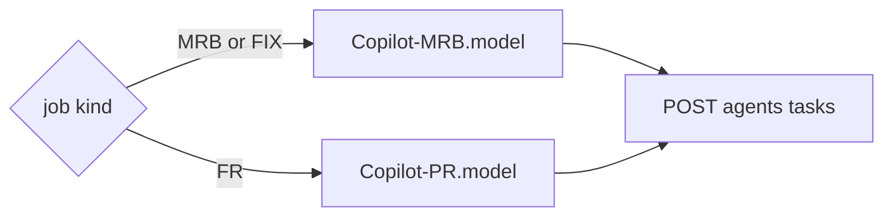

# FR-E: Jeeves Copilot dispatch — MRB+FIX→Copilot-MRB, FR→Copilot-PR

**Target:** SimonBarnett/bobiverse (Jeeves chair + common)  
**Theme:** Weights New Digest  
**Implements:** S5

## Goal

Jeeves chair posts CCA tasks with the Weights model for that job kind.

## Locked map

| Job kind | Weights agent row |
|---|---|
| MRB | Copilot-MRB |
| FIX | Copilot-MRB (same as MRB) |
| FR | Copilot-PR |

## Deliverables

- Land on Jeeves chair path: `common/scripts/copilot_dispatch.py` (`weights_copilot_model` / `resolve_copilot_model` / `build_task_body`) and any `jeeves/` callers.
- Select model by job kind per the table; empty model omits `model` from agents-tasks POST.
- Persist chosen model on `copilot-jobs.json`; digest export shows it.
- FR-creating paths (Haiku refill / Start-BobCopilot) use **Copilot-PR** when reading Weights (do not ignore a non-empty Copilot-PR pick without documented override).
- Short docs section in `jeeves/docs/empty-offer-operator.md` (or sibling) for the kind→row map.
- Remove hard dependency on agent name exactly `"Copilot"`.

## Success

| id | metric | target | how measured | fail-when |
|---|---|---|---|---|
| S5 | Jeeves kind-aware model | MRB+FIX → Copilot-MRB; FR → Copilot-PR; empty omits key | pytest `resolve_copilot_model` / `build_task_body` for MRB, FIX, FR | FIX→Copilot-PR; FR→Copilot-MRB; legacy `"Copilot"` only; empty sent as `""` |

## Shape

LOCKED

Primary: app

## Stack

Jeeves chair + `common/scripts/copilot_dispatch.py`; Weights catalog from FR-D.

## Architecture

Caption: Job kind selects Weights agent model for CCA POST.

## Testable

- CI: `jeeves/tests` + `common/tests` — MRB, FIX, FR fixtures with distinct Weights models; assert MRB and FIX share Copilot-MRB, FR uses Copilot-PR, empty omits key.
- Fail-when: wrong row per kind; empty model sent as `""`; Testable manual-only.

## Depends-on

`Depends-on: #<digest> #<FR-D>` (hard)

## Out of scope

Concurrency/quota/Haiku refill policy changes beyond reading the Weights row for FR posts.
