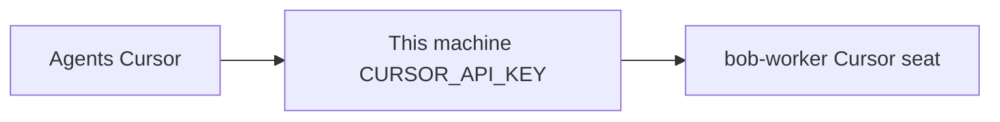
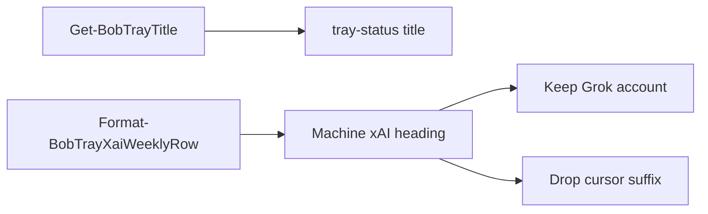

# Feature request: Tray Cursor local tokens + heading cleanup

**Target repo:** SimonBarnett/bobiverse  
**Plan folder:** `plan/work/plan-20261125-174956`  
**Index:** `docs/fr-index-tray-cursor-heading-2026-11-25.md`

## Ultimate objective

TipForm systray Cursor seats spend this machine’s Cursor tokens; machine xAI headings show Grok account without Cursor suffixes; top title is `Bobiverse #<machine>`.

## Success

| id | metric | target | how measured | fail-when |
|---|---|---|---|---|
| S1 | Local Cursor credential | Agents→Cursor child uses this machine’s CURSOR_API_KEY / local login | pytest start-path pin | Shared/account pool credential used |
| S2 | Machine heading | No `cursor …` suffix on xAI weekly line; Grok account kept | pytest Format-BobTrayXaiWeeklyRow | Cursor suffix present; Grok account dropped |
| S3 | Top title | `Bobiverse #<machineId>` | pytest Get-BobTrayTitle | Still `#Bobiverse (` form |

## Shape

LOCKED

Primary: app

TipForm tray + Status/hover consumers of the same title/heading helpers. Mocks: `docs/mocks/tray-cursor-heading/`.

## Stack

- `bob/tray/src/Public/Get-BobTrayHover.ps1` — `Get-BobTrayTitle`, `Format-BobTrayXaiWeeklyRow`
- `bob/tray/tools/Watch-BobTray.ps1` — Agents Cursor start / `CURSOR_API_KEY`
- Status card if it paints the same `title` / machine headings

## Architecture

Caption: Cursor seat binds local machine credential only.

Caption: Title and machine heading paint paths.

## Depends-on

Held parent digest; children Depends-on digest only. Hold only on parent.

## Out of scope

Weights #9991; removing digest `cursor_account` JSON field; VERSION/release.

## Screens / mocks

`docs/mocks/tray-cursor-heading/home.html`, `empty.html`, `error.html`.

## Filed issues

| Draft | Issue | Title |
|---|---|---|
| Digest | #10000 | Digest: Tray Cursor local tokens + heading cleanup (hold) |
| FR-A | #10001 | Agents→Cursor local tokens |
| FR-B | #10002 | Drop Cursor suffix from machine heading |
| FR-C | #10003 | Title Bobiverse #machine |

## Anti-omnibus children

| Draft | Title | Success |
|---|---|---|
| FR-A | Agents→Cursor local tokens | S1 |
| FR-B | Drop Cursor suffix from machine heading | S2 |
| FR-C | Title Bobiverse #machine | S3 |
