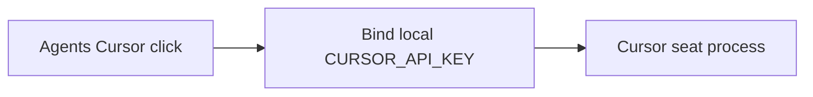

# FR-A: Agents→Cursor uses this machine’s CURSOR_API_KEY / local login

**Target:** SimonBarnett/bobiverse  
**Theme:** Tray Cursor local tokens + heading cleanup  
**Implements:** S1

## Goal

Tray Agents → Cursor starts a seat that spends this host’s Cursor tokens (not a shared/account pool).

## Deliverables

- On Cursor (and Automatic→Cursor) start, bind the child to local Cursor credential for this machine (`CURSOR_API_KEY` / local CLI login — never a shared fleet/account pool key).
- When local remaining is available, start in local-pool mode; session BYOK dialog only for confirmed local exhaustion.
- Do not select another machine’s / account-wide Cursor pool for the child.
- Lifecycle log redacts secrets; never print key values.
- Docs one line: Cursor seats are machine-local.

## Success

| id | metric | target | how measured | fail-when |
|---|---|---|---|---|
| S1 | Local Cursor credential | Child uses this machine’s Cursor key/login | pytest start-path pin | Shared/account pool still chosen |

## Shape

LOCKED

Primary: app

## Stack

`Watch-BobTray.ps1` Agents start; bob-worker Cursor launch env; local Cursor remaining helpers.

## Architecture

Caption: Local credential wins over shared pool for Cursor seats.

## Testable

- CI: `bob/tests/test_frXXXX_cursor_local_token_start.py` — Cursor start asserts local credential binding / absence of shared-pool env; secret not logged.
- Fail-when: shared/account pool still chosen; Testable manual-only.

## Depends-on

`Depends-on: #<digest>`

## Out of scope

Grok session-key dialog; OpenCode; heading paint (FR-B/C).
