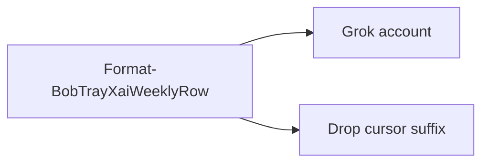

# FR-B: Machine xAI heading — drop Cursor suffix; keep Grok account

**Target:** SimonBarnett/bobiverse  
**Theme:** Tray Cursor local tokens + heading cleanup  
**Implements:** S2

## Goal

Per-machine xAI weekly line keeps Grok account; drops Cursor-specific suffix from FR #7907.

## Deliverables

- In `Format-BobTrayXaiWeeklyRow`, stop appending `cursor {email} (user)` / `cursor api_key` to the heading.
- Keep Grok / `xai_weekly.account` on the line when present.
- Update pins that expected the Cursor suffix to expect absence on the machine heading.
- Status / TipForm tiles using the same formatter inherit the change.
- Digest JSON `cursor_account` may remain; this FR only stops painting it on the machine xAI heading.

## Success

| id | metric | target | how measured | fail-when |
|---|---|---|---|---|
| S2 | Machine heading | No `cursor ` suffix; Grok account kept | pytest Format-BobTrayXaiWeeklyRow | Cursor suffix present; Grok account dropped |

## Shape

LOCKED

Primary: app

## Stack

`Get-BobTrayHover.ps1` `Format-BobTrayXaiWeeklyRow`; related `test_fr7907_*` pins.

## Architecture

Caption: Machine heading keeps Grok account only.

## Testable

- CI: pytest with CursorAccount params bound → heading excludes `cursor `; with xAI account set → heading includes that account.
- Fail-when: Cursor suffix still present; Grok account removed; no CI command.

## Depends-on

`Depends-on: #<digest>`

## Out of scope

Removing digest `cursor_account` publication; title change (FR-C).
