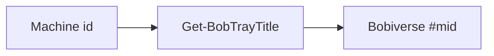

# FR-C: Tray title — Bobiverse #<machine>

**Target:** SimonBarnett/bobiverse  
**Theme:** Tray Cursor local tokens + heading cleanup  
**Implements:** S3

## Goal

Top-level Bob/tray title is `Bobiverse #<this machine name>`.

## Deliverables

- Change `Get-BobTrayTitle` from `#Bobiverse ({mid})` to `Bobiverse #{mid}`.
- Resolve real machine id (`Get-ThisMachineId` / `BOB_MACHINE_ID`); avoid literal `this-machine` when host id is known.
- Update consumers: tray-status `title`, TipForm hover title, Status window if it shows the same string.
- Update pins / snapshots that assert `#Bobiverse (`.

## Success

| id | metric | target | how measured | fail-when |
|---|---|---|---|---|
| S3 | Top title | `Bobiverse #<machineId>` | pytest Get-BobTrayTitle | Still `#Bobiverse (` or known id painted as this-machine |

## Shape

LOCKED

Primary: app

## Stack

`Get-BobTrayTitle` in `Get-BobTrayHover.ps1`; tray-status writer; Status title consumer if shared.

## Architecture

Caption: Title helper emits Bobiverse hash-machine form.

## Testable

- CI: pytest `Get-BobTrayTitle` for known mid → `Bobiverse #flamingo` (example); missing mid fallback documented.
- Fail-when: old `#Bobiverse (` format remains; no CI command.

## Depends-on

`Depends-on: #<digest>`

## Out of scope

Machine row Cursor suffix (FR-B); Cursor credential binding (FR-A).
