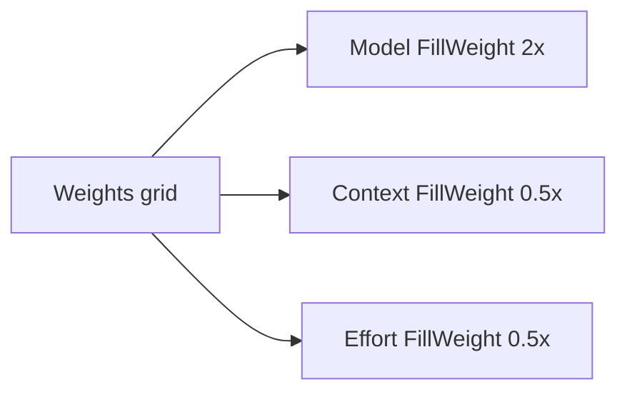

# FR-B: Weights grid — double Model width; halve Context + Effort

**Target:** SimonBarnett/bobiverse  
**Theme:** Weights New Digest  
**Implements:** S3

## Goal

Model column is twice as wide (relative FillWeight); Context and Effort each half as wide.

## Deliverables

- In `bob/tray/dialogs/WeightsForm.cs`, set explicit `FillWeight` so Model ≈ 2× prior equal share and Context/Effort each ≈ ½ (e.g. Model 200, Context 50, Effort 50).
- Keep Agent/CLI readable; avoid horizontal scroll on default dialog width.
- Update `docs/mocks/weights-new-digest/home.html` column proportions.

## Success

| id | metric | target | how measured | fail-when |
|---|---|---|---|---|
| S3 | Column layout | Model FillWeight ≈ 2×; Context and Effort each ≈ ½ | C# pin / dialog dump test | Equal Fill across Model/Context/Effort |

## Shape

LOCKED

Primary: app

## Stack

WinForms WeightsForm DataGridView FillWeight; HTML mock only.

## Architecture

Caption: FillWeight ratio for Model vs Context/Effort.

## Testable

- CI: `bob/tests/test_frXXXX_weights_column_widths.py` (or extend `test_fr8715_*` / `test_fr9266_weights_*`) compiling WeightsForm and asserting FillWeight ratios.
- Fail-when: ratios unchanged; screenshot-only Testable.

## Depends-on

`Depends-on: #<digest>`

## Out of scope

Webhook / Copilot catalog changes.
