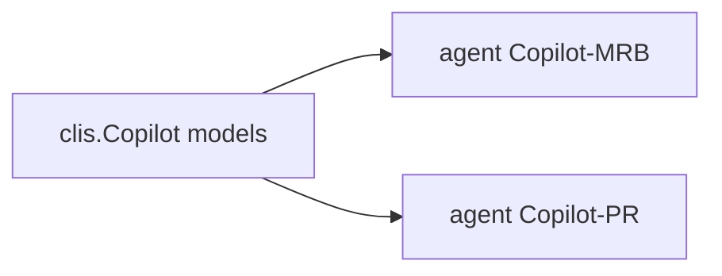

# FR-D: Weights agents — Copilot-MRB + Copilot-PR

**Target:** SimonBarnett/bobiverse  
**Theme:** Weights New Digest  
**Implements:** S4

## Goal

Weights shows two Copilot agent rows so operators pick models by work kind (Jeeves reads them in FR-E).

## Deliverables

- Replace default agent `"Copilot"` with **`Copilot-MRB`** and **`Copilot-PR`** (both `cli: Copilot`, empty model allowed).
- Migration: lone saved `Copilot` expands to both rows (copy prior model onto both).
- GET/PUT round-trip; valid-only dropdowns from Copilot CLI catalog.
- Tray Weights grid lists both rows; update mocks/docs that name a single Copilot agent.

## Success

| id | metric | target | how measured | fail-when |
|---|---|---|---|---|
| S4 | Dual Copilot agents | Defaults `Copilot-MRB` + `Copilot-PR` | pytest models_catalog defaults + GET | Single `Copilot` agent only; PUT rejects rename |

## Shape

LOCKED

Primary: app

## Stack

`models_catalog.py` defaults/migration; WeightsForm binds agents from GET; mocks under `weights-new-digest/`.

## Architecture

Caption: One Copilot CLI catalog feeds two agent rows.

## Testable

- CI: `common/tests` models_catalog — both agents in defaults; migration from legacy single Copilot; empty model allowed; other agents unchanged.
- Fail-when: only one Copilot agent; rename breaks PUT validation; no CI command.

## Depends-on

`Depends-on: #<digest> #<FR-C>` (after create)

## Out of scope

Chair dispatch wiring (FR-E).
