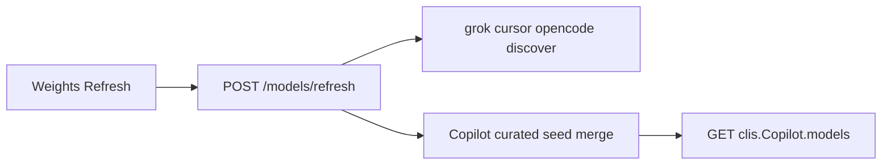

# FR-C: Refresh models — Copilot as 5th CLI catalog update

**Target:** SimonBarnett/bobiverse  
**Theme:** Weights New Digest  
**Implements:** S2

## Goal

Refresh models updates the Copilot CLI catalog (today Refresh never touches it; live models list empty).

## Deliverables

- Extend refresh so Copilot is a first-class catalog target without spawning a local `copilot` CLI (GitHub `agents/models` historically 404 — use curated/ops seed merge).
- Server: on POST `/bob/v1/models/refresh`, merge maintained Copilot agent-task ids into `clis.copilot` (include `claude-haiku-4.5` + current known ids), even when client body omits `copilot`.
- Client: may include `copilot` key from a bundled seed; never block Refresh if Copilot discovery is N/A.
- GET after Refresh shows non-empty Copilot models; per-CLI status shows Copilot (ok/seeded/failed).
- Docs: Copilot is the 5th refresh CLI (catalog merge), distinct from local grok/cursor/opencode discover.

## Success

| id | metric | target | how measured | fail-when |
|---|---|---|---|---|
| S2 | Copilot on Refresh | GET `clis.Copilot.models` ≥1 id after refresh | pytest `models_refresh` + catalog | Copilot models stay empty; local CLI timeout blocks Refresh |

## Shape

LOCKED

Primary: app

## Stack

`common/scripts/models_refresh.py`, `models_catalog.py`, tray `BobModelsClient.RefreshClis` / DiscoverLocalModels.

## Architecture

Caption: Refresh merges Copilot seed without a local Copilot CLI process.

## Testable

- CI: pytest on `models_refresh` + `models_catalog` — client body with only grok/cursor/opencode still yields Copilot models ≥1; PUT/GET preserves Copilot entries.
- Pin: server always seeds Copilot on refresh (document in test name/docstring).
- Fail-when: Copilot empty after hermetic refresh; missing local CLI times out whole Refresh.

## Depends-on

`Depends-on: #<digest>`

## Out of scope

Agent row rename (FR-D); chair dispatch (FR-E); public PUT heal (FR-A).
