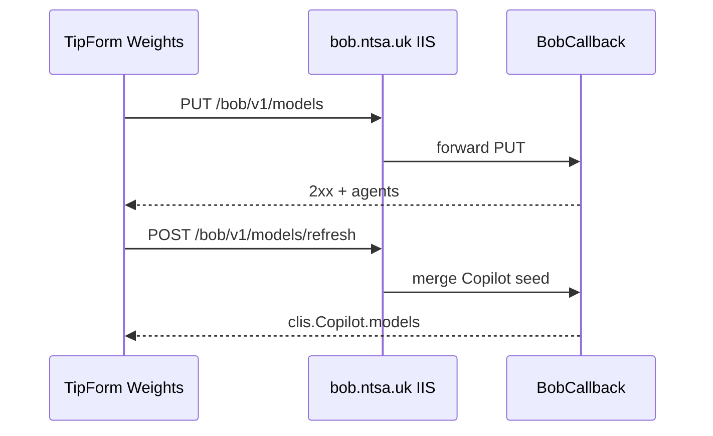
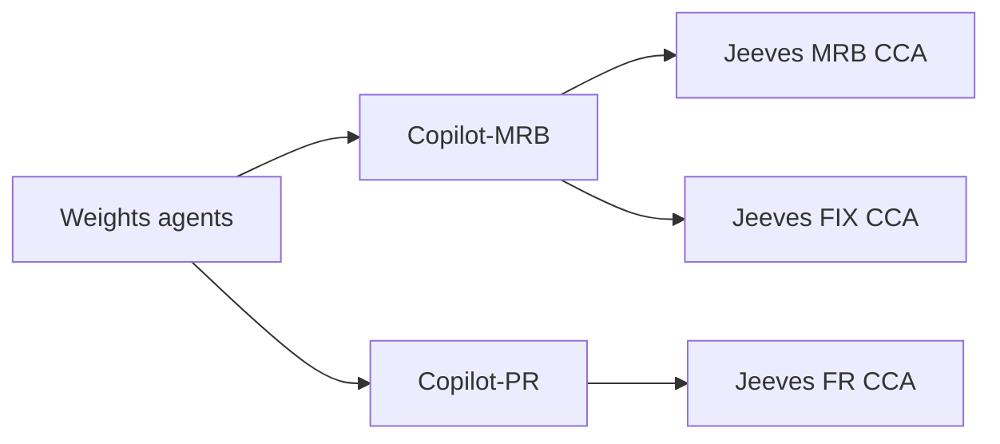

# Feature request: Weights New Digest (save / Copilot refresh / layout / MRB+PR)

**Target repo:** SimonBarnett/bobiverse  
**Plan folder:** `plan/work/plan-20261125-153552`  
**Index:** `docs/fr-index-weights-new-digest-2026-11-25.md`

## Ultimate objective

Operators use TipForm Weights (systray New Digest) to Save model picks through the public URL, Refresh keeps the Copilot catalog current, the grid is readable, and Jeeves posts CCA tasks with **Copilot-MRB** for MRB/FIX and **Copilot-PR** for FR.

## Success

| id | metric | target | how measured | fail-when |
|---|---|---|---|---|
| S1 | Public Weights Save | PUT `https://bob.ntsa.uk/bob/v1/models` returns 2xx/JSON (or empty-PUT JSON 400 `agents must be a list`), then GET matches saved agents | installer public probe + tray `weights_save` | HTML/empty **404** on public PUT |
| S2 | Copilot on Refresh | After Refresh models, GET `clis.Copilot.models` has ≥1 seeded agent-task id (incl. `claude-haiku-4.5`) | pytest refresh + hermetic catalog | Copilot models stay empty after refresh |
| S3 | Column layout | Model FillWeight ≈ 2× prior equal share; Context and Effort each ≈ ½ | C# pin / dialog dump test | Equal Fill across Model/Context/Effort |
| S4 | Dual Copilot agents | Defaults are `Copilot-MRB` + `Copilot-PR` (cli `Copilot`) | pytest models_catalog + GET | Single `Copilot` agent only |
| S5 | Jeeves kind-aware model | MRB+FIX → `Copilot-MRB.model`; FR → `Copilot-PR.model`; empty omits `model` | pytest `resolve_copilot_model` / `build_task_body` | FIX uses Copilot-PR; FR uses Copilot-MRB; legacy `"Copilot"` only |

## Shape

LOCKED

Primary: app

TipForm Weights WinForms + Jeeves models webhook / IIS front door + Jeeves chair Copilot dispatch. Mocks: `docs/mocks/weights-new-digest/`.

## Stack

- bob tray: `bob/tray/dialogs/WeightsForm.cs`, `BobModelsClient.cs`
- common: `models_catalog.py`, `models_refresh.py`, `copilot_dispatch.py`
- jeeves: IIS `Install-BobWebhooks.ps1` / BobModelsWebhook; chair uses common dispatch
- Live evidence 2026-11-25: public GET 200, public PUT **404**, Copilot models empty

## Architecture

Caption: Weights Save and Refresh through public front door to BobCallback.

Caption: Jeeves CCA model pick by job kind from Weights rows.

## Depends-on

Held parent digest; children Depends-on digest; FR-D on FR-C; FR-E on FR-D. Hold only on parent.

## Kind map (LOCKED)

| Job kind | Weights agent |
|---|---|
| MRB | Copilot-MRB |
| FIX | Copilot-MRB |
| FR | Copilot-PR |

## Out of scope

Copilot concurrency / quota / Haiku refill watcher; replacing PUT with POST; VERSION/release; new repo.

## Screens / mocks

`docs/mocks/weights-new-digest/home.html`, `empty.html`, `error.html`.

## Filed issues

| Draft | Issue | Title |
|---|---|---|
| Digest | #9991 | Digest: Weights New Digest (hold) |
| FR-A | #9992 | Weights Save PUT 404 |
| FR-B | #9993 | Column widths |
| FR-C | #9994 | Copilot refresh |
| FR-D | #9995 | Copilot-MRB + Copilot-PR |
| FR-E | #9996 | Jeeves kind map |

## Anti-omnibus children

| Draft | Title | Success rows |
|---|---|---|
| FR-A | Heal live public PUT 404 | S1 |
| FR-B | Column widths | S3 |
| FR-C | Refresh Copilot as 5th CLI | S2 |
| FR-D | Copilot-MRB + Copilot-PR agents | S4 |
| FR-E | Jeeves kind → model | S5 |
