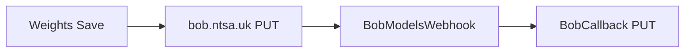

# FR-A: Weights Save — heal live public PUT /bob/v1/models 404

**Target:** SimonBarnett/bobiverse  
**Theme:** Weights New Digest  
**Implements:** S1

## Goal

TipForm Weights Save against `https://bob.ntsa.uk/bob/v1/models` succeeds (no HTML/empty 404).

## Deliverables

- Confirm BobCallback still handles PUT (`models_catalog.handle_models_put`).
- Redeploy / repair live IIS `BobModelsWebhook` so PUT|PATCH reach BobCallback (same class as #9273/#9585; content-only publish does not refresh `web.config`).
- Keep/require installer public empty-PUT probe (JSON 400 `agents must be a list` = forwarded; HTML/404 = fail when require switch set).
- Docs note owner-authorised redeploy and public write exposure.
- Tray evidence: `weights_save` 2xx and `weights_reload_match` true after Save.

## Success

| id | metric | target | how measured | fail-when |
|---|---|---|---|---|
| S1 | Public Weights Save | Public PUT reaches BobCallback; GET matches saved agents | installer public probe + tray `weights_save` / `--weights-save` | HTML/empty **404** on public PUT |

## Shape

LOCKED

Primary: app

## Stack

jeeves `Install-BobWebhooks.ps1`, IIS BobModelsWebhook, BobCallback models PUT, TipForm Weights Save client.

## Architecture

Caption: Public PUT must forward to BobCallback like GET.

## Testable

- CI: `jeeves/tests/test_fr9273_models_put_iis.py` or successor `test_frXXXX_models_put_public_probe.py` — stand-ins for JSON-400 / HTML-404 / empty-403.
- Optional: `bob/tests/test_frXXXX_weights_save_real_backend.py` against loopback BobCallback.
- Fail-when: only localhost green while public PUT still 404; Testable manual-only.

## Depends-on

Stamp on GitHub issue body after digest create: `Depends-on: #<digest>`

## Out of scope

Changing client verb away from PUT; auth redesign.
