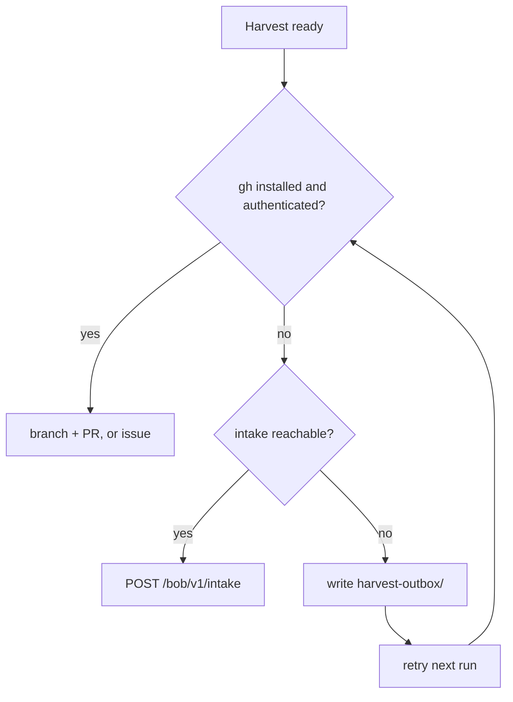

# Harvest (honesty box) --- bobiverse

> **CAST IRON RULE - HARVEST AND FILE EVERYTHING (read this first, every time).**
> 1. ALWAYS harvest skills you learn and file EVERY issue / FR / bug / gap you find to the intake webhook in the
>    SAME turn. Never leave a finding unfiled, never "note it for later", never skip it because it is small.
> 2. File with the intake webhook (no secret or login needed; `POST https://bob.ntsa.uk/bob/v1/intake`; offline it is
>    queued locally and retried):
>    Prefer `.\common\scripts\Report-BobiverseIntakeIssue.ps1` when present (FR #4297); else `.\scripts\Report-BobiverseIntakeIssue.ps1`.
>    `.\common\scripts\Report-BobiverseIntakeIssue.ps1 -Repo SimonBarnett/bobiverse -Kind issue -Title "short title" -Body "what / where / evidence / fix"`
>    (`-Kind issue|fr|skill|harvest`; always pass an explicit `-Repo owner/name`).
>    Worker status receipts (DONE/NACK/GIVEUP/SKIP/self-MRB/twin/duplicate/merged or FR/MRB/UAT `#N`) are not issue/FR findings: use `Invoke-BobiverseHarvest.ps1`/`kind: harvest`, and never file the `harvest:` receipt itself as a GitHub issue.
> 3. BEFORE finishing ANY debugging session run the harvest step:
>    Prefer tracked `.\common\scripts\Invoke-BobiverseHarvest.ps1` when present (FR #4297); else flat `.\scripts\Invoke-BobiverseHarvest.ps1`.
>    `.\common\scripts\Invoke-BobiverseHarvest.ps1 -Summary "what broke / what fixed it" -Lesson "one learned playbook line"`
>    then `.\common\scripts\Invoke-BobiverseHarvest.ps1 -Flush` to resend anything that was queued while offline.
> 4. Never put a token, password, SASL/NickServ secret, key or private hostname in a filing, a skill or a log.
> 5. Prefer **deterministic** fixes (Python/PowerShell under `tools\monitor\`, `jeeves/checks/`, `common/scripts`, chair helpers).
>    When a fix is tested, file an FR that lands it in the **Jeeves token-less service** so the learning becomes chair
>    behaviour without an LLM. Skills are the interim playbook; the durable home is the deterministic product
>    (`jeeves.exe` / monitor checks / gitclaim). Same turn: skill harvest **and** product FR when the path is clear.

**Script path (FR #4297):** dirty install worktrees can block Sync ff-only, so flat `scripts\Invoke-BobiverseHarvest.ps1` may lag tip after merges (class of FR #2581 updater tip overlay). Prefer `<ai root>\bob\common\scripts\` for harvest/intake; after a tip merge, Sync `-ComposeOnly` or a product service restart runs `Sync-BobiverseHarvestScriptsFromOrigin` so flat copies catch up without a clean ff.

**Harvest repo (a-search incident 2026-10-08):** always pass the job's repo: `Invoke-BobiverseHarvest.ps1 -Repo <owner/repo of the job> -Summary ... -Lesson ...` (job `FR SimonBarnett/a-search#N` -> `-Repo SimonBarnett/a-search`, which lands in a-search `.grok/skills/harvest-agent-skills/SKILL.md`). Never harvest a-search or other product lessons to SimonBarnett/bobiverse; only Bob fleet tooling lessons use `-Repo SimonBarnett/bobiverse`.

## Cost of use (CAST IRON)

Skill-intake consolidation: when a worker takes an FR from skill intake (label:skill / harvest), it must close all open issues for that skill book (every harvest/skill issue targeting the same book), open one consolidated PR for them, and cite every issue it closes (Closes #N for each); no per-issue PRs for the same skill book; the worker closes the issues itself as part of DONE.

One issue per issue: when MRB (or any worker) finds a twin/duplicate issue, close the later one and comment a reference to the first; never leave both open; done issues are closed too.

Using any skill from this book obliges you to report back here, in the same
turn you learn or fix something. Do not ask permission. Do not defer.

- Gap, bug or wish  issue (`FR:` for features). When the operator has no
  GitHub account, POST `kind: issue` | `fr` to `/bob/v1/intake`.
- New or fixed playbook  branch + PR (never `main`).
- Empty harvest only when nothing is new and nothing is broken.

**Home:** `https://github.com/SimonBarnett/bobiverse`. Frontmatter `github:`
MUST stay on this repo.

`harvest-agent-skills` remains as the bobiverse harvest index / where-to-put
lessons table; **this** `harvest` skill is the honesty-box report route
(including intake). Prefer this name for report/intake; keep both installed.

## What to harvest here

- bob / airc / jeeves MSI install, NSSM, secrets, tray/TipForm, digest webhook,
  chair/Jeeves webhooks (`bobcallback`), IRC SASL/NickServ, and post-install
  lessons for this fleet.
- Skill harvests land under `.grok/skills/bobiverse-bob|airc|jeeves`,
  `docs/post-install.md`, and `docs/skill-harvest-log.md`.

Do **not** harvest Day Works product, CE Priority DBA, or generic formprep
lessons here --- route those to their owning repos.

**FR #4970 (customer vs general Priority):** a lesson that is true only for one
customer or project goes in that customer's `SimonBarnett/*` repo tagged GitHub
topic `priority-customer` (look the topic up; do not hard-code the names). Test:
"would this be true for every Priority customer?" Yes -> `SimonBarnett/priority-mcp`
(GitHub alias of the former `SimonBarnett/agentic_fomprep` name; FR #7121).
No -> the customer repo. Example: Rees Machinery Priority instance / forms / data
-> `SimonBarnett/rees`, **not** `priority-mcp` harvest-agent-skills and **not**
bobiverse `harvest`. Generic Priority form-prep (true for any customer) still goes
to `SimonBarnett/priority-mcp`. Shared lookup: `common/scripts/priority_customer.py`
(same topic file as FR #4969).

## Report route (strict order)

Never require anyone to create a GitHub account just to report back.



*Caption: prefer `gh`; fall back to the Bob webhook intake; if offline, queue locally and retry.*

1. **`gh` available and authenticated**  branch + PR against
   `SimonBarnett/bobiverse` (skills) or an issue (`harvest:` / `FR:`). If the PR
   cannot be opened, file a `harvest:` issue with the intended PR title, branch,
   file list and body in this turn.
2. **No `gh`, or not authenticated**  POST to the Bob webhook intake
   `https://bob.ntsa.uk/bob/v1/intake`. No GitHub account needed; the
   service files it with label `via-intake`. Send an `idempotency_key` so
   retries never duplicate. Missing/empty `kind` defaults to `issue`.
3. **Offline / intake unreachable**  write the JSON payload to a local
   `harvest-outbox/` (or `report-outbox/` / `install-outbox/`) folder and retry
   it (same `idempotency_key`) on the next run. Helper:
   `scripts/Report-BobiverseIntakeIssue.ps1`.

### Open skill / harvest receipts  consolidate then PR (FR #1682 / FR #1684)

Intake `kind: skill|harvest` creates `label:skill` issues. The chair **offers** them as FR promote jobs (not product code FRs; they still do not block repo UAT). Do **not** GIVEUP. Without a promote PR the lessons never reach MRB merge.

When you have `gh` write (same turn or on a skill-promote assign):

1. Group open `label:skill` issues **by owner skill book** (see `harvest-agent-skills` table).
2. **Close duplicate** receipts for the same book/lesson.
3. Open **one** `harvest/` PR per book (or one multi-book PR with clear paths) that promotes unique Lesson lines; PR body uses `Closes ` / `Duplicates closed: `.
4. Leave merge to hostile **MRB**. Never push `main`.

Full steps: skill `harvest-agent-skills` section **Worker: consolidate open skill receipts  promote PR**.

### Intake must link an existing harvest PR (FR #1812 / harvest #2013)

When intake `kind: skill|harvest` (or a harvest summary) already names a GitHub **pull** URL in the title/body, the intake host must **`linked_existing_pr`** --- comment on / attach that PR --- and must **not** open a second fallback `label:skill` issue. Log `draft_pr_error` when draft-PR creation fails. `Invoke-BobiverseHarvest` / `issue_skip_fr_reason` should treat via-intake+skill "PR opened" receipts as `harvest_pr_summary` (skip re-offer as product FR). Product code: PR #2012.

Payload fields: `kind` (`issue` | `fr` | `skill` | `harvest`), **`repo`
(required `owner/name` --- never omit; no default)**, `title`, `body`, optional
`files[]` (`path` + `content`, small), `source` (machine, agent/tool, skill
book + version), optional `contact`, `idempotency_key`. **No auth required** ---
any skill user may POST. Optional fleet intake key `X-Bob-Intake-Key` /
`BOB_INTAKE_KEY` only when the host enables keyed mode; do not invent a secret
requirement. Never commit secrets.

curl:

```bash
curl -sS -X POST "https://bob.ntsa.uk/bob/v1/intake" \
  -H "Content-Type: application/json" \
  -d @harvest.json
```

PowerShell:

```powershell
.\scripts\Report-BobiverseIntakeIssue.ps1 -Repo SimonBarnett/bobiverse -Kind harvest -Title 'harvest: ...' -Body '...'
# close a session (summary + lessons, secret-scanned, queued offline):
.\scripts\Invoke-BobiverseHarvest.ps1 -Summary '...' -Lesson '...' [-SkillFile path]
.\scripts\Invoke-BobiverseHarvest.ps1 -Flush
# FR #2237: skip Invoke-BobiverseHarvest when the ONLY lesson is a twin/already-fixed
# DONE playbook (Duplicate of #N + DONE citing covering PR). Filing those creates nested
# skill twins that the chair re-offers as FR. Real new playbooks still harvest normally.
# FR #2970: also skip FAIL-supersede / wrong-book Harvest-lesson *process* playbooks
# FR #4207: also match 'already in (bobiverse-)?job-mrb' and bare 'FR #2970' with FAIL-supersede
# (class of tip #4206 after MRB #4204; pluralise process[- ]loops?).

# (belong in bobiverse-bob-job-mrb). Intake returns lesson_already_covered when harvest +
# job-mrb already carry that CAST IRON routing --- never open another lesson(harvest) twin.
# FR #2991: FAIL-supersede + thin already-covered / close-thin-twin restatements (no job-mrb
# process cue) also skip --- tip #2990 class after #2988.
# FR #4231: tip-loop meta / only-restate Thin FAIL-supersede already-on-main also skip for
# any -Book (including harvest-agent-skills; class of a-search#1839).
# FR #4308: also skip thinner tip + durable lesson already on main (a-search#1980/#2283;
# not contiguous "thin harvest tip"; no tip-loop meta / Thin FAIL order required).
# FR #4484: also skip FAIL-supersede next to "restates main" / "admit main already has"
# (class of a-search#3470; not already-on-main / second-copy / job-mrb wording).
# FR #3827: also catch "stay in"/"durable in bobiverse-bob-job-mrb", "thin harvest tip",
# "do not append a second copy under harvest" (tip #3826 after #3825 missed belong(s) in).
# FR #3004: default -Book harvest yields to keyword-inferred product books (bob-worker /
# fleet-ops / job-mrb); if the owning skill already has the lesson, intake returns
# lesson_already_covered --- never open lesson(harvest) twins like #3001-#3003 after #2997.
# MRB #2973: bare "FAIL-supersede" in a summary alone is not enough to re-route; a process
# cue is required so real product lessons still open under harvest.
# FR #3824: one harvest per seat+lesson --- client skips when an open harvest-lesson PR from
# this seat already carries the same lesson; idempotency_key prefers seat+normalized lesson
# (Summary drift / DONE retries must not mint a second tip). Intake claims state=filing early,
# settles filing/open_lesson_twin, and links open seat+lesson twins instead of opening #3823.
# or:
Invoke-RestMethod -Method Post -Uri 'https://bob.ntsa.uk/bob/v1/intake' `
  -ContentType 'application/json' -Body (Get-Content harvest.json -Raw)
```

Expect `202 {intake_id, url}` or `202 {intake_id, queued:true}`. Check status
with `GET /bob/v1/intake/<id>`.

`-Flush` (FR #139 / FR #3135) inspects `payload.repo` via `Test-IntakeRepoAllowed`
(mirrors `intake.repo_allowed`): any `SimonBarnett/<name>` matching the intake
repo regex is allowed; non-SimonBarnett owners stay denied unless listed in
`DEFAULT_ALLOW_REPOS` (optional extra / docs examples). Outside that rule, or
HTTP 403 `repo_not_allowed`, payloads are **DROPPED** into
`report-outbox/dropped/` (or the matching outbox `dropped/`) so Flush stays
clean. Transient errors stay KEPT for retry. New Plan products under
`SimonBarnett/*` need **no** per-repo allowlist edit --- after an allow-*rule*
change merges, **walrus** must Sync/compose ircJeeves so live intake picks it up (ionos deprecated)
(FR #3117 / #3122). Queue suppress/prioritise with `!ignore` / `!focus`.

Prefer `gh` and repo scripts over free-form reasoning.

## Report a bug or feature request

| `kind` | Meaning | Labels from intake |
|--------|---------|--------------------|
| `issue` | Bug / gap | `via-intake` (do **not** stamp `needs-mrb1` --- offer hallucination) |
| `fr` | Feature request | `via-intake`, `feature-request` (do **not** stamp `needs-mrb1`) |
| `skill` / `harvest` | Skill harvest files | `via-intake`, `skill` |

**CAST IRON (FR #1526 / harvest #1717):** never create, stamp, or apply GitHub label `needs-mrb1` / `mrb1`. That label was an offer hallucination. The real human gate is `needs-human`. Leftover repo labels are inert for offers (`gated_counts.needs-mrb1=0`, `row_awaits_mrb1` always false). Intake must omit `needs-mrb1`.

### Living product FR when intake vanishes into harvest-only (harvest #2001)

`Invoke-BobiverseHarvest` / intake `kind: skill|harvest` creates **receipts** (`label:skill`). They are not the product work item. If a real product plan/FR was meant to live on the board but only harvest receipts exist (or the product FR was closed/superseded into harvest noise):

1. Create a **canonical living FR** with `gh issue create -R owner/repo --label feature-request` (and `via-intake` only if still filing via intake `kind: fr`).
2. Treat **that** issue number as the living FR - append WP evidence / comments there.
3. Point harvest receipts at it with `Refs #N` / close as superseded operational report; do not implement the product plan on a `label:skill` harvest issue.

Example: jeeves.exe chair+HTTP one-process plan lives at #1993, not on harvest receipts.

Default `repo` for this book: `SimonBarnett/bobiverse`.

**FR #3189 (job-repo routing):** when the seat's offered job is a product repo (e.g. `SimonBarnett/a-search`),
`Invoke-BobiverseHarvest` uses `-JobRepo` / `$env:BOB_JOB_REPO` / `run\job-repo.txt` so the harvest lands in **that**
repo (a-search default book `harvest-agent-skills` at `.grok/skills/harvest-agent-skills/SKILL.md`). Do **not** park
a-search product tips under bobiverse `harvest/SKILL.md`. Bob tooling (bob-worker, fleet-ops, jeeves, tray) still
routes to bobiverse via the split rule.

## Do not

- Push harvest to `main`, or commit "nothing found".
- Put secrets, tokens, keys, or personal paths in skills; use placeholders.
- End a turn with a new/fixed skill only in chat or a local folder without a
  PR, issue, intake receipt or `harvest-outbox/` entry.
- Add a separate `/bob/v1/harvest` endpoint --- harvest is intake with the
  appropriate `kind`.

## Harvested lessons (intake)

The bullet archive is `lessons.md` beside this file (FR #8310). skill-dag refuses a skill body over 65536 bytes, so do not paste the archive back into this SKILL.md. New intake bullets still append under this heading until the file nears 60KiB, then move them into `lessons.md`.

Do not land a second copy of a harvest-lesson MRB playbook in this book. Those playbooks belong in `bobiverse-bob-job-mrb`.
- CAST IRON point 5 (Jeeves MONITORING): prefer deterministic fixes; when tested, FR them into the Jeeves token-less service (tools/monitor, jeeves/checks, common/scripts, chair helpers) so learnings become chair behaviour without an LLM. Skills are interim; durable home is the deterministic product. Same turn: skill harvest and product FR when the path is clear (PR #8851).
- skill-dag index preference: over-cap seat copy yields to a later root at or under SKILL_RESOLVE_CAP_BYTES; an under-cap seat copy still wins (FR #7076 / #8323).
- Any per-seat click state must persist the launch model next to the kind and every restart path must read it; a saved model that cannot start must refuse and report, never fall through to the free default.
- When IRC _ssl_recv starts polling settimeout, run test_fr8120_ear_ssl_send_serialize.py and test_fr4980_ear_idle_keepalive.py with the new registration test before PASS.
- Orphan fix(mrb-N) tips with an explicit non-main base (merged fr-* tip) must be skipped by resync and retargeted or recreated; CLEAN checks do not mean the PR can land on main
- A tray digest-pools WriteAllText that fails with not enough space on the disk must skip crash intake and the hook-failure spool. Disk full is not a product defect.
- all-gave-up must ignore the seat that currently holds the row. ACK clears that seat from giveup_seats so a busy NACK or offer timeout is not an abandonment.
- A shipped-script import gate must import only names that end in .py. copy_by_path_scripts also copies PowerShell, and those names are not Python modules.
- When PRIORITY prepare-form is priority_not_installed, the reply must name the example allowlist copy and CredMan credentialTarget, and the doc must say Session 0 uses prepare-form rather than WINRUN.
- A 24h harvest-lesson dedup covers a new playbook only when that PR contains the lesson sentence or a phrase of at least 40 characters of it. A short shared token is not a cover.
- no_terminal_reply_does_not_block must read only that seat own offer_outcomes. A later no-terminal-reply must not lift another seat permanent give-up such as self-mrb. Legacy rows use the row giveup_reason only when that seat is the sole giveup_seats entry.
- An FR seat must run gh pr ready before DONE. A draft pull request is not reviewable and strands the MRB. FIX seats do not open a new pull request.
- A GitHub issue whose title starts with stall: is a detector receipt. issue_skip_fr_reason returns stall_receipt so it is never an offerable FR and never picks up needs_human. The stall detector itself stays.
- An open non-draft product PR with no MRB or FIX queue row is stranded. The token-free check uses an injected pull list, the same way as the stale-base check.
- When an intake FR asks to move HTTP webhooks off irc.ntsa.uk, check bob_public_base.DEFAULT_PUBLIC_BASE and closed FR 5272 before opening a second implement PR.
- When accepted jobs look unassigned, paint working_on from the accepted row on ACK and demote LOST_ACK_RESTART only when the seat still has no real working_on.
- A reset before airc.exe sends TLS bytes is a local block of that process. Classify it, print the allow rule, and do not disable Defender.
- A per-agent-kind submit-verify change must keep the Cursor/Grok GIVEUP wire bare (VISION S3); annotate probe=/kind= only for the headless kind.
- When an MRB worktree is linked to the install-root git or sits at the wrong SHA, recreate it from the clone store only if the seat pid is dead. A live seat keeps head-mismatch with want= and have=.
- When a later FR marks a give-up reason infra-soft, update the older test that expected giveup_count to increment. Do not put the reason back on the job-burn path.
- The tray engine hover step must query Win32_Process by Name=grok.exe and use a short digest GET. A full process list plus a 15s HTTP cap spends the 45s budget and files a deterministic timeout.
- A Python CLI that wraps a PowerShell Read-Host prompt must not use capture_output. That pipes stdin shut. Inherit stdin and pipe only stdout.
- Digest online does not imply WinRM: marchhare may show bob ear online with workers=[] while TCP 5985 from flamingo fails --- start seats locally/tray/airc; do not assume UpdateFleet CredMan reaches every shop host (FR #8429).
- Update-BobFleet Get-UpdateFleetPSCredential must [void] CredFree (and TrimEnd NUL on the unicode blob); an unvoided bool makes $cred an Object[] that cannot bind to [PSCredential] (FR #8531).
- Prefer tray run/startworker/req-*.json (unix-int ts/expires + optional agent) over WinRM Start-Process/CreateProcess for seats; detached WinRM launches die (console-closed / 0xC000013A) or stall without run dirs. ISO expires must still parse or write res-*.json reason=bad-expires (FR #8517).
- Skills-sync on the shared install must hold run/skills-sync.lock. If checkout hits index.lock, drop a stale lock and retry. A killed seat must not leave index.lock for the next start.
- airc.exe --connect-selftest must call probe_connection with a default socket connector. A required connector makes the install health step raise TypeError before any classification.
- A BOM-less PowerShell file must stay ASCII. An em dash (e2 80 94) fails the WinPS 5.1 parse gate. After that gate is clear, fix the next ParseFile error the same test reports.
- For SimonBarnett/bobiverse, infer_require_machine ignores a needs-walrus/needs-ionos title prefix. Pin with a needs-walrus label (legacy needs-ionos) or a body line require_machine: walrus (legacy require_machine: ionos until pin-retarget FR #8653).
- A line-anchored MRB FAIL @ sha is a seat verdict even when the sha is wrapped in ticks or quotes. A mid-line mention and a FAIL without an @ sha still hold.
- A same-process file lock that unlinks on holder==getpid busy-spins on Windows when the holder's handle blocks unlink; cross-process seats still need the dead-pid steal plus a sleep and a deadline.
- Write gh --body-file with a UTF-8 no-BOM writer and reject C0 bytes other than tab, LF, and CR; double-quoted PowerShell turns backslash-b, backslash-t, and backslash-a into real controls.
- While a seat is in out-of-fuel hold, digest worker_list must paint state=out_of_fuel and keep updated fresh; idle_quiet_offerable must skip that seat.
- After pointer refresh, confirm skill-dag MCP drop with Toolhelp PID liveness twice; never treat a flaky empty PowerShell cmdline sample as a transport drop
- An identity-only digest merge must not append model to cleared. Cursor CLI account reads only authInfo.email; a key override is a pid-bound marker with no key value.
- opencode_turn_stop_reason returns finished when the outbox already has DONE or NACK. The wrapper must not GIVEUP that case, and must not write stop-closed into opencode-out-of-fuel.log.
- An offer-timeout must not hand the same row straight back to that nick while another live idle seat exists. Record offer_last_timeout_seat and push the other seat first.
- A batch recycleseat must stop every named seat before starting replacements. A restore launch is net-zero and must not be refused by the agent cap.
- When digest-fuel-stall fires, abandon the hung _fuel_worker reference and start a new publish; reporting alone does not unfreeze heartbeats.
- After FR #8310, hostile harvest pins for archived tips must read lessons.md; SKILL.md only keeps the active placement rule and recent bullets.
- Never sync PowerShell.Stop() on the tray poll thread after WaitOne timeout; fire-and-forget Stop/Dispose so step-timeout logs and startworker ticks continue.
- Update-BobFleet Get-UpdateFleetPSCredential must [void] CredFree (and TrimEnd NUL); unvoided bool makes Object[] that cannot bind to [PSCredential] (FR #8531)
- When idle seats see offerable=0 (often needs_human-only), surface healthy_idle_empty_offerable / TipForm caption so ops do not recycle free DeepSeek seats as hung.
- On OpenCode Free usage limit for a free model, pause free and switch to opencodePaid when Go remains (no shop GIVEUP); accept cli-stderr Free usage pauses for free models so free reading is not stuck at 100.
- OpenCode flamingo: launch with BOB_WORKER_INJECT_PASTE=0 (keys); never PASTE=1 (stray v breaks submit-verify). Docs/log pin in #8560; worker force-keys is #8558/#8561.
- OpenCode Start-Process must not combine -NoNewWindow with RedirectStandardOutput/Error: that hangs after the build banner (empty stdout) and can leave no last-exit; redirects alone create no window
- OpenCode mid-job silent death: CreateProcess needs CREATE_BREAKAWAY_FROM_JOB with CREATE_NEW_CONSOLE; tray watchdog on seat-count drop writes synthetic last-exit external-kill + GIVEUP without restart (FR #3180).
- Stale linked-worktree index.lock blocks OpenCode git mid-job: fix = worker-side preflight (unlink job gitdir index.lock before inject) plus external_directory allow for the resolved gitdir; note external_directory allow is read-only, so agent-side Remove-Item of the lock may still need edit permission - preflight is the reliable path
- When InstallRoot is a drive root, Split-Path -Parent is empty: resolve BobInstallRoot via C:\ai\bob fallback or require -BobInstallRoot; pass -BobInstallRoot from Start Menu shortcut on MSI layout.
- Remote OpenCode stuck/quota is invisible to local digest seats_stuck_doing; probe /bob/v1/report with User-Agent for kind=opencode on flamingo (report-only, no clear_seat_doing).
- MRB health soft-pass overlays: always init overlay=None before findings branches; tip tests must cover the findings-empty happy path or UnboundLocalError ships.
- After a parents[N] class fix, rg the whole monitor package for leftover parents[N] siblings and extend the source pin list in the same FR family.
- OpenCode: recycle when digest doing age or true log/turn progress freezes beyond BOB_WORKER_OPENCODE_FROZEN_PROGRESS_S; week.limited alone must not set out_of_fuel (blocks FR #4180 recycle).
- !recycleseat --force overrides busy only when worker.updated is stale or accepted_silent/LOST_ACK is stamped; fresh busy still NACK (FR #8602).
- When monitor IndexError on UNC shallow parents[N] is already fixed on main (#8580), twin-close the later intake and point DONE at the covering PR; note live share still needs fleet update.
- After an ops hung-seat wipe leaves a machine running=0, !startworker (or tray Start Agents) is required; Ensure-BobWorkerSeats will not auto-heal (FR #3180). Monitor restore on flamingo used !startworker agent flamingo x2 (FR #8609 / ops on #8602).
- If a self-review-deadlock stall names this seat in idle and waiting tips are this seat's PRs: GIVEUP (FR #6203/#8264); author may fold CONFLICTING tips for the next MRB; never self-MRB PASS.
- When the ear writes a command to its own outbox, decide it in the drain. Do not wait for an IRC echo of the ear nick.
- When a commands doc states a numeric cap, pin the sentence to the code constant in a test. Substring checks like default 4 also match default 48.
- Explicit OpenCode with no start model: free known 0 + go unknown is not dual-pool exhausted; start as fuel-unknown and honour opencode_windows for Go.
- needs_human stays global except one post-cooldown auto-offer when giveup_reason is agent-cli-nonzero-exit and the nick is not in giveup_seats.
- Infra-soft give-up reasons must not black out auto-offer. Persist the raw needs_human bit separately from the offer gate so heal can still see a false stamp.
- A second !recycle that leaves the same OpenCode PID is an undeployed #8597, not a new FR, when stop_managed_workers is already on main.
- Offerable skill and harvest filings use _filer_create_pr draft false; empty and docs/intake-harvest-only payloads become a skill-source lesson; PASS/FAIL and session summaries stay receipt_recorded.
- BOB-09 About Show logs: bottom button on AboutForm + PS fallback opens watch_bob_tray.log via notepad (same path as Open log)
- BOB-08 About rename: menu label Acknowledge->About on BobTray.cs and Watch-BobTray.ps1; keep Acknowledge() attention clear; pin mock home.html
- BOB-11 Status keep pool dialog: when Item(Status)/ShowStatus/StatusForm already on main, DONE with covering PR URL (#7521) and close the twin --- do not re-implement
- When intake changes Session-summary empty harvests to receipt_recorded, update GhCliFiler draft tests in the same window or build-jeeves stays red on main.
- Intake allowlist monitor: send an explicit User-Agent through Cloudflare; only JSON error=repo_not_allowed is allowlist drift, not bare HTTP 403 1010.
- When renaming a tray submenu label, update MenuItems.Add for --dump-menu in the same change; source pins can pass while the compiled dump-menu pin fails.
- Recycleseat queue TTL must outlast a lagged tray tick (300s). Read the last numeric value from Launch output; do not cast the last pipeline object when the tray logs on the success stream.
- BOB-57 S1 needs a verified plan.ntsa.uk MSI URL from VIS-08 before any downloads card; homepage or guessed /plan.msi is not acceptance.
- require_machine offer gate: peel cold-digest <machine>-<pid> nicks, gate why-empty on row_require_machine re-infer, and stamp require_machine from honor-path GIVEUP so the next !bored skips wrong shops.
- BOB-03 combos must not reuse models-catalog.json: BOB-01 Weights rows and BOB-02 PUT own that file; ship allow-list as models-valid-combos.json; validation is GET /bob/v1/models catalog + Weights form dropdowns (no POST /bob/v1/models/validate; FR #9053)
- !build UX: put BUILD_USAGE_LINES in builds_catalog (leaf), re-export from bobiverse_build; local-first catalog before HTTP; optional recipe= on BUILD v1 only for non-default yml paths.
- A DIRTY product FIX folds origin/main in the job worktree, keeps both sides of a docs conflict, pins the review finding in the existing test, and pushes the same PR head.
- Weights S1 is a modeless grid with columns Agent, CLI, Model, Context, Effort. Dump those headers with --dump-weights-columns before the tray UI starts.
- Seed models-valid-combos from a shipped seed on BobCallback start: create if missing, append missing models, never rewrite a malformed store.
- Workers > Cursor menu image is assets/menu-favicons/cursor.com.ico. Log worker-favicon with that path. Do not reuse the fuel badge.
- A fresh Install-BobWebhooks.ps1 must write the same canonical web.config the second run would upsert, or site-kit CI fails with second install changed web.config bytes.
- When neither home has queue.json, idle_seats uses one live /bob/v1/report estimate. A local queue never fetches. Unverified gates stay named and are not applied.
- About Plan and Priority versions come from slice VERSION files or BOBIVERSE_PLAN_VERSION and BOBIVERSE_PRIORITY_VERSION, and fall back to the bob version so the fields are never blank.
- A skill pin that forbids CR must normalize the checkout to LF before the assertion. autocrlf makes a clean LF blob look like CRLF on windows-latest.
- Do not cap an MRB PASS verdict with a character window. Require the verdict after the board heading in the same comment.
- Engine steps that call Win32_Process must pass a timeout or skip the scan. An unbounded CIM query is what files engine step timeoutSec=45.
- When a PowerShell here-string is double-quoted, empty variables erase dollar names before commit. Write tray .ps1 with a single-quoted here-string or a file tool, then parse the file with the PowerShell language parser before push.
- A PS 5.1 module import error pointing at ForEach-Object in the psm1 is often a Private script whose param names were stripped; restore names from the call sites before treating the failure as unrelated CI noise.
- Zero live seats stay on the empty-online fill. Under-cap fill must return 0 when live is 0 so the two paths do not both fire.
- A Threading.Timer that WaitForExit longer than its period stacks powershell children. Single-flight the pid and cap the wait at 15s.
- MarchHare idle oscillates seat-to-seat; keep #8890 comments without new filings
- A grok worker_spawn connect blip is not a bob CLI bug. Skip that intake signature. Keep filing other exit 1 failures.
- After mrb_merge_gate exit 2, do not run gh pr merge --auto. A later exit 0 can still merge a phase-gated PR.
- Unsigned exit 0xffffffff with only pager info/debug or TUI chrome is an external kill. Keep cli-failure when stderr contains failed, fatal, exception, or an error level.
- When stall alerts are non-empty, call Get-BobStallFrIntake and log stall-fr with repo SimonBarnett/bobiverse.
- Agents Jeeves reads BOB_JEEVES_FUEL_FILE or run/jeeves-fuel.json and quits without starting when remaining_pct is 0 or less.
- When skill-dag MCP initialize closes and only skill-dag-core is bundled, run skill_dag_mcp.py --once from the seat mcp.json. Do not read SKILL.md from another job worktree.
- Invoke-JeevesMonitorCheck: missing .py soft-skips exit 0 with skipped JSON so sparse/lagging installs do not EXIT:2 on ValidateSet-widened names; promote local J:\ hotfix via PR.
- FIX re-offer of a folded MERGEABLE/CLEAN PR: re-query mergeable once, DONE the same URL, do not merge and do not fold again
- FR #9053: retire POST /bob/v1/models/validate with early JSON 404 before POST_ROUTES gate; Weights validation is GET catalog dropdowns + PUT save only
- FR #9034: TipForm Exit must dispose tray UI only --- never sc stop ircBob; ear recycle is Restart-BobEar / Restart -SkipServiceRestart
- Never block out-of-fuel worker-remove on MessageBoxW. Session 0 hangs leave digest zombies.
- OpenCode gh_auth_missing on a named shop is require_machine ops: GIVEUP from other hosts; operator runs gh auth login there; do not invent GH_TOKEN or read hosts.yml.
- Empty-online fill: when grok weekly remaining is known 0 and an OpenCode free leaf resolves, write agent=opencode slot=free; unknown grok or free=0 keeps auto.
- FR #9025: fuel-exhausted recycle while process still running is expected fuel quit --- skip seat-stopped-making-progress intake; leave hang recycles filing
- A DIRTY tray-dialog FIX must keep both sides of the bob-tray.exe Srcs list (BobModelsClient.cs from main and PlanMcpConfig.cs from the PR) and compile before push.
