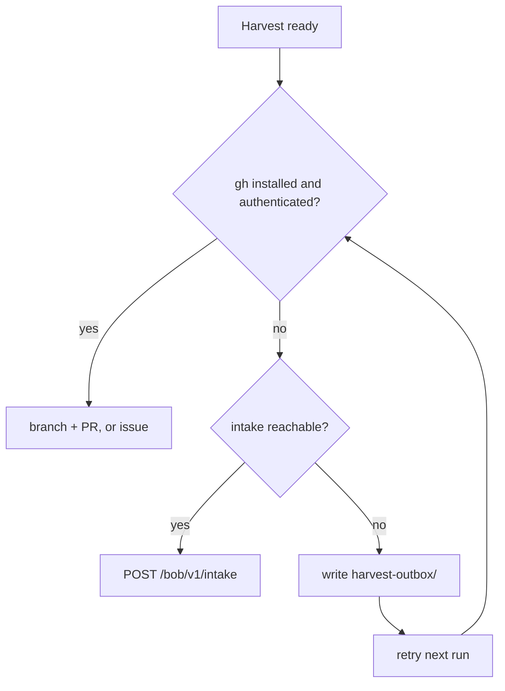

# Harvest (honesty box) --- bobiverse

> **CAST IRON RULE - HARVEST AND FILE EVERYTHING (read this first, every time).**
> 1. ALWAYS harvest skills you learn and file EVERY issue / FR / bug / gap you find to the intake webhook in the
>    SAME turn. Never leave a finding unfiled, never "note it for later", never skip it because it is small.
> 2. File with the intake webhook (no secret or login needed; `POST https://bob.ntsa.uk/bob/v1/intake`; offline it is
>    queued locally and retried):
>    Prefer `.\common\scripts\Report-BobiverseIntakeIssue.ps1` when present (FR #4297); else `.\scripts\Report-BobiverseIntakeIssue.ps1`.
>    `.\common\scripts\Report-BobiverseIntakeIssue.ps1 -Repo SimonBarnett/bobiverse -Kind issue -Title "short title" -Body "what / where / evidence / fix"`
>    (`-Kind issue|fr|skill|harvest`; always pass an explicit `-Repo owner/name`).
>    Worker status receipts (DONE/NACK/GIVEUP/SKIP/self-MRB/twin/duplicate/merged or FR/MRB/UAT `#N`) are not issue/FR findings: use `Invoke-BobiverseHarvest.ps1`/`kind: harvest`, and never file the `harvest:` receipt itself as a GitHub issue.
> 3. BEFORE finishing ANY debugging session run the harvest step:
>    Prefer tracked `.\common\scripts\Invoke-BobiverseHarvest.ps1` when present (FR #4297); else flat `.\scripts\Invoke-BobiverseHarvest.ps1`.
>    `.\common\scripts\Invoke-BobiverseHarvest.ps1 -Summary "what broke / what fixed it" -Lesson "one learned playbook line"`
>    then `.\common\scripts\Invoke-BobiverseHarvest.ps1 -Flush` to resend anything that was queued while offline.
> 4. Never put a token, password, SASL/NickServ secret, key or private hostname in a filing, a skill or a log.

**Script path (FR #4297):** dirty install worktrees can block Sync ff-only, so flat `scripts\Invoke-BobiverseHarvest.ps1` may lag tip after merges (class of FR #2581 updater tip overlay). Prefer `<ai root>\bob\common\scripts\` for harvest/intake; after a tip merge, Sync `-ComposeOnly` or a product service restart runs `Sync-BobiverseHarvestScriptsFromOrigin` so flat copies catch up without a clean ff.

**Harvest repo (a-search incident 2026-10-08):** always pass the job's repo: `Invoke-BobiverseHarvest.ps1 -Repo <owner/repo of the job> -Summary ... -Lesson ...` (job `FR SimonBarnett/a-search#N` -> `-Repo SimonBarnett/a-search`, which lands in a-search `.grok/skills/harvest-agent-skills/SKILL.md`). Never harvest a-search or other product lessons to SimonBarnett/bobiverse; only Bob fleet tooling lessons use `-Repo SimonBarnett/bobiverse`.

## Cost of use (CAST IRON)

Skill-intake consolidation: when a worker takes an FR from skill intake (label:skill / harvest), it must close all open issues for that skill book (every harvest/skill issue targeting the same book), open one consolidated PR for them, and cite every issue it closes (Closes #N for each); no per-issue PRs for the same skill book; the worker closes the issues itself as part of DONE.

One issue per issue: when MRB (or any worker) finds a twin/duplicate issue, close the later one and comment a reference to the first; never leave both open; done issues are closed too.

Using any skill from this book obliges you to report back here, in the same
turn you learn or fix something. Do not ask permission. Do not defer.

- Gap, bug or wish → issue (`FR:` for features). When the operator has no
  GitHub account, POST `kind: issue` | `fr` to `/bob/v1/intake`.
- New or fixed playbook → branch + PR (never `main`).
- Empty harvest only when nothing is new and nothing is broken.

**Home:** `https://github.com/SimonBarnett/bobiverse`. Frontmatter `github:`
MUST stay on this repo.

`harvest-agent-skills` remains as the bobiverse harvest index / where-to-put
lessons table; **this** `harvest` skill is the honesty-box report route
(including intake). Prefer this name for report/intake; keep both installed.

## What to harvest here

- bob / airc / jeeves MSI install, NSSM, secrets, tray/TipForm, digest webhook,
  chair/Jeeves webhooks (`bobcallback`), IRC SASL/NickServ, and post-install
  lessons for this fleet.
- Skill harvests land under `.grok/skills/bobiverse-bob|airc|jeeves`,
  `docs/post-install.md`, and `docs/skill-harvest-log.md`.

Do **not** harvest Day Works product, CE Priority DBA, or generic formprep
lessons here --- route those to their owning repos.

**FR #4970 (customer vs general Priority):** a lesson that is true only for one
customer or project goes in that customer's `SimonBarnett/*` repo tagged GitHub
topic `priority-customer` (look the topic up; do not hard-code the names). Test:
"would this be true for every Priority customer?" Yes -> `SimonBarnett/priority-mcp`
(GitHub alias of the former `SimonBarnett/agentic_fomprep` name; FR #7121).
No -> the customer repo. Example: Rees Machinery Priority instance / forms / data
-> `SimonBarnett/rees`, **not** `priority-mcp` harvest-agent-skills and **not**
bobiverse `harvest`. Generic Priority form-prep (true for any customer) still goes
to `SimonBarnett/priority-mcp`. Shared lookup: `common/scripts/priority_customer.py`
(same topic file as FR #4969).

## Report route (strict order)

Never require anyone to create a GitHub account just to report back.



*Caption: prefer `gh`; fall back to the Bob webhook intake; if offline, queue locally and retry.*

1. **`gh` available and authenticated** → branch + PR against
   `SimonBarnett/bobiverse` (skills) or an issue (`harvest:` / `FR:`). If the PR
   cannot be opened, file a `harvest:` issue with the intended PR title, branch,
   file list and body in this turn.
2. **No `gh`, or not authenticated** → POST to the Bob webhook intake
   `https://bob.ntsa.uk/bob/v1/intake`. No GitHub account needed; the
   service files it with label `via-intake`. Send an `idempotency_key` so
   retries never duplicate. Missing/empty `kind` defaults to `issue`.
3. **Offline / intake unreachable** → write the JSON payload to a local
   `harvest-outbox/` (or `report-outbox/` / `install-outbox/`) folder and retry
   it (same `idempotency_key`) on the next run. Helper:
   `scripts/Report-BobiverseIntakeIssue.ps1`.

### Open skill / harvest receipts → consolidate then PR (FR #1682 / FR #1684)

Intake `kind: skill|harvest` creates `label:skill` issues. The chair **offers** them as FR promote jobs (not product code FRs; they still do not block repo UAT). Do **not** GIVEUP. Without a promote PR the lessons never reach MRB merge.

When you have `gh` write (same turn or on a skill-promote assign):

1. Group open `label:skill` issues **by owner skill book** (see `harvest-agent-skills` table).
2. **Close duplicate** receipts for the same book/lesson.
3. Open **one** `harvest/…` PR per book (or one multi-book PR with clear paths) that promotes unique Lesson lines; PR body uses `Closes …` / `Duplicates closed: …`.
4. Leave merge to hostile **MRB**. Never push `main`.

Full steps: skill `harvest-agent-skills` section **Worker: consolidate open skill receipts → promote PR**.

### Intake must link an existing harvest PR (FR #1812 / harvest #2013)

When intake `kind: skill|harvest` (or a harvest summary) already names a GitHub **pull** URL in the title/body, the intake host must **`linked_existing_pr`** --- comment on / attach that PR --- and must **not** open a second fallback `label:skill` issue. Log `draft_pr_error` when draft-PR creation fails. `Invoke-BobiverseHarvest` / `issue_skip_fr_reason` should treat via-intake+skill "PR opened" receipts as `harvest_pr_summary` (skip re-offer as product FR). Product code: PR #2012.

Payload fields: `kind` (`issue` | `fr` | `skill` | `harvest`), **`repo`
(required `owner/name` --- never omit; no default)**, `title`, `body`, optional
`files[]` (`path` + `content`, small), `source` (machine, agent/tool, skill
book + version), optional `contact`, `idempotency_key`. **No auth required** ---
any skill user may POST. Optional fleet intake key `X-Bob-Intake-Key` /
`BOB_INTAKE_KEY` only when the host enables keyed mode; do not invent a secret
requirement. Never commit secrets.

curl:

```bash
curl -sS -X POST "https://bob.ntsa.uk/bob/v1/intake" \
  -H "Content-Type: application/json" \
  -d @harvest.json
```

PowerShell:

```powershell
.\scripts\Report-BobiverseIntakeIssue.ps1 -Repo SimonBarnett/bobiverse -Kind harvest -Title 'harvest: ...' -Body '...'
# close a session (summary + lessons, secret-scanned, queued offline):
.\scripts\Invoke-BobiverseHarvest.ps1 -Summary '...' -Lesson '...' [-SkillFile path]
.\scripts\Invoke-BobiverseHarvest.ps1 -Flush
# FR #2237: skip Invoke-BobiverseHarvest when the ONLY lesson is a twin/already-fixed
# DONE playbook (Duplicate of #N + DONE citing covering PR). Filing those creates nested
# skill twins that the chair re-offers as FR. Real new playbooks still harvest normally.
# FR #2970: also skip FAIL-supersede / wrong-book Harvest-lesson *process* playbooks
# FR #4207: also match 'already in (bobiverse-)?job-mrb' and bare 'FR #2970' with FAIL-supersede
# (class of tip #4206 after MRB #4204; pluralise process[- ]loops?).

# (belong in bobiverse-bob-job-mrb). Intake returns lesson_already_covered when harvest +
# job-mrb already carry that CAST IRON routing --- never open another lesson(harvest) twin.
# FR #2991: FAIL-supersede + thin already-covered / close-thin-twin restatements (no job-mrb
# process cue) also skip --- tip #2990 class after #2988.
# FR #4231: tip-loop meta / only-restate Thin FAIL-supersede already-on-main also skip for
# any -Book (including harvest-agent-skills; class of a-search#1839).
# FR #4308: also skip thinner tip + durable lesson already on main (a-search#1980/#2283;
# not contiguous "thin harvest tip"; no tip-loop meta / Thin FAIL order required).
# FR #4484: also skip FAIL-supersede next to "restates main" / "admit main already has"
# (class of a-search#3470; not already-on-main / second-copy / job-mrb wording).
# FR #3827: also catch "stay in"/"durable in bobiverse-bob-job-mrb", "thin harvest tip",
# "do not append a second copy under harvest" (tip #3826 after #3825 missed belong(s) in).
# FR #3004: default -Book harvest yields to keyword-inferred product books (bob-worker /
# fleet-ops / job-mrb); if the owning skill already has the lesson, intake returns
# lesson_already_covered --- never open lesson(harvest) twins like #3001-#3003 after #2997.
# MRB #2973: bare "FAIL-supersede" in a summary alone is not enough to re-route; a process
# cue is required so real product lessons still open under harvest.
# FR #3824: one harvest per seat+lesson --- client skips when an open harvest-lesson PR from
# this seat already carries the same lesson; idempotency_key prefers seat+normalized lesson
# (Summary drift / DONE retries must not mint a second tip). Intake claims state=filing early,
# settles filing/open_lesson_twin, and links open seat+lesson twins instead of opening #3823.
# or:
Invoke-RestMethod -Method Post -Uri 'https://bob.ntsa.uk/bob/v1/intake' `
  -ContentType 'application/json' -Body (Get-Content harvest.json -Raw)
```

Expect `202 {intake_id, url}` or `202 {intake_id, queued:true}`. Check status
with `GET /bob/v1/intake/<id>`.

`-Flush` (FR #139 / FR #3135) inspects `payload.repo` via `Test-IntakeRepoAllowed`
(mirrors `intake.repo_allowed`): any `SimonBarnett/<name>` matching the intake
repo regex is allowed; non-SimonBarnett owners stay denied unless listed in
`DEFAULT_ALLOW_REPOS` (optional extra / docs examples). Outside that rule, or
HTTP 403 `repo_not_allowed`, payloads are **DROPPED** into
`report-outbox/dropped/` (or the matching outbox `dropped/`) so Flush stays
clean. Transient errors stay KEPT for retry. New Plan products under
`SimonBarnett/*` need **no** per-repo allowlist edit --- after an allow-*rule*
change merges, **ionos** must Sync/compose ircJeeves so live intake picks it up
(FR #3117 / #3122). Queue suppress/prioritise with `!ignore` / `!focus`.

Prefer `gh` and repo scripts over free-form reasoning.

## Report a bug or feature request

| `kind` | Meaning | Labels from intake |
|--------|---------|--------------------|
| `issue` | Bug / gap | `via-intake` (do **not** stamp `needs-mrb1` --- offer hallucination) |
| `fr` | Feature request | `via-intake`, `feature-request` (do **not** stamp `needs-mrb1`) |
| `skill` / `harvest` | Skill harvest files | `via-intake`, `skill` |

**CAST IRON (FR #1526 / harvest #1717):** never create, stamp, or apply GitHub label `needs-mrb1` / `mrb1`. That label was an offer hallucination. The real human gate is `needs-human`. Leftover repo labels are inert for offers (`gated_counts.needs-mrb1=0`, `row_awaits_mrb1` always false). Intake must omit `needs-mrb1`.

### Living product FR when intake vanishes into harvest-only (harvest #2001)

`Invoke-BobiverseHarvest` / intake `kind: skill|harvest` creates **receipts** (`label:skill`). They are not the product work item. If a real product plan/FR was meant to live on the board but only harvest receipts exist (or the product FR was closed/superseded into harvest noise):

1. Create a **canonical living FR** with `gh issue create -R owner/repo --label feature-request` (and `via-intake` only if still filing via intake `kind: fr`).
2. Treat **that** issue number as the living FR - append WP evidence / comments there.
3. Point harvest receipts at it with `Refs #N` / close as superseded operational report; do not implement the product plan on a `label:skill` harvest issue.

Example: jeeves.exe chair+HTTP one-process plan lives at #1993, not on harvest receipts.

Default `repo` for this book: `SimonBarnett/bobiverse`.

**FR #3189 (job-repo routing):** when the seat's offered job is a product repo (e.g. `SimonBarnett/a-search`),
`Invoke-BobiverseHarvest` uses `-JobRepo` / `$env:BOB_JOB_REPO` / `run\job-repo.txt` so the harvest lands in **that**
repo (a-search default book `harvest-agent-skills` at `.grok/skills/harvest-agent-skills/SKILL.md`). Do **not** park
a-search product tips under bobiverse `harvest/SKILL.md`. Bob tooling (bob-worker, fleet-ops, jeeves, tray) still
routes to bobiverse via the split rule.

## Do not

- Push harvest to `main`, or commit "nothing found".
- Put secrets, tokens, keys, or personal paths in skills; use placeholders.
- End a turn with a new/fixed skill only in chat or a local folder without a
  PR, issue, intake receipt or `harvest-outbox/` entry.
- Add a separate `/bob/v1/harvest` endpoint --- harvest is intake with the
  appropriate `kind`.

## Harvested lessons (intake)

The bullet archive is `lessons.md` beside this file (FR #8310). skill-dag refuses a skill body over 65536 bytes, so do not paste the archive back into this SKILL.md. New intake bullets still append under this heading until the file nears 60KiB, then move them into `lessons.md`.

Do not land a second copy of a harvest-lesson MRB playbook in this book. Those playbooks belong in `bobiverse-bob-job-mrb`.
- skill-dag index preference: over-cap seat copy yields to a later root at or under SKILL_RESOLVE_CAP_BYTES; an under-cap seat copy still wins (FR #7076 / #8323).
- Any per-seat click state must persist the launch model next to the kind and every restart path must read it; a saved model that cannot start must refuse and report, never fall through to the free default.
- When IRC _ssl_recv starts polling settimeout, run test_fr8120_ear_ssl_send_serialize.py and test_fr4980_ear_idle_keepalive.py with the new registration test before PASS.
- Orphan fix(mrb-N) tips with an explicit non-main base (merged fr-* tip) must be skipped by resync and retargeted or recreated; CLEAN checks do not mean the PR can land on main
- A tray digest-pools WriteAllText that fails with not enough space on the disk must skip crash intake and the hook-failure spool. Disk full is not a product defect.
- all-gave-up must ignore the seat that currently holds the row. ACK clears that seat from giveup_seats so a busy NACK or offer timeout is not an abandonment.
- A shipped-script import gate must import only names that end in .py. copy_by_path_scripts also copies PowerShell, and those names are not Python modules.
- When PRIORITY prepare-form is priority_not_installed, the reply must name the example allowlist copy and CredMan credentialTarget, and the doc must say Session 0 uses prepare-form rather than WINRUN.
- A 24h harvest-lesson dedup covers a new playbook only when that PR contains the lesson sentence or a phrase of at least 40 characters of it. A short shared token is not a cover.
- no_terminal_reply_does_not_block must read only that seat own offer_outcomes. A later no-terminal-reply must not lift another seat permanent give-up such as self-mrb. Legacy rows use the row giveup_reason only when that seat is the sole giveup_seats entry.
- An FR seat must run gh pr ready before DONE. A draft pull request is not reviewable and strands the MRB. FIX seats do not open a new pull request.
- A GitHub issue whose title starts with stall: is a detector receipt. issue_skip_fr_reason returns stall_receipt so it is never an offerable FR and never picks up needs_human. The stall detector itself stays.
- When an intake FR asks to move HTTP webhooks off irc.ntsa.uk, check bob_public_base.DEFAULT_PUBLIC_BASE and closed FR 5272 before opening a second implement PR.
- A reset before airc.exe sends TLS bytes is a local block of that process. Classify it, print the allow rule, and do not disable Defender.
