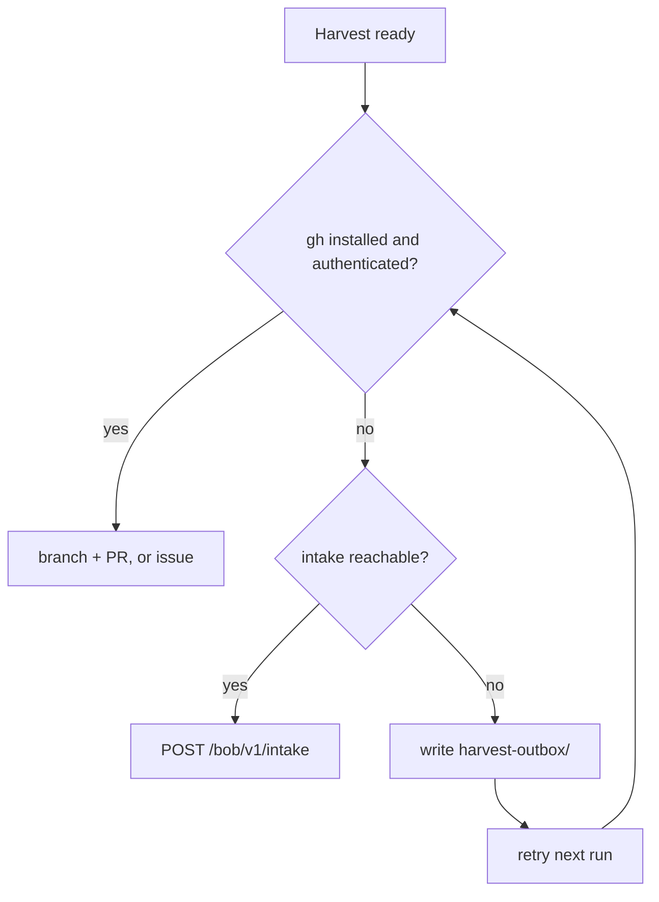

# Harvest (honesty box) --- bobiverse

> **CAST IRON RULE - HARVEST AND FILE EVERYTHING (read this first, every time).**
> 1. ALWAYS harvest skills you learn and file EVERY issue / FR / bug / gap you find to the intake webhook in the
>    SAME turn. Never leave a finding unfiled, never "note it for later", never skip it because it is small.
> 2. File with the intake webhook (no secret or login needed; `POST https://bob.ntsa.uk/bob/v1/intake`; offline it is
>    queued locally and retried):
>    Prefer `.\common\scripts\Report-BobiverseIntakeIssue.ps1` when present (FR #4297); else `.\scripts\Report-BobiverseIntakeIssue.ps1`.
>    `.\common\scripts\Report-BobiverseIntakeIssue.ps1 -Repo SimonBarnett/bobiverse -Kind issue -Title "short title" -Body "what / where / evidence / fix"`
>    (`-Kind issue|fr|skill|harvest`; always pass an explicit `-Repo owner/name`).
>    Worker status receipts (DONE/NACK/GIVEUP/SKIP/self-MRB/twin/duplicate/merged or FR/MRB/UAT `#N`) are not issue/FR findings: use `Invoke-BobiverseHarvest.ps1`/`kind: harvest`, and never file the `harvest:` receipt itself as a GitHub issue.
> 3. BEFORE finishing ANY debugging session run the harvest step:
>    Prefer tracked `.\common\scripts\Invoke-BobiverseHarvest.ps1` when present (FR #4297); else flat `.\scripts\Invoke-BobiverseHarvest.ps1`.
>    `.\common\scripts\Invoke-BobiverseHarvest.ps1 -Summary "what broke / what fixed it" -Lesson "one learned playbook line"`
>    then `.\common\scripts\Invoke-BobiverseHarvest.ps1 -Flush` to resend anything that was queued while offline.
> 4. Never put a token, password, SASL/NickServ secret, key or private hostname in a filing, a skill or a log.
> 5. **CAST IRON FR #9906 - Never set GIT_ASKPASS to echo GH_TOKEN / GITHUB_TOKEN / `gh auth token`.**
>     AskPass that echoes the token prints it into the terminal transcript (harvest-MRB fold class). Prefer
>     `GH_TOKEN` / `GITHUB_TOKEN` env alone, or `gh` credential helper / `gh auth setup-git`. Never Write-Output /
>     echo the token into AskPass. If a transcript leaked a `github_pat_` / `ghp_` value: redact, rotate that token,
>     and file intake - do not paste the secret into skills or PRs.
> 6. Prefer **deterministic** fixes (Python/PowerShell under `tools\monitor\`, `jeeves/checks/`, `common/scripts`, chair helpers).
>    When a fix is tested, file an FR that lands it in the **Jeeves token-less service** so the learning becomes chair
>    behaviour without an LLM. Skills are the interim playbook; the durable home is the deterministic product
>    (`jeeves.exe` / monitor checks / gitclaim). Same turn: skill harvest **and** product FR when the path is clear.
> 7. **FR #9180 — owe a skill PR for bobiverse books:** a new `-Lesson` / `-SkillFile` for `harvest`, `bobiverse-*`,
>    or `bobiverse-jeeves-*` must open or update a `lesson(<book>):` / `harvest/…` PR that patches the owning
>    `.grok/skills/<book>/SKILL.md` (same-turn via `Ensure-BobiverseHarvestSkillPr` when `gh` is authenticated).
>    Intake `kind: harvest|skill` receipt-only / twin-cite without that SKILL.md tip is fail-closed — builds, Sync,
>    and MSI only ship what is on `main`. Cite the covering PR URL when a twin already exists (FR #3824/#1812).
> 8. **CAST IRON — interventions → ircJeeves FR (#9627).** Every MONITORING / ops intervention (`!assign`, `!sweep`,
>    `!cleargiveup`, `!focus`, `!ignore`, `!pin`, `!recycle`, heal, …) must create or de-dup-comment a product FR against
>    ircJeeves (`SimonBarnett/bobiverse`) the same turn so the chair performs it deterministically. FR #8827 is bridge-only.
>    Closed-COMPLETED but still bridged live ⇒ regression FR with evidence.
> 9. **CAST IRON — idle + open FRs/PRs = FAIL (#9644).** Idle seats with dispatchable open FRs/PRs: intervene + FR the
>    chair path same turn. Ungated idle+work is never report-only.
> 10. **CAST IRON — multi-FR batch needs Digest parent (#9652).** Filing ≥2 related FRs in one turn/batch requires a
>    `Digest: …` parent with label `fr-digest` first; each parked child body starts with `Depends-on: #<digest>` (plain grammar).
>    Never leave a multi-FR batch free-floating. Digests stay useful when unheld; `hold` parks the whole batch. Same-turn
>    repair: if ≥2 related FRs already filed without a digest, file the digest immediately and add Depends-on on children.
>    Last open child close closes the digest (#9552). One issue per issue inside the digest.
>    **FR #9854 tip-priority (LIST ONLY):** tip-blocking FIX/MRB that must merge while the digest stays held are listed on
>    the digest under Tip-priority siblings and must **not** carry `Depends-on: #<digest>` until unhold (held-digest gate
>    #9821 would starve the tip). Never auto-wire Depends-on onto those filings.
>    read `$r.number` from the reporter object (or `ISSUE_NUMBER=` line); see fr-filing skill for Digest receipt procedure

**Script path (FR #4297):** dirty install worktrees can block Sync ff-only, so flat `scripts\Invoke-BobiverseHarvest.ps1` may lag tip after merges (class of FR #2581 updater tip overlay). Prefer `<ai root>\bob\common\scripts\` for harvest/intake; after a tip merge, Sync `-ComposeOnly` or a product service restart runs `Sync-BobiverseHarvestScriptsFromOrigin` so flat copies catch up without a clean ff.

**Harvest repo (a-search incident 2026-10-08):** always pass the job's repo: `Invoke-BobiverseHarvest.ps1 -Repo <owner/repo of the job> -Summary ... -Lesson ...` (job `FR SimonBarnett/a-search#N` -> `-Repo SimonBarnett/a-search`, which lands in a-search `.grok/skills/harvest-agent-skills/SKILL.md`). Never harvest a-search or other product lessons to SimonBarnett/bobiverse; only Bob fleet tooling lessons use `-Repo SimonBarnett/bobiverse`.

## Cost of use (CAST IRON)

Skill-intake consolidation: when a worker takes an FR from skill intake (label:skill / harvest), it must close all open issues for that skill book (every harvest/skill issue targeting the same book), open one consolidated PR for them, and cite every issue it closes (Closes #N for each); no per-issue PRs for the same skill book; the worker closes the issues itself as part of DONE.

One issue per issue: when MRB (or any worker) finds a twin/duplicate issue, close the later one and comment a reference to the first; never leave both open; done issues are closed too.

Using any skill from this book obliges you to report back here, in the same
turn you learn or fix something. Do not ask permission. Do not defer.

- Gap, bug or wish  issue (`FR:` for features). When the operator has no
  GitHub account, POST `kind: issue` | `fr` to `/bob/v1/intake`.
- New or fixed playbook  branch + PR (never `main`).
- Empty harvest only when nothing is new and nothing is broken.

**Home:** `https://github.com/SimonBarnett/bobiverse`. Frontmatter `github:`
MUST stay on this repo.

`harvest-agent-skills` remains as the bobiverse harvest index / where-to-put
lessons table; **this** `harvest` skill is the honesty-box report route
(including intake). Prefer this name for report/intake; keep both installed.

## What to harvest here

- bob / airc / jeeves MSI install, NSSM, secrets, tray/TipForm, digest webhook,
  chair/Jeeves webhooks (`bobcallback`), IRC SASL/NickServ, and post-install
  lessons for this fleet.
- Skill harvests land under `.grok/skills/bobiverse-bob|airc|jeeves`,
  `docs/post-install.md`, and `docs/skill-harvest-log.md`.

Do **not** harvest Day Works product, CE Priority DBA, or generic formprep
lessons here --- route those to their owning repos.

**FR #4970 (customer vs general Priority):** a lesson that is true only for one
customer or project goes in that customer's `SimonBarnett/*` repo tagged GitHub
topic `priority-customer` (look the topic up; do not hard-code the names). Test:
"would this be true for every Priority customer?" Yes -> `SimonBarnett/priority-mcp`
(GitHub alias of the former `SimonBarnett/agentic_fomprep` name; FR #7121).
No -> the customer repo. Example: Rees Machinery Priority instance / forms / data
-> `SimonBarnett/rees`, **not** `priority-mcp` harvest-agent-skills and **not**
bobiverse `harvest`. Generic Priority form-prep (true for any customer) still goes
to `SimonBarnett/priority-mcp`. Shared lookup: `common/scripts/priority_customer.py`
(same topic file as FR #4969).

## Report route (strict order)

Never require anyone to create a GitHub account just to report back.



*Caption: prefer `gh`; fall back to the Bob webhook intake; if offline, queue locally and retry.*

1. **`gh` available and authenticated**  branch + PR against
   `SimonBarnett/bobiverse` (skills) or an issue (`harvest:` / `FR:`). If the PR
   cannot be opened, file a `harvest:` issue with the intended PR title, branch,
   file list and body in this turn.
2. **No `gh`, or not authenticated**  POST to the Bob webhook intake
   `https://bob.ntsa.uk/bob/v1/intake`. No GitHub account needed; the
   service files it with label `via-intake`. Send an `idempotency_key` so
   retries never duplicate. Missing/empty `kind` defaults to `issue`.
3. **Offline / intake unreachable**  write the JSON payload to a local
   `harvest-outbox/` (or `report-outbox/` / `install-outbox/`) folder and retry
   it (same `idempotency_key`) on the next run. Helper:
   `scripts/Report-BobiverseIntakeIssue.ps1`.

### Open skill / harvest receipts  consolidate then PR (FR #1682 / FR #1684)

Intake `kind: skill|harvest` creates `label:skill` issues. The chair **offers** them as FR promote jobs (not product code FRs; they still do not block repo UAT). Do **not** GIVEUP. Without a promote PR the lessons never reach MRB merge.

When you have `gh` write (same turn or on a skill-promote assign):

1. Group open `label:skill` issues **by owner skill book** (see `harvest-agent-skills` table).
2. **Close duplicate** receipts for the same book/lesson.
3. Open **one** `harvest/` PR per book (or one multi-book PR with clear paths) that promotes unique Lesson lines; PR body uses `Closes ` / `Duplicates closed: `.
4. Leave merge to hostile **MRB**. Never push `main`.

Full steps: skill `harvest-agent-skills` section **Worker: consolidate open skill receipts  promote PR**.

### Intake must link an existing harvest PR (FR #1812 / harvest #2013)

When intake `kind: skill|harvest` (or a harvest summary) already names a GitHub **pull** URL in the title/body, the intake host must **`linked_existing_pr`** --- comment on / attach that PR --- and must **not** open a second fallback `label:skill` issue. Log `draft_pr_error` when draft-PR creation fails. `Invoke-BobiverseHarvest` / `issue_skip_fr_reason` should treat via-intake+skill "PR opened" receipts as `harvest_pr_summary` (skip re-offer as product FR). Product code: PR #2012.

Payload fields: `kind` (`issue` | `fr` | `skill` | `harvest`), **`repo`
(required `owner/name` --- never omit; no default)**, `title`, `body`, optional
`files[]` (`path` + `content`, small), `source` (machine, agent/tool, skill
book + version), optional `contact`, `idempotency_key`. **No auth required** ---
any skill user may POST. Optional fleet intake key `X-Bob-Intake-Key` /
`BOB_INTAKE_KEY` only when the host enables keyed mode; do not invent a secret
requirement. Never commit secrets.

curl:

```bash
curl -sS -X POST "https://bob.ntsa.uk/bob/v1/intake" \
  -H "Content-Type: application/json" \
  -d @harvest.json
```

PowerShell:

```powershell
.\scripts\Report-BobiverseIntakeIssue.ps1 -Repo SimonBarnett/bobiverse -Kind harvest -Title 'harvest: ...' -Body '...'
# close a session (summary + lessons, secret-scanned, queued offline):
.\scripts\Invoke-BobiverseHarvest.ps1 -Summary '...' -Lesson '...' [-SkillFile path]
.\scripts\Invoke-BobiverseHarvest.ps1 -Flush
# FR #2237: skip Invoke-BobiverseHarvest when the ONLY lesson is a twin/already-fixed
# DONE playbook (Duplicate of #N + DONE citing covering PR). Filing those creates nested
# skill twins that the chair re-offers as FR. Real new playbooks still harvest normally.
# FR #2970: also skip FAIL-supersede / wrong-book Harvest-lesson *process* playbooks
# FR #4207: also match 'already in (bobiverse-)?job-mrb' and bare 'FR #2970' with FAIL-supersede
# (class of tip #4206 after MRB #4204; pluralise process[- ]loops?).

# (belong in bobiverse-bob-job-mrb). Intake returns lesson_already_covered when harvest +
# job-mrb already carry that CAST IRON routing --- never open another lesson(harvest) twin.
# FR #2991: FAIL-supersede + thin already-covered / close-thin-twin restatements (no job-mrb
# process cue) also skip --- tip #2990 class after #2988.
# FR #4231: tip-loop meta / only-restate Thin FAIL-supersede already-on-main also skip for
# any -Book (including harvest-agent-skills; class of a-search#1839).
# FR #4308: also skip thinner tip + durable lesson already on main (a-search#1980/#2283;
# not contiguous "thin harvest tip"; no tip-loop meta / Thin FAIL order required).
# FR #4484: also skip FAIL-supersede next to "restates main" / "admit main already has"
# (class of a-search#3470; not already-on-main / second-copy / job-mrb wording).
# FR #3827: also catch "stay in"/"durable in bobiverse-bob-job-mrb", "thin harvest tip",
# "do not append a second copy under harvest" (tip #3826 after #3825 missed belong(s) in).
# FR #3004: default -Book harvest yields to keyword-inferred product books (bob-worker /
# fleet-ops / job-mrb); if the owning skill already has the lesson, intake returns
# lesson_already_covered --- never open lesson(harvest) twins like #3001-#3003 after #2997.
# MRB #2973: bare "FAIL-supersede" in a summary alone is not enough to re-route; a process
# cue is required so real product lessons still open under harvest.
# FR #3824: one harvest per seat+lesson --- client skips when an open harvest-lesson PR from
# this seat already carries the same lesson; idempotency_key prefers seat+normalized lesson
# (Summary drift / DONE retries must not mint a second tip). Intake claims state=filing early,
# settles filing/open_lesson_twin, and links open seat+lesson twins instead of opening #3823.
# or:
Invoke-RestMethod -Method Post -Uri 'https://bob.ntsa.uk/bob/v1/intake' `
  -ContentType 'application/json' -Body (Get-Content harvest.json -Raw)
```

Expect `202 {intake_id, url}` or `202 {intake_id, queued:true}`. Check status
with `GET /bob/v1/intake/<id>`.

`-Flush` (FR #139 / FR #3135) inspects `payload.repo` via `Test-IntakeRepoAllowed`
(mirrors `intake.repo_allowed`): any `SimonBarnett/<name>` matching the intake
repo regex is allowed; non-SimonBarnett owners stay denied unless listed in
`DEFAULT_ALLOW_REPOS` (optional extra / docs examples). Outside that rule, or
HTTP 403 `repo_not_allowed`, payloads are **DROPPED** into
`report-outbox/dropped/` (or the matching outbox `dropped/`) so Flush stays
clean. Transient errors stay KEPT for retry. New Plan products under
`SimonBarnett/*` need **no** per-repo allowlist edit --- after an allow-*rule*
change merges, **walrus** must Sync/compose ircJeeves so live intake picks it up (ionos deprecated)
(FR #3117 / #3122). Queue suppress/prioritise with `!ignore` / `!focus`.

Prefer `gh` and repo scripts over free-form reasoning.

## Report a bug or feature request

| `kind` | Meaning | Labels from intake |
|--------|---------|--------------------|
| `issue` | Bug / gap | `via-intake` (do **not** stamp `needs-mrb1` --- offer hallucination) |
| `fr` | Feature request | `via-intake`, `feature-request` (do **not** stamp `needs-mrb1`) |
| `skill` / `harvest` | Skill harvest files | `via-intake`, `skill` |

**CAST IRON (FR #1526 / harvest #1717):** never create, stamp, or apply GitHub label `needs-mrb1` / `mrb1`. That label was an offer hallucination. The real human gate is `needs-human`. Leftover repo labels are inert for offers (`gated_counts.needs-mrb1=0`, `row_awaits_mrb1` always false). Intake must omit `needs-mrb1`.

### Living product FR when intake vanishes into harvest-only (harvest #2001)

`Invoke-BobiverseHarvest` / intake `kind: skill|harvest` creates **receipts** (`label:skill`). They are not the product work item. If a real product plan/FR was meant to live on the board but only harvest receipts exist (or the product FR was closed/superseded into harvest noise):

1. Create a **canonical living FR** with `gh issue create -R owner/repo --label feature-request` (and `via-intake` only if still filing via intake `kind: fr`).
2. Treat **that** issue number as the living FR - append WP evidence / comments there.
3. Point harvest receipts at it with `Refs #N` / close as superseded operational report; do not implement the product plan on a `label:skill` harvest issue.

Example: jeeves.exe chair+HTTP one-process plan lives at #1993, not on harvest receipts.

Default `repo` for this book: `SimonBarnett/bobiverse`.

**FR #3189 (job-repo routing):** when the seat's offered job is a product repo (e.g. `SimonBarnett/a-search`),
`Invoke-BobiverseHarvest` uses `-JobRepo` / `$env:BOB_JOB_REPO` / `run\job-repo.txt` so the harvest lands in **that**
repo (a-search default book `harvest-agent-skills` at `.grok/skills/harvest-agent-skills/SKILL.md`). Do **not** park
a-search product tips under bobiverse `harvest/SKILL.md`. Bob tooling (bob-worker, fleet-ops, jeeves, tray) still
routes to bobiverse via the split rule.

## Do not

- Push harvest to `main`, or commit "nothing found".
- Put secrets, tokens, keys, or personal paths in skills; use placeholders.
- End a turn with a new/fixed skill only in chat or a local folder without a
  PR, issue, intake receipt or `harvest-outbox/` entry.
- Add a separate `/bob/v1/harvest` endpoint --- harvest is intake with the
  appropriate `kind`.

## Harvested lessons (intake)

The bullet archive is `lessons.md` beside this file (FR #8310). skill-dag refuses a skill body over 65536 bytes, so do not paste the archive back into this SKILL.md. New intake bullets still append under this heading until the file nears 60KiB, then move them into `lessons.md`.

Do not land a second copy of a harvest-lesson MRB playbook in this book. Those playbooks belong in `bobiverse-bob-job-mrb`.
- CAST IRON point 5 (Jeeves MONITORING): prefer deterministic fixes; when tested, FR them into the Jeeves token-less service (tools/monitor, jeeves/checks, common/scripts, chair helpers) so learnings become chair behaviour without an LLM. Skills are interim; durable home is the deterministic product. Same turn: skill harvest and product FR when the path is clear (PR #8851).
- CAST IRON idle + open FRs/PRs = FAIL (#9644): intervene same turn and FR/de-dup deterministic chair feed (#9628); ungated idle+work is never report-only.
- CAST IRON multi-FR batch needs Digest parent (#9652): file `fr-digest` Digest first; children `Depends-on: #<digest>`; last-child close closes digest (#9552).
- skill-dag index preference: over-cap seat copy yields to a later root at or under SKILL_RESOLVE_CAP_BYTES; an under-cap seat copy still wins (FR #7076 / #8323).
- Any per-seat click state must persist the launch model next to the kind and every restart path must read it; a saved model that cannot start must refuse and report, never fall through to the free default.
- When IRC _ssl_recv starts polling settimeout, run test_fr8120_ear_ssl_send_serialize.py and test_fr4980_ear_idle_keepalive.py with the new registration test before PASS.
- Orphan fix(mrb-N) tips with an explicit non-main base (merged fr-* tip) must be skipped by resync and retargeted or recreated; CLEAN checks do not mean the PR can land on main
- A tray digest-pools WriteAllText that fails with not enough space on the disk must skip crash intake and the hook-failure spool. Disk full is not a product defect.
- all-gave-up must ignore the seat that currently holds the row. ACK clears that seat from giveup_seats so a busy NACK or offer timeout is not an abandonment.
- A shipped-script import gate must import only names that end in .py. copy_by_path_scripts also copies PowerShell, and those names are not Python modules.
- When PRIORITY prepare-form is priority_not_installed, the reply must name the example allowlist copy and CredMan credentialTarget, and the doc must say Session 0 uses prepare-form rather than WINRUN.
- A 24h harvest-lesson dedup covers a new playbook only when that PR contains the lesson sentence or a phrase of at least 40 characters of it. A short shared token is not a cover.
- no_terminal_reply_does_not_block must read only that seat own offer_outcomes. A later no-terminal-reply must not lift another seat permanent give-up such as self-mrb. Legacy rows use the row giveup_reason only when that seat is the sole giveup_seats entry.
- An FR seat must run gh pr ready before DONE. A draft pull request is not reviewable and strands the MRB. FIX seats do not open a new pull request.
- A GitHub issue whose title starts with stall: is a detector receipt. issue_skip_fr_reason returns stall_receipt so it is never an offerable FR and never picks up needs_human. The stall detector itself stays.
- An open non-draft product PR with no MRB or FIX queue row is stranded. The token-free check uses an injected pull list, the same way as the stale-base check.
- When an intake FR asks to move HTTP webhooks off irc.ntsa.uk, check bob_public_base.DEFAULT_PUBLIC_BASE and closed FR 5272 before opening a second implement PR.
- When accepted jobs look unassigned, paint working_on from the accepted row on ACK and demote LOST_ACK_RESTART only when the seat still has no real working_on.
- A reset before airc.exe sends TLS bytes is a local block of that process. Classify it, print the allow rule, and do not disable Defender.
- A per-agent-kind submit-verify change must keep the Cursor/Grok GIVEUP wire bare (VISION S3); annotate probe=/kind= only for the headless kind.
- When an MRB worktree is linked to the install-root git or sits at the wrong SHA, recreate it from the clone store only if the seat pid is dead. A live seat keeps head-mismatch with want= and have=.
- When a later FR marks a give-up reason infra-soft, update the older test that expected giveup_count to increment. Do not put the reason back on the job-burn path.
- The tray engine hover step must query Win32_Process by Name=grok.exe and use a short digest GET. A full process list plus a 15s HTTP cap spends the 45s budget and files a deterministic timeout.
- A Python CLI that wraps a PowerShell Read-Host prompt must not use capture_output. That pipes stdin shut. Inherit stdin and pipe only stdout.
- Digest online does not imply WinRM: marchhare may show bob ear online with workers=[] while TCP 5985 from flamingo fails --- start seats locally/tray/airc; do not assume UpdateFleet CredMan reaches every shop host (FR #8429).
- Update-BobFleet Get-UpdateFleetPSCredential must [void] CredFree (and TrimEnd NUL on the unicode blob); an unvoided bool makes $cred an Object[] that cannot bind to [PSCredential] (FR #8531).
- Prefer tray run/startworker/req-*.json (unix-int ts/expires + optional agent) over WinRM Start-Process/CreateProcess for seats; detached WinRM launches die (console-closed / 0xC000013A) or stall without run dirs. ISO expires must still parse or write res-*.json reason=bad-expires (FR #8517).
- Skills-sync on the shared install must hold run/skills-sync.lock. If checkout hits index.lock, drop a stale lock and retry. A killed seat must not leave index.lock for the next start.
- airc.exe --connect-selftest must call probe_connection with a default socket connector. A required connector makes the install health step raise TypeError before any classification.
- A BOM-less PowerShell file must stay ASCII. An em dash (e2 80 94) fails the WinPS 5.1 parse gate. After that gate is clear, fix the next ParseFile error the same test reports.
- For SimonBarnett/bobiverse, infer_require_machine ignores a needs-walrus/needs-ionos title prefix. Pin with a needs-walrus label (legacy needs-ionos) or a body line require_machine: walrus (legacy require_machine: ionos until pin-retarget FR #8653).
- A line-anchored MRB FAIL @ sha is a seat verdict even when the sha is wrapped in ticks or quotes. A mid-line mention and a FAIL without an @ sha still hold.
- A same-process file lock that unlinks on holder==getpid busy-spins on Windows when the holder's handle blocks unlink; cross-process seats still need the dead-pid steal plus a sleep and a deadline.
- Write gh --body-file with a UTF-8 no-BOM writer and reject C0 bytes other than tab, LF, and CR; double-quoted PowerShell turns backslash-b, backslash-t, and backslash-a into real controls.
- While a seat is in out-of-fuel hold, digest worker_list must paint state=out_of_fuel and keep updated fresh; idle_quiet_offerable must skip that seat.
- After pointer refresh, confirm skill-dag MCP drop with Toolhelp PID liveness twice; never treat a flaky empty PowerShell cmdline sample as a transport drop
- An identity-only digest merge must not append model to cleared. Cursor CLI account reads only authInfo.email; a key override is a pid-bound marker with no key value.
- opencode_turn_stop_reason returns finished when the outbox already has DONE or NACK. The wrapper must not GIVEUP that case, and must not write stop-closed into opencode-out-of-fuel.log.
- An offer-timeout must not hand the same row straight back to that nick while another live idle seat exists. Record offer_last_timeout_seat and push the other seat first.
- A batch recycleseat must stop every named seat before starting replacements. A restore launch is net-zero and must not be refused by the agent cap.
- When digest-fuel-stall fires, abandon the hung _fuel_worker reference and start a new publish; reporting alone does not unfreeze heartbeats.
- After FR #8310, hostile harvest pins for archived tips must read lessons.md; SKILL.md only keeps the active placement rule and recent bullets.
- Never sync PowerShell.Stop() on the tray poll thread after WaitOne timeout; fire-and-forget Stop/Dispose so step-timeout logs and startworker ticks continue.
- Update-BobFleet Get-UpdateFleetPSCredential must [void] CredFree (and TrimEnd NUL); unvoided bool makes Object[] that cannot bind to [PSCredential] (FR #8531)
- When idle seats see offerable=0 (often needs_human-only), surface healthy_idle_empty_offerable / TipForm caption so ops do not recycle free DeepSeek seats as hung.
- On OpenCode Free usage limit for a free model, pause free and switch to opencodePaid when Go remains (no shop GIVEUP); accept cli-stderr Free usage pauses for free models so free reading is not stuck at 100.
- OpenCode flamingo: launch with BOB_WORKER_INJECT_PASTE=0 (keys); never PASTE=1 (stray v breaks submit-verify). Docs/log pin in #8560; worker force-keys is #8558/#8561.
- OpenCode Start-Process must not combine -NoNewWindow with RedirectStandardOutput/Error: that hangs after the build banner (empty stdout) and can leave no last-exit; redirects alone create no window
- OpenCode mid-job silent death: CreateProcess needs CREATE_BREAKAWAY_FROM_JOB with CREATE_NEW_CONSOLE; tray watchdog on seat-count drop writes synthetic last-exit external-kill + GIVEUP without restart (FR #3180).
- Stale linked-worktree index.lock blocks OpenCode git mid-job: fix = worker-side preflight (unlink job gitdir index.lock before inject) plus external_directory allow for the resolved gitdir; note external_directory allow is read-only, so agent-side Remove-Item of the lock may still need edit permission - preflight is the reliable path
- When InstallRoot is a drive root, Split-Path -Parent is empty: resolve BobInstallRoot via C:\ai\bob fallback or require -BobInstallRoot; pass -BobInstallRoot from Start Menu shortcut on MSI layout.
- Remote OpenCode stuck/quota is invisible to local digest seats_stuck_doing; probe /bob/v1/report with User-Agent for kind=opencode on flamingo (report-only, no clear_seat_doing).
- MRB health soft-pass overlays: always init overlay=None before findings branches; tip tests must cover the findings-empty happy path or UnboundLocalError ships.
- After a parents[N] class fix, rg the whole monitor package for leftover parents[N] siblings and extend the source pin list in the same FR family.
- OpenCode: recycle when digest doing age or true log/turn progress freezes beyond BOB_WORKER_OPENCODE_FROZEN_PROGRESS_S; week.limited alone must not set out_of_fuel (blocks FR #4180 recycle).
- !recycleseat --force overrides busy only when worker.updated is stale or accepted_silent/LOST_ACK is stamped; fresh busy still NACK (FR #8602).
- When monitor IndexError on UNC shallow parents[N] is already fixed on main (#8580), twin-close the later intake and point DONE at the covering PR; note live share still needs fleet update.
- After an ops hung-seat wipe leaves a machine running=0, !startworker (or tray Start Agents) is required; Ensure-BobWorkerSeats will not auto-heal (FR #3180). Monitor restore on flamingo used !startworker agent flamingo x2 (FR #8609 / ops on #8602).
- If a self-review-deadlock stall names this seat in idle and waiting tips are this seat's PRs: GIVEUP (FR #6203/#8264); author may fold CONFLICTING tips for the next MRB; never self-MRB PASS.
- When the ear writes a command to its own outbox, decide it in the drain. Do not wait for an IRC echo of the ear nick.
- When a commands doc states a numeric cap, pin the sentence to the code constant in a test. Substring checks like default 4 also match default 48.
- Explicit OpenCode with no start model: free known 0 + go unknown is not dual-pool exhausted; start as fuel-unknown and honour opencode_windows for Go.
- needs_human stays global except one post-cooldown auto-offer when giveup_reason is agent-cli-nonzero-exit and the nick is not in giveup_seats.
- Infra-soft give-up reasons must not black out auto-offer. Persist the raw needs_human bit separately from the offer gate so heal can still see a false stamp.
- A second !recycle that leaves the same OpenCode PID is an undeployed #8597, not a new FR, when stop_managed_workers is already on main.
- Offerable skill and harvest filings use _filer_create_pr draft false; empty and docs/intake-harvest-only payloads become a skill-source lesson; PASS/FAIL and session summaries stay receipt_recorded.
- Dispatched BOB-* FR with vision Depends-on still open: ACK then GIVEUP reason=blocked-on <depend-id>; leave OPEN; do not invent DONE URL
- BOB-51 S1: Invoke-BobPriorityModelsDryRun resolves agent=priority from GET /bob/v1/models (or fixture) and writes LOCALAPPDATA\Bobiverse\logs\priority-models-dry-run.log citing webhook=; fixture covers until BOB-01 lands.
- BOB-09 About Show logs: bottom button on AboutForm + PS fallback opens watch_bob_tray.log via notepad (same path as Open log)
- BOB-08 About rename: menu label Acknowledge->About on BobTray.cs and Watch-BobTray.ps1; keep Acknowledge() attention clear; pin mock home.html
- BOB-11 Status keep pool dialog: when Item(Status)/ShowStatus/StatusForm already on main, DONE with covering PR URL (#7521) and close the twin --- do not re-implement
- When intake changes Session-summary empty harvests to receipt_recorded, update GhCliFiler draft tests in the same window or build-jeeves stays red on main.
- BOB-49 S1: Stage-BobAgentFolders must fail closed without plan\AGENTS.md and write plan\BOB-49-PLAN-IN-MSI.txt so bob-ear MSI heat harvest includes Plan.
- Intake allowlist monitor: send an explicit User-Agent through Cloudflare; only JSON error=repo_not_allowed is allowlist drift, not bare HTTP 403 1010.
- When renaming a tray submenu label, update MenuItems.Add for --dump-menu in the same change; source pins can pass while the compiled dump-menu pin fails.
- Recycleseat queue TTL must outlast a lagged tray tick (300s). Read the last numeric value from Launch output; do not cast the last pipeline object when the tray logs on the success stream.
- BOB-57 S1 needs a verified plan.ntsa.uk MSI URL from VIS-08 before any downloads card; homepage or guessed /plan.msi is not acceptance.
- require_machine offer gate: peel cold-digest <machine>-<pid> nicks, gate why-empty on row_require_machine re-infer, and stamp require_machine from honor-path GIVEUP so the next !bored skips wrong shops.
- BOB-03 combos must not reuse models-catalog.json: BOB-01 Weights rows and BOB-02 PUT own that file; ship allow-list as models-valid-combos.json; validation is GET /bob/v1/models catalog + Weights form dropdowns (no POST /bob/v1/models/validate; FR #9053)
- !build UX: put BUILD_USAGE_LINES in builds_catalog (leaf), re-export from bobiverse_build; local-first catalog before HTTP; optional recipe= on BUILD v1 only for non-default yml paths.
- A DIRTY product FIX folds origin/main in the job worktree, keeps both sides of a docs conflict, pins the review finding in the existing test, and pushes the same PR head.
- Weights S1 is a modeless grid with columns Agent, CLI, Model, Context, Effort. Dump those headers with --dump-weights-columns before the tray UI starts.
- Seed models-valid-combos from a shipped seed on BobCallback start: create if missing, append missing models, never rewrite a malformed store.
- Workers > Cursor menu image is assets/menu-favicons/cursor.com.ico. Log worker-favicon with that path. Do not reuse the fuel badge.
- BOB-54 Priority menu icon: pin PRI-07 priority.ico at vendor/priority/ next to PriorityAgent.exe (same path as BOB-50 StartPriorityExe); MSI priority\ layout is BOB-55 scope
- A fresh Install-BobWebhooks.ps1 must write the same canonical web.config the second run would upsert, or site-kit CI fails with second install changed web.config bytes.
- When neither home has queue.json, idle_seats uses one live /bob/v1/report estimate. A local queue never fetches. Unverified gates stay named and are not applied.
- About Plan and Priority versions come from slice VERSION files or BOBIVERSE_PLAN_VERSION and BOBIVERSE_PRIORITY_VERSION, and fall back to the bob version so the fields are never blank.
- A skill pin that forbids CR must normalize the checkout to LF before the assertion. autocrlf makes a clean LF blob look like CRLF on windows-latest.
- Do not cap an MRB PASS verdict with a character window. Require the verdict after the board heading in the same comment.
- Engine steps that call Win32_Process must pass a timeout or skip the scan. An unbounded CIM query is what files engine step timeoutSec=45.
- When a PowerShell here-string is double-quoted, empty variables erase dollar names before commit. Write tray .ps1 with a single-quoted here-string or a file tool, then parse the file with the PowerShell language parser before push.
- A PS 5.1 module import error pointing at ForEach-Object in the psm1 is often a Private script whose param names were stripped; restore names from the call sites before treating the failure as unrelated CI noise.
- Zero live seats stay on the empty-online fill. Under-cap fill must return 0 when live is 0 so the two paths do not both fire.
- A Threading.Timer that WaitForExit longer than its period stacks powershell children. Single-flight the pid and cap the wait at 15s.
- MarchHare idle oscillates seat-to-seat; keep #8890 comments without new filings
- A grok worker_spawn connect blip is not a bob CLI bug. Skip that intake signature. Keep filing other exit 1 failures.
- After mrb_merge_gate exit 2, do not run gh pr merge --auto. A later exit 0 can still merge a phase-gated PR.
- Unsigned exit 0xffffffff with only pager info/debug or TUI chrome is an external kill. Keep cli-failure when stderr contains failed, fatal, exception, or an error level.
- When stall alerts are non-empty, call Get-BobStallFrIntake and log stall-fr with repo SimonBarnett/bobiverse.
- Agents Jeeves reads BOB_JEEVES_FUEL_FILE or run/jeeves-fuel.json and quits without starting when remaining_pct is 0 or less.
- FR #9114: MRB on-hold uses the live linked FR hold label. Stale PR HOLD comments after the FR is unlabeled are not on-hold (#8748).
- When skill-dag MCP initialize closes and only skill-dag-core is bundled, run skill_dag_mcp.py --once from the seat mcp.json. Do not read SKILL.md from another job worktree.
- FR assign with open Closes PR: DONE covering URL; do not open a twin tip (#9100/#9107)
- FIX on CLI-exit classifier DIRTY tip: keep _stderr_is_seat_prompt_echo with grok_worker_spawn_connect_failure and unsigned_exit_stderr_is_noise; silent ORs prompt-echo and noise
- MRB tip behind main: run mrb_merge_gate.py --merge from a current worktree when the assigned tip predates --merge support; do not fail the gate on tip-local usage error
- gh_auth_blocks: Failed to log in / re-authenticate wins over Active account true even on exit 0; never invent GH_TOKEN
- BOB-HOVER-XAI: Get-BobTrayHoverXaiPoolLabel maps SuperGrok to xAI never SG; hover remainPct uses digest xai_weekly remaining_pct including stale so it matches Format-BobTrayXaiWeeklyRow
- Do not kill MH bare opencode.exe fuel-stats children even when seat idle (#9016)
- When an MRB PR carries label hold, GIVEUP reason=on-hold and do not merge.
- Invoke-JeevesMonitorCheck: missing .py soft-skips exit 0 with skipped JSON so sparse/lagging installs do not EXIT:2 on ValidateSet-widened names; promote local J:\ hotfix via PR.
- BOB-D1 Depends-on parser is S1 park-only: dedicated-line match with [^\S\n] (not \s), first-seen dedupe, relative #N via optional repo kwarg; do not reuse FR #8754 gitclaim backlog-token helpers for (repo, number) tuples.
- BOB-37 S1: Agents>Jeeves dry-run prints cwd J: and StartWorker/Start-BobTrayWorkerExe use WorkingDirectory J:\ (drive mapped to ai\jeeves).
- FIX re-offer of a folded MERGEABLE/CLEAN PR: re-query mergeable once, DONE the same URL, do not merge and do not fold again
- FR #9053: retire POST /bob/v1/models/validate with early JSON 404 before POST_ROUTES gate; Weights validation is GET catalog dropdowns + PUT save only
- FR #9034: TipForm Exit must dispose tray UI only --- never sc stop ircBob; ear recycle is Restart-BobEar / Restart -SkipServiceRestart
- Never block out-of-fuel worker-remove on MessageBoxW. Session 0 hangs leave digest zombies.
- OpenCode gh_auth_missing on a named shop is require_machine ops: GIVEUP from other hosts; operator runs gh auth login there; do not invent GH_TOKEN or read hosts.yml.
- Empty-online fill: when grok weekly remaining is known 0 and an OpenCode free leaf resolves, write agent=opencode slot=free; unknown grok or free=0 keeps auto.
- FR #9025: fuel-exhausted recycle while process still running is expected fuel quit --- skip seat-stopped-making-progress intake; leave hang recycles filing
- A DIRTY tray-dialog FIX must keep both sides of the bob-tray.exe Srcs list (BobModelsClient.cs from main and PlanMcpConfig.cs from the PR) and compile before push.
- Steady OK cycle: no intake when seats busy, pools fresh, held_prs=0.
- FR #8811: wire row_fr_depends_blocked_reason beside every FR hold offer/purge/reconcile site (bob_d7_wire_hold); Depends-on OPEN skips offer but keeps the row
- Jeeves MSI before skill-dag left J:\scripts without skill_dag_mcp.py; tip allowlist needs InstallRoot .git --- pack Assert-BobiverseStageHasSkillDagMcp + Ensure-BobiverseSkillDagScripts + Write-BobiverseInstallSkillDagMcp on Install/Sync even when skipStaleCompose.
- Ghost TipForm clicks with Clear toolbars=0: Clear-BobOrphanNotifyIcons -HealLadder (session explorer recycle + re-sweep) and MenuClosed Visible rebind before relaunching Watch.
- TipForm park poll must never Wait-Job update-hover or Write-BobIrcStatus on STA: step-skip + trayHoverTimer snapshot + Update-Hover -FromSnapshot; trayDigestTimer posts for TipForm too.
- FR #9180: bobiverse book harvest with real Lessons owes a lesson(book) PR patching .grok/skills/<book>/SKILL.md same-turn when gh is authenticated; receipt-without-skill-PR is fail-closed; -SkillFile lands at skill_book_path not harvest/<name>
- Twin fix already merged: keep main's primitive as source of truth, wrap the branch API, and satisfy both pinned test files before push.
- trayDigestTimer Action runspace has no parent BobBridge: Import-Module src\BobBridge.psd1 when Get-ThisMachineId or Write-BobIrcStatus is missing; dotting Get-BobIrc alone is not enough (FR #9198).
- Drain must recreate empty outbox.txt after atomic move.
- WinPS 5.1: never assign $pid/$PID in tray helpers (read-only automatic); use $trayPid/$killPid; pin source forbids $pid = in Stop-BobTrayProcessesProtectingSeats (MRB #9206).
- Flamingo idle+offerable monitor intakes: re-check live /report offer_outcomes before coding; disk NACK cooldown looks like idle starve but is FR #6240 ops, twin of #9073/#9103 / PR #8871.
- FR docstring drift after route retire: rewrite bobcallback and models_catalog together; keep /bob/v1/models/validate substring for pin tests via handler comment or retired wording.
- FR #9217: ruleset required-ci-3948 requires pytest-ascii-bom with conflict-markers; job name must stay pytest-ascii-bom.
- FR #9220: Depends-on offer gate indexes open FRs by owner/repo#N; relative #N resolves against the FR repo (no cross-repo bare-number false skip).
- FR #9121: bobcallback /bob/v1/digest and /digest are 301 to /bob/v1/report; docstring must not claim same JSON body
- FR #9229: after hold/on-hold are issues-only (#9082), fr9080 requeue hold-skip tests must use do-not-merge/wip on PR snapshots (not hold).
- FR #9104: under local intake RateLimiter deny, bobcallback acks check_run/check_suite with 204 rate deferred (no retry storm); push/PR/issues stay 429; monitor github_rate_limit EXIT 1 under floor 500
- FR TipForm digest fail: prefer digest ear-offline when ircBob Stopped or digest online=false; keep digest unreachable for pure HTTP GetResponse timeouts; ship ircbob_ear monitor in ValidateSet.
- TipForm menu vanishes on AppFocusChange when bob-status/tip TOPMOST steals focus --- Cancel AppFocusChange on MenuClosing, gate Status while menu open, Opening Hide-BobTrayCard + close bob-status.
- FR #9209: OpenCode launch wrapper mirrors capture-file growth with Console.Out.Write+Flush live; end with opencode-capture-done marker, never dump full $outStr again
- ensure_mrb_requeued_after_head_move must take issue_lookup and call linked_issue_hold_reason; prefetch outside the queue lock (FR #9243).
- workers_last_good orphans: delete_worker/worker-remove must clear last-good + workers_stale; TTL BOB_DIGEST_LAST_GOOD_MAX_S; monitor workers_last_good_orphan.
- Never Path.read_bytes() the whole outbox in take_outbox_records --- seek to .pos offset and cap the read (OUTBOX_READ_MAX_BYTES) or the ear OOMs (FR #9239).
- After Install-BobWebhooks writes IIS rewrite to :7700, GET Backend/bob/v1/report (WARN; -RequireBackend to fail; -SkipBackendProbe in unit _run helpers) so a mid-deploy dead BobCallback is visible instead of a silent public 502.
- OpenCode: one park-worktree at a time per seat; NACK busy, holding <first> for a second job; accept_offered refuses twin when nick already accepted (FR #9254).
- TipForm HealEngine must compare tray-status.json age vs tray.alive freshness and refuse heartbeat mtime refresh while short/title is startup seed starting; bounded status-writer restart never touches seats; paint Bob: engine up at tray-up or Bob: status stalled after 180s
- SiteKit owned-rule HTML comments must sit immediately before <rule name=...>, never inside <conditions>/<rule>; Get-BobOwnedRuleXml drops inner comments and second Install fails byte-stable CI (fr8934 / CR on #9278).
- When FR #7618 self-probe exits under low RAM, log free_mb, defer exit with BOB_CALLBACK_LOW_MEM_* instead of crash-looping, and retry prior-clean scans (BOB_PRIOR_SCAN_ATTEMPTS) so the first NSSM restart survives transient CIM failure.
- OpenCode opencode-lost-ack-stale / opencode-frozen-progress recycles with exit_code None skip seat-stopped intake (class of #7978/#9025); MRB may repair PR body control-char nits without a fix PR.
- monkeypatch.setenv(BOB_DIGEST_HOME/BOB_HOME) before jeeves_main.main so undo clears the chair tmp home; bare delenv raising=False when absent registers no undo and leaks into later suite tests (FR #9291).
- fr-digest / umbrella epics: ACK then GIVEUP; never Closes a living digest; children implement (job-irc umbrella rule).
- When FR #9236 tip CONFLICTING with #9297 bobcallback intake skips: keep LOW_MEM_* constants and free_mb intake plus early pytest/UNIT_TEST_LISTENER_PORTS skips; do not drop either side.
- FR #9310: live_seat_nicks must skip machines with workers_stale (FR #8513 last-good restore into worker_list); otherwise auto-offer targets dead nicks after workers=[].
- SV harvest tips without a worktree: mirror catalog SKILL.md + meta.json from frontmatter; patch docs/skill-sources/_dag when dag.json is readable, else omit full rebuild.
- Composed J:\ Start/Invoke must prefer Bob tip Sync that contains sync-monitor-force over stale J:\scripts\Sync; else tools\monitor never force-copies (opencode_seats class of #9309)
- MRB BOB-D8: FAIL tip that says Depends-on not enforced after D1-D7 closed; one fix PR marks enforced + pin tests; FAIL-supersede original tip; Closes on fix
- BOB-D6 FR_BODY_FETCH_SHARED_CACHE: clear TTLCache in pytest fixtures or pass cache={} --- empty negative-cache hits make fetch_issue look never called.
- MRB CI-G2: PASS when build-jeeves pull_request runs open_children_gate.py --pr with issues/pull-requests read; stack may Closes CI-G1+#G2 together; soft-ok without Closes parents
- skill-dag resolve must not sum SKILL.md body sizes across depends_on when packing matched metadata; charge response metadata and skip only single bodies over max_bytes so MRB keeps job-irc (FR #9330 / PR #9334).
- Fresh MRB re-offer after FIX: clear Relay _finished_refs on ACK; treat already-finished NACK as terminal only when done[] verdict SHA matches current head.
- BOB-G3 digests must remain offerable and hold-purge exempt --- skip only in offer/assign via digest_issue_reason, or purge paths drop the gate row.
- empty-online.disabled seat-start guard must be fail-closed: allowlist only TipForm menu/workers-*/jeeves-menu and explicit startworker; default/other/unknown triggers refuse like auto-start
- On non-chair J:\, bypass Invoke-JeevesMonitorCheck Sync preflight (or bound it) and run python -u tools\monitor\<check>.py; clear freeze watch when target issue closed / nick absent from /report.
- MRB TipForm Exit under #9011 park: Exit-park 5m + TipForm-Exit-park; never Stop ircBob; Ensure-BobTrayRunning heals Stopped ear before watchdog-skip-suppress
- FR #9354: bob MSI PlanAgent comes from skills-visionary release download+sha256 into plan\ with PlanAgent.MANIFEST.json; -SkipPlanAgentExe only with -SkipMsi; then re-offer #8833
- Write-BobiverseVendoredExeManifest must not emit Path on the success stream; Stage-Product return Stage concatenates pipeline output and heat FR6969 fails when MANIFEST.json paths join Stage.
- When Sync moves to Start-Process ArgumentList, widen FR #9007 pin to accept '-Product','jeeves' as well as literal -Product jeeves
- Bob HTTP API defaults must use bob.ntsa.uk/bob; irc.ntsa.uk stays for IRC only --- tree scan test_irc_host_defaults_remain_irc fails on any https://irc.ntsa.uk/bob embed.
- walrus_jeeves_install_ready: run with PYTHONPATH pointing at jeeves/tools/monitor (PR worktree until that tip merges, else install); MONITORING outbox assigns must be PRIVMSG #channel :!assign ... (never bare !assign to the outbox file)
- When adding uat_release.repo_has_release_to_build gates, extend jeeves/tests conftest BOB_UAT_RELEASE_REPOS for synthetic o/* UAT fixtures in the same PR; denial tests must use real non-release names (wetherby).
- gh pr comment --body with multiline here-string can fail accepts-at-most-1-arg; use --body-file for MRB boards
- Monitor unit tests that expect EXIT_FINDING must monkeypatch non_chair_overlay to None; fresh live /bob/v1/report + missing queue.json soft-passes findings on CI/worker (FR #8579)
- PR_HOLD_TITLE_RE: bare mid-title on hold is product prose (Create fr-digest on hold); only leading On hold or on hold: counts
- FR #9411: BORED_GITHUB_CALL_BUDGET=0 must not skip CLOSED live check --- use unbudgeted depends_issue_open_checker for FR closed (same as Depends-on #8754); ops-monitor MONITORING/GateIssues body cues are skip_fr and purge from unaccepted
- After sticky-offer MRB lands, feed idle seats with ungated tray FRs (!assign); never assign hold-labeled #9403 or cast-iron UAT.
- When an open FR PR is hundreds of commits behind and misses the live click surface (compiled BobTray StartPriorityExe), supersede it with a fresh origin/main tip that gates the real Start path; mirror the nearest sibling gate (Plan BOB-46 fuel file) for Priority.
- Redqueen ear relay outbox is C:\ai\bob\home\outbox.txt (bob-ear --home); ~/.bobiverse/outbox.txt is not drained. Pace !assign ~3s; avoid self-MRB; title substring fr-digest must not skip MRB offers.
- Ghost offered_to on held/skip/ops-monitor trackers must drop the unaccepted pin (digests stay queued); !stuck classifies offered_on_held and aged idle/gone for release_ghost_offers (FR #9402).
- FR idle_seats+auto_feed off: monitor EXIT 1 is FR #8493 alert --- do not tip-enable auto-feed; GIVEUP monitor-snapshot when ops already !assign/!bored; enable auto-feed.json only as chair-host ops
- Jeeves butler menu icon: resolve install assets cache from https://bob.ntsa.uk/jeeves/assets/jeeves-butler.ico first (short HttpWebRequest), then jeeves/assets fallback; SkipFetch env for tests.
- After BOB-G1 issue_fetch on offer/!assign, also wire depends_issue_fetch_checker into stuck_job_sweep.classify_queue_row and stall_detectors; strip Depends-on (...) annotations so BOB-D5 does not mark depends-unresolved
- Queue refs must stay list[str] of #N: never persist extra["refs"]=",".join; normalize on write/read/load or tuple(str(x) for x in prior) char-splits and poisons ledger keys.
- After a tip strips BOM from one edited .cs file, check every other edited .cs in the same FR (BobAbout.cs still had BOM while BobTray.cs was clean); extend encoding assert to each edited file
- MRB author heal: prefer roster dead-pid stamp on older chairs; tip reserved ghost-N (N>=1) must stick through enrich via _reserved_heal_seat_nick; durable path remains soft free=/#9480
- marchhare online_zero_workers with tray.alive but no bob-ear: check stderr for ENOSPC then ircBob child; do not trust nssm Running alone; prefer redqueen !assign for flamingo-authored MRBs while marchhare down
- Clear Remove-BobiversePathForce: wrap cmd rmdir in try/catch (FR #9500); Access denied on PYTEST~1 must warn and continue, not abort StrictMode Stop
- Start-BobTray ForceNew prior sweep: timed Win32_Process EnumerationOptions + Get-Process bob-tray fallback; never bare Get-CimInstance (FR #9509). BOM-less ps1 must stay ASCII (FR #8765).
- !assign syntax is worker repo KIND num; flamingo-authored MRB needs redqueen/marchhare; marchhare !startworker agent marchhare NACKs engine.alive stale until interactive tray restart
- When reviewing PowerShell added by FR seats, assert dollar-signed param/vars in the new function body (count of $ >= N); string-contains of the function name alone misses stripped-$ parse breaks that cascade into tray queue tests.
- When many build-jeeves runs stay in_progress and PR checks stay queued 20m+, cancel older superseded in_progress runs to free runners so tip PR auto-merge can finish.
- Merge closing FR != host healed: after tray engine_stale fix merges, keep polling !startworker until workers>0 and file residual if NACK persists post-merge
- offer-timeout:idle-no-ack must clear seat-holds.json with the pin (aged live too); assign inject miss / second agent-not-ready assign must NACK so chair drops offered_to (FR #9403).
- When !startworker NACKs tray-not-logged-in / no_interactive_session, stuck must report tray_session_missing for that machine (not vague online_zero_workers / needs_human).
- ACC-moved orphan offer holds: clear on note_seat_hold exclusivity, accept_offered, and purge_orphan_seat_holds from seat_open_job/stuck sweep; keep ack-missing
- test_mrb2824 contiguous assert: do not add ## Harvested lessons (intake) H2 after ## Harvested monitor playbook; fold bullets into the playbook Harvested lessons section
- When folding #9588 onto #9586, keep AddOpencodeTopLevelChoices and retarget fr9263/fr9588 pins to WeightsLaunchField (drop OpencodeWebhookModel catalog asserts).
- Never stage bob-plan.exe alongside PlanAgent.exe; TipForm Plan uses plan\PlanAgent.exe (9271); Copy-BobTrayVendorExes mirrors vendor\plan\PlanAgent.exe only and deletes leftover bob-plan twins.
- all-gave-up stall fingerprint must be per-repo class key (like bored-latency machine key); intake msgfp keeps #N so it will not collapse twins --- fix stall_detectors.fingerprint key, not fuzzy intake.
- When build-jeeves is red on an MRB tip, repro the failing tests on origin/main before FAIL or fold; same failures on main are a separate FR, not a fold of the assigned PR (FR #4649).
- ConPTY twins: keep oldest #9612 as canonical, close Depends-on companions as Duplicate after merging acceptance; tray recycleseat stays its own FR
- Seat-end intake class keys omit nick so twin seats on one machine share one tip; nick/job/pid stay in the body (FR #9609).
- Any !assign/sweep/heal bridge must same-turn FR ircJeeves for deterministic chair behaviour; closed-COMPLETED but still bridged => regression FR
- After FR #7593 grok recycle, probe CreatePseudoConsole before relaunch and GIVEUP shell-hung when terminal/call-*.log stays empty after run_terminal_command (FR #9612).
- Each MONITORING bridge class gets its own ircJeeves FR same turn (#9627); de-dup offer_to_idle to #9628 and self-MRB to #9622
- Workers MaxWorkers=2 is Workers-submenu only; Agents Plan must StartPlanExe vendor\plan\PlanAgent.exe; Agents Jeeves must not CapRefusal via StartWorker agent
- New tools/monitor helper modules that are not -Check names must join FR #9049 SKIP (like ear_down_gate); pytest-ascii-bom fails on U+2014 in changed .ps1
- CAST IRON FR #9652: filing >=2 related FRs in one turn MUST create/reuse Digest parent (feature-request + fr-digest) with Depends-on on each child; digests stay useful when unheld; rule FR itself is not fr-digest
- After bobiverse body require_machine stop pinning, update every pin expect to needs-<machine> or assert empty; keep _body_for_queue preserve asserts separate from infer stamps
- TipForm Plan must start vendor\plan\PlanAgent.exe --root <install>\plan (or PLAN_AGENT_ROOT); bare vendor PlanAgent FATAL plan-agent tree not found; ops workaround --root C:\ai\bob\plan
- gitclaim must not hard-code LIVE_CHAIR_HOST=walrus --- resolve via BOB_CHAIR_MACHINE/JEEVES_CHAIR_HOST; needs-walrus/ionos fold onto configured host (FR #9680)
- Present empty local ops home is not authoritative: detect vs fresh /report (empty_local_queue/seat_state_mismatch), prefer live seats or EXIT 0 skipped=stale_local_home; JEEVES_MONITOR_DIGEST_HOME overrides BOB_DIGEST_HOME
- bob_git_hook announce_seen must match Ergo nick case-insensitively (:jeeves! and :Jeeves!); seed ~/.grok/ergo/connect.password from bob config\ergo.password before Start-BobiverseGitAnnounceListen
- When flamingo authors dominate the MRB queue, prefer no-flamingo-author MERGEABLE rows for flamingo seats (exact-nick self-MRB is tip #9574/#9579; host lag may still false-refuse — #9672). Sticky assign-sent + digest-idle is #9633.
- TrayContext cannot call WorkerLauncher.Quote - inline ProcessStartInfo Arguments path quoting for PlanAgent --root (CS0103 on build-bob-tray); companion fix #9684
- CAST IRON FR #9698: disk GIVEUP/NACK (worktree-create-failed:disk / disk-low) auto-files one open bobiverse issue per machine with require_machine: <machine> body + needs-<machine> label; twin-comment instead of a second file
- flamingo disk: Clear-BobiverseJobWorktrees needs git safe.directory for SYSTEM-owned C:\ai\bob; orphan C:\Users\simon\.grok\bob-bridge\worktrees not in git worktree list must be bulk-reclaimed; set BOB_JOB_WORKTREE_BASE=D:\ai\worktrees
- FIX on CONFLICTING tip: rebuild from fresh origin/main; if empty force-push closes or sticks PR head, reopen and verify ls-remote refs/pull/N/head matches branch
- CAST IRON FR #9669: needs-walrus / require_machine=walrus NACK->GIVEUP is a hand-off to the Jeeves agent on walrus (Slab/Si-yes); split mixed work into code FR (no pin) + walrus FR (needs-walrus, Depends-on code) under one Digest; stop wrong-machine re-offer thrash
- Seat hold on closed MRB survives !cleargiveup ledger=0; !stuck shows held; need chair clear of seat_job hold for closed tips (#9633)
- pool_for_digest sticky allowance exhausted wins over fresher observation ok/unlimited --- clear exhaust on observe ok or prefer fresher obs
- Weights Copilot catalog: add Copilot to VALID_CLI_KEYS/defaults; GET backfill only when legacy full seven-row set; PUT may omit only Copilot and merge stored row; keep REFRESH_CLIS without copilot
- CCA task POST accepts model=claude-haiku-4.5; chair build_task_body must grow BOB_COPILOT_MODEL to avoid Auto/Luna-only
- When updating Digest #9744 pack: comment+edit child bodies with live CCA evidence (model string claude-haiku-4.5, single-slot tick, sticky exhausted vs unlimited); keep TargetHaiku=2 via refill while chair FR-A/E land
- If outbox len barely grows after UTF-8 appends and pos stays 0, a twin bob-ear or tray rewriter is truncating outbox --- kill socketless :6697 peers before re-appending assigns.
- open_pr_mrb_missing default-heals missing expected MRB rows (incl lesson tips) via heal_open_prs_missing_mrb; --no-heal for report-only (FR #9635).
- !assign <nick> clears that nick+row giveup (queue giveup_seats + seat-ledger) instead of refusing already gave this row up; no separate !cleargiveup required (FR #9634).
- If outbox pos==len but no Bob-* jeeves replies for >60s, check duplicate bob-ear TCP: keep only PID with Established IRC; dead peer can steal pos.
- disk_starvation: never for-seat in giveup_seats when it may be a JSON string --- wrap via iter_giveup_seats or chars become WinRM hosts (FR #9728).
- !recycle must accept shop seat nick <machine>-<pid> (map to roster machine); keep machine/all/jeeves tokens
- FR #9743 Running-duplicate must not replace _ear_child_alive for heal; FakeAgent tests that bind Client._drain_outbox_path also need irc_live_for_outbox
- When report returns prefer tip FIX/MRB (#9866); prune NO_IRC+Resume; Restart only if EST=0
- CCA missing_conclusion must soft-release + forget job + last_infra_error and return infra_retry before quota exhaust; quote reviewed-sha when assign pins it
- Pack heat System.Collections.Hashtable <path>: find uncaptured helper that returns Hashtable (here Assert-BobiversePlanAgentNotBobWorker); $null= at call site and harden Assert-BobiverseHeatStagePath type checks
- Keep growing held Digest #9830 with every new Jeeves/IRCD lesson same turn; parked lessons wire Depends-on #9830. Tip-blocking FIX (class of #9840) is tip-priority LIST ONLY on the digest — no Depends-on while held (FR #9854); held-digest gate would starve the tip merge.
- Treat assign: refused busy holding FIX as evidence seat is not idle even if /report lags; keep bridging exact idle nicks from fresh report
- On /report 502 use IRC inbound; if redqueen workers=[] with offerable>0 escalate TipForm #9462 only --- never Start-BobWorker from monitor
- ircJeeves AppStdout without AppRotateFiles/Bytes/Online grows unbounded; pin rotate on Install and re-assert on Update for Product=jeeves
- After MRB FAIL+FIX tip push (FR #5142), re-review the new head SHA and PASS when the prior finding is fixed; do not FAIL again for the same ascii-bom finding.
- FR #8781 class: /health ok and last_digest_write do not prove AppStdout progress; expose progress_ok ages on /health and EXIT 1 via chair_progress when logs stale
- PR body: avoid GitHub closing keywords (close/closes/closed/fix/fixed/resolve) immediately before an unrelated #N; they add closingIssuesReferences.
- Probe report with curl -m hard timeout; IWR TimeoutSec can hang indefinitely on stuck /report
- CCA/Copilot dispatch must call the same Depends-on gate as !bored (depends_gate_reason / held_digest_cca_skip_reason); a MONITORING script deny-list is not durable.
- FIX tip CI: when build-jeeves fails test_digest_includes_copilot (tasks) or test_fr8775 winrm DAG, fold origin/main that already carries the #9928 tip-CI allowlist before re-pushing the assigned tip.
- Tip red blocks walrus install; blank JEEVES_MONITOR_NICKS must keep default monitoring; WinRM byte-copy of ~17MB exe hits 10MB deserialize limit --- use UNC Copy-Item for the exe
- gh REST 0 remaining: load C:\passwords\gitPAT.txt into GH_TOKEN without printing; wait for core reset then pr create; GraphQL may still have budget
- After tip allowlist clears, prefer open MERGEABLE non-draft (#9917/#9417/#9918); never offer CONFLICTING or draft as MRB --- FIX-first or skip; walrus truncate+pos=0 shop-wire for live !bored nicks
- Harvest-lesson tips that append the same SKILL.md trailing hunk: set merge=union in .gitattributes (git add -f under install exclude /*) and insert before - Harvest-lesson tips are documentation; they do not require CI --- light triage then gh pr merge --admin --squash (fold CONFLICTING same-SKILL appends onto tip first)
<!-- harvest-tip:intake-in_1ba0900f1c5f4298 -->
- OpenCode no-jobs twin of Cursor #10019: file product Clear-ACK (#10038) and gh_auth_missing (#10039) plus monitor fingerprints (#10040/#10041) as Depends-on digest children same turn --- do not leave (owe) rows.
<!-- harvest-tip:intake-in_657cab73ea2f41cb -->
- When chair GH 429s: compare New-BobGitWebhook subscribed events vs bobcallback.GIT_EVENTS allow-list before adding more polls; dropped workflow_run forces REST. File anti-omnibus FR-W0 accept-events first, then kill poll cadences.
<!-- harvest-tip:intake-in_789cef4c2f0a4929 -->
- When folding a CONFLICTING FIX tip, keep a single allowlist entry if both sides added the same field with different comments; push onto the existing PR branch and do not open a second pull request.
<!-- harvest-tip:intake-in_99a865ea9aed4c13 -->
- A WinRM Invoke-Command Start-Process is inside the WinRM job and dies when the session ends. A durable extra seat needs a detached start. BOB_WORKER_MAX above 2 is not a bypass and a silent death is not a logged cap refusal.
<!-- harvest-tip:intake-in_fbe27d53477c4614 -->
- When a FIX CI log is unavailable because gh is rate-limited, do not push a blind main fold. NACK after recording which step failed and which targeted pytest already passed.
<!-- harvest-tip:intake-in_dec9651161834c6f -->
- When a gate change reverses unheld-digest soft-allow, update test_fr9859 nested parallel and ordered sibling tests in the same PR or gitclaim CI fails after merge.
<!-- harvest-tip:intake-in_874090e130744661 -->
- A pin that forbids a path string must not put that path in comments inside the file under test.
<!-- harvest-tip:intake-in_4a0f9f2e66b64fdf -->
- An offer-gate helper that is not called from depends_gate_reason does not implement the FR. MRB FAIL that PR and put the wire-up in one fix PR.
<!-- harvest-tip:intake-in_498d3fffee264d85 -->
- Worker Grok, Cursor, and OpenCode MCP entries are the public catalog URL. Do not put skill_dag_mcp.py --root in the seat config, and do not git-overlay .grok/skills between jobs.
<!-- harvest-tip:intake-in_984804423c7c4843 -->
- After FR #9986, unlimited plus remaining=0 must not clear tasks_exhausted; only remaining greater than 0 does. Update the FR #9733 pin instead of folding main.
<!-- harvest-tip:intake-in_6aecf60597f74258 -->
- When FIX CI is already pushed on the reviewed SHA, re-run the named failing test and DONE that PR URL if it passes; do not add an empty commit.
<!-- harvest-tip:intake-in_1366c7119d3d4507 -->
- PowerShell 5.1 Start-Process -ArgumentList rejects an empty string. An OpenCode standing prompt has no job directory, so passing an empty --cwd throws before CreateProcess. The wrapper then records exit -1 and bytes=165, which is CRLF plus the ArgumentList parameter error, not a TUI handshake. Omit --cwd when there is no job directory.
<!-- harvest-tip:intake-in_98a3b38a40fa45e6 -->
- After OpenCode weights-row pin change, unpinned seats still need free-first resolve_opencode_model; pin path is BOB_SEAT_MODEL_PIN only.
<!-- harvest-tip:intake-in_01fd445291d84d82 -->
- Read require_machine in FR body before worktree: jeeves.exe WP4 cutover is ionos-only; ACK+GIVEUP from wrong shop.
<!-- harvest-tip:intake-in_8f2c478e5b574eb8 -->
- When live_report_gateway_down, intervene_assign must not emit blind !assign from stale queue---skip with inbound_transcript fallback until walrus heals report.
<!-- harvest-tip:intake-in_3079f4050b984b97 -->
- In workflow pwsh use -Targets "tray,about" for [string]$Targets; unquoted binds string[] (MRB #10060).
<!-- harvest-tip:intake-in_0322043393ec48dd -->
- Wire refuse cross-job GIVEUP/NACK in may_send_outbox; call drain_run_outbox_now after bored.turn_ended so DONE is not stranded after harvest !bored.
<!-- harvest-tip:intake-in_7ae0b2cce9cb4c07 -->
- When build-jeeves is red on every open PR, run the failing depends tests on origin/main before editing a product branch. FR #10059 blocks an unheld OPEN digest; update the older soft-allow asserts instead of reverting the gate.
<!-- harvest-tip:intake-in_ens_01c2dc63c1b8 -->
- When a linked worktree .git gitfile points at a missing admin dir, run job_worktree_gitlink.py --check first; --repair only with an explicit branch (the admin dir is rebuilt, the working tree is untouched).
<!-- harvest-tip:intake-in_ens_0415dab42afc -->
- summarize offerable vs live offer_focus_top: log live_skip; never fold to blocked_other without it; nak busy needs bored_gate_busy_reason when seat_open_job empty
<!-- harvest-tip:intake-in_e55e3ba66cf7471e -->
- bob-tray engine update-hover-engine: LocalOnly hover inside 45s step; full grok/peer belongs off hot path
<!-- harvest-tip:intake-in_92d9faddbf0147df -->
- jeeves source tests: assert OpenCode launcher strings from repo_layout REPO path, not bob.scripts import __file__.
<!-- harvest-tip:intake-in_ens_c79c4e6746d2 -->
- When file_submission gains a new filing branch, update fr1812 state assertions in the same change.
<!-- harvest-lessons-eof -->
 with unique tip_anchor (FR #9915)
- When fr-digest gains hold via labeled webhook, clear_offers_for_held_digest_children immediately (unaccepted sticky + accepted soft-release) and queue a stand_down notice for #bobiverse.
- Digest batch filing: capture $r = Report-BobiverseIntakeIssue; use $r.number (or ISSUE_NUMBER= host line), never $Matches on prose URLs (FR #9837).
- When a dispatch/focus filter drops rows from ordered_unaccepted, also skip those rows inside mrb_yields_to_older_fr (and similar raw-unaccepted walks) or tip MRBs stay empty behind lock-blocked tray FRs.
- When merging monitor Invoke-JeevesMonitorCheck.ps1 ValidateSet conflicts, union token lists so tip checks (shop_wire_assign) and main checks (digest_ci_gate, 9830_harvest, lessons_digest_harvest) all remain.
- Harvest-lesson tips are documentation; they do not require CI --- light triage then gh pr merge --admin --squash (fold CONFLICTING same-SKILL appends onto tip first)
<!-- harvest-lessons-eof -->

- Two PowerShell statements pasted as one line bind the second token to the first cmdlet. A Cursor seat on this machine's login is two statements: Remove-Item Env:CURSOR_API_KEY, then bob-worker.exe --mode agent --agent cursor. Do not set CURSOR_API_KEY when the seat must spend the machine login.
- WINDBI cannot start PowerShell. ACTIVATE only accepts {P|r|d|c|L} plus an entity name. xp_cmdshell CreateProcess error 5 and SQL Agent "process could not be created" for NT SERVICE\SQLAgent$instance are the service account. CREATE CREDENTIAL is server-level; msdb has no dbo.sp_add_credential. Grant the proxy to CmdExec subsystem 3 before the job step.
- Unhold of an fr-digest does not offer the digest row (skip:label:fr-digest). A child that still Depends-on another OPEN issue stays depends_held. Offer order is MRB, then UAT, then FIX, then FR, lowest number first.
- The same issue number in two repos is not a twin. Close only the repo the operator named.
- When a lesson tip is CONFLICTING, merge origin/main on the intake branch, keep both harvest bullets, take main for product tests the tip was only pinning, push, then gh pr merge --admin --squash. Retry once if GraphQL says the base moved.
- Digest completeness gate: harvest digest bullets starting - ** must end with ) or lessons:/held; append (FR #N) when a CAST IRON bullet would otherwise fail test_mrb2718_digest_bullets_complete_lines
- OpenCode launch-opencode.ps1 pins seat cwd via opencode run --dir and ConPTY --cwd, not Start-Process -WorkingDirectory; stale WorkingDirectory asserts FAIL on main
- FR #8865 tip overlay: worker_prompt tests must use tmp_path; ignore install tips that still say MCP resolve then get_skill (public MCP has list_catalog/get_skill only).
