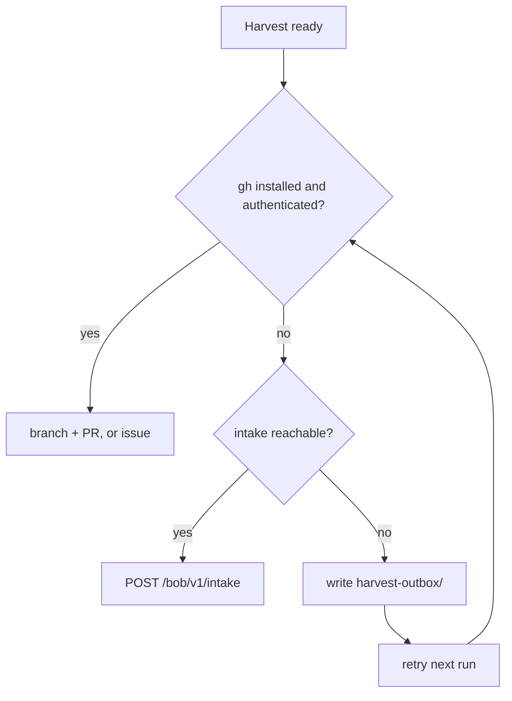

# Harvest (honesty box) --- bobiverse

> **CAST IRON RULE - HARVEST AND FILE EVERYTHING (read this first, every time).**
> 1. ALWAYS harvest skills you learn and file EVERY issue / FR / bug / gap you find to the intake webhook in the
>    SAME turn. Never leave a finding unfiled, never "note it for later", never skip it because it is small.
> 2. File with the intake webhook (no secret or login needed; `POST https://bob.ntsa.uk/bob/v1/intake`; offline it is
>    queued locally and retried):
>    Prefer `.\common\scripts\Report-BobiverseIntakeIssue.ps1` when present (FR #4297); else `.\scripts\Report-BobiverseIntakeIssue.ps1`.
>    `.\common\scripts\Report-BobiverseIntakeIssue.ps1 -Repo SimonBarnett/bobiverse -Kind issue -Title "short title" -Body "what / where / evidence / fix"`
>    (`-Kind issue|fr|skill|harvest`; always pass an explicit `-Repo owner/name`).
>    Worker status receipts (DONE/NACK/GIVEUP/SKIP/self-MRB/twin/duplicate/merged or FR/MRB/UAT `#N`) are not issue/FR findings: use `Invoke-BobiverseHarvest.ps1`/`kind: harvest`, and never file the `harvest:` receipt itself as a GitHub issue.
> 3. BEFORE finishing ANY debugging session run the harvest step:
>    Prefer tracked `.\common\scripts\Invoke-BobiverseHarvest.ps1` when present (FR #4297); else flat `.\scripts\Invoke-BobiverseHarvest.ps1`.
>    `.\common\scripts\Invoke-BobiverseHarvest.ps1 -Summary "what broke / what fixed it" -Lesson "one learned playbook line"`
>    then `.\common\scripts\Invoke-BobiverseHarvest.ps1 -Flush` to resend anything that was queued while offline.
> 4. Never put a token, password, SASL/NickServ secret, key or private hostname in a filing, a skill or a log.

**Script path (FR #4297):** dirty install worktrees can block Sync ff-only, so flat `scripts\Invoke-BobiverseHarvest.ps1` may lag tip after merges (class of FR #2581 updater tip overlay). Prefer `<ai root>\bob\common\scripts\` for harvest/intake; after a tip merge, Sync `-ComposeOnly` or a product service restart runs `Sync-BobiverseHarvestScriptsFromOrigin` so flat copies catch up without a clean ff.

**Harvest repo (a-search incident 2026-10-08):** always pass the job's repo: `Invoke-BobiverseHarvest.ps1 -Repo <owner/repo of the job> -Summary ... -Lesson ...` (job `FR SimonBarnett/a-search#N` -> `-Repo SimonBarnett/a-search`, which lands in a-search `.grok/skills/harvest-agent-skills/SKILL.md`). Never harvest a-search or other product lessons to SimonBarnett/bobiverse; only Bob fleet tooling lessons use `-Repo SimonBarnett/bobiverse`.

## Cost of use (CAST IRON)

Skill-intake consolidation: when a worker takes an FR from skill intake (label:skill / harvest), it must close all open issues for that skill book (every harvest/skill issue targeting the same book), open one consolidated PR for them, and cite every issue it closes (Closes #N for each); no per-issue PRs for the same skill book; the worker closes the issues itself as part of DONE.

One issue per issue: when MRB (or any worker) finds a twin/duplicate issue, close the later one and comment a reference to the first; never leave both open; done issues are closed too.

Using any skill from this book obliges you to report back here, in the same
turn you learn or fix something. Do not ask permission. Do not defer.

- Gap, bug or wish → issue (`FR:` for features). When the operator has no
  GitHub account, POST `kind: issue` | `fr` to `/bob/v1/intake`.
- New or fixed playbook → branch + PR (never `main`).
- Empty harvest only when nothing is new and nothing is broken.

**Home:** `https://github.com/SimonBarnett/bobiverse`. Frontmatter `github:`
MUST stay on this repo.

`harvest-agent-skills` remains as the bobiverse harvest index / where-to-put
lessons table; **this** `harvest` skill is the honesty-box report route
(including intake). Prefer this name for report/intake; keep both installed.

## What to harvest here

- bob / airc / jeeves MSI install, NSSM, secrets, tray/TipForm, digest webhook,
  chair/Jeeves webhooks (`bobcallback`), IRC SASL/NickServ, and post-install
  lessons for this fleet.
- Skill harvests land under `.grok/skills/bobiverse-bob|airc|jeeves`,
  `docs/post-install.md`, and `docs/skill-harvest-log.md`.

Do **not** harvest Day Works product, CE Priority DBA, or generic formprep
lessons here --- route those to their owning repos.

**FR #4970 (customer vs general Priority):** a lesson that is true only for one
customer or project goes in that customer's `SimonBarnett/*` repo tagged GitHub
topic `priority-customer` (look the topic up; do not hard-code the names). Test:
"would this be true for every Priority customer?" Yes -> `SimonBarnett/agentic_fomprep`.
No -> the customer repo. Example: Rees Machinery Priority instance / forms / data
-> `SimonBarnett/rees`, **not** `agentic_fomprep` harvest-agent-skills and **not**
bobiverse `harvest`. Generic Priority form-prep (true for any customer) still goes
to `SimonBarnett/agentic_fomprep`. Shared lookup: `common/scripts/priority_customer.py`
(same topic file as FR #4969).

## Report route (strict order)

Never require anyone to create a GitHub account just to report back.



*Caption: prefer `gh`; fall back to the Bob webhook intake; if offline, queue locally and retry.*

1. **`gh` available and authenticated** → branch + PR against
   `SimonBarnett/bobiverse` (skills) or an issue (`harvest:` / `FR:`). If the PR
   cannot be opened, file a `harvest:` issue with the intended PR title, branch,
   file list and body in this turn.
2. **No `gh`, or not authenticated** → POST to the Bob webhook intake
   `https://bob.ntsa.uk/bob/v1/intake`. No GitHub account needed; the
   service files it with label `via-intake`. Send an `idempotency_key` so
   retries never duplicate. Missing/empty `kind` defaults to `issue`.
3. **Offline / intake unreachable** → write the JSON payload to a local
   `harvest-outbox/` (or `report-outbox/` / `install-outbox/`) folder and retry
   it (same `idempotency_key`) on the next run. Helper:
   `scripts/Report-BobiverseIntakeIssue.ps1`.

### Open skill / harvest receipts → consolidate then PR (FR #1682 / FR #1684)

Intake `kind: skill|harvest` creates `label:skill` issues. The chair **offers** them as FR promote jobs (not product code FRs; they still do not block repo UAT). Do **not** GIVEUP. Without a promote PR the lessons never reach MRB merge.

When you have `gh` write (same turn or on a skill-promote assign):

1. Group open `label:skill` issues **by owner skill book** (see `harvest-agent-skills` table).
2. **Close duplicate** receipts for the same book/lesson.
3. Open **one** `harvest/…` PR per book (or one multi-book PR with clear paths) that promotes unique Lesson lines; PR body uses `Closes …` / `Duplicates closed: …`.
4. Leave merge to hostile **MRB**. Never push `main`.

Full steps: skill `harvest-agent-skills` section **Worker: consolidate open skill receipts → promote PR**.

### Intake must link an existing harvest PR (FR #1812 / harvest #2013)

When intake `kind: skill|harvest` (or a harvest summary) already names a GitHub **pull** URL in the title/body, the intake host must **`linked_existing_pr`** --- comment on / attach that PR --- and must **not** open a second fallback `label:skill` issue. Log `draft_pr_error` when draft-PR creation fails. `Invoke-BobiverseHarvest` / `issue_skip_fr_reason` should treat via-intake+skill "PR opened" receipts as `harvest_pr_summary` (skip re-offer as product FR). Product code: PR #2012.

Payload fields: `kind` (`issue` | `fr` | `skill` | `harvest`), **`repo`
(required `owner/name` --- never omit; no default)**, `title`, `body`, optional
`files[]` (`path` + `content`, small), `source` (machine, agent/tool, skill
book + version), optional `contact`, `idempotency_key`. **No auth required** ---
any skill user may POST. Optional fleet intake key `X-Bob-Intake-Key` /
`BOB_INTAKE_KEY` only when the host enables keyed mode; do not invent a secret
requirement. Never commit secrets.

curl:

```bash
curl -sS -X POST "https://bob.ntsa.uk/bob/v1/intake" \
  -H "Content-Type: application/json" \
  -d @harvest.json
```

PowerShell:

```powershell
.\scripts\Report-BobiverseIntakeIssue.ps1 -Repo SimonBarnett/bobiverse -Kind harvest -Title 'harvest: ...' -Body '...'
# close a session (summary + lessons, secret-scanned, queued offline):
.\scripts\Invoke-BobiverseHarvest.ps1 -Summary '...' -Lesson '...' [-SkillFile path]
.\scripts\Invoke-BobiverseHarvest.ps1 -Flush
# FR #2237: skip Invoke-BobiverseHarvest when the ONLY lesson is a twin/already-fixed
# DONE playbook (Duplicate of #N + DONE citing covering PR). Filing those creates nested
# skill twins that the chair re-offers as FR. Real new playbooks still harvest normally.
# FR #2970: also skip FAIL-supersede / wrong-book Harvest-lesson *process* playbooks
# FR #4207: also match 'already in (bobiverse-)?job-mrb' and bare 'FR #2970' with FAIL-supersede
# (class of tip #4206 after MRB #4204; pluralise process[- ]loops?).

# (belong in bobiverse-bob-job-mrb). Intake returns lesson_already_covered when harvest +
# job-mrb already carry that CAST IRON routing --- never open another lesson(harvest) twin.
# FR #2991: FAIL-supersede + thin already-covered / close-thin-twin restatements (no job-mrb
# process cue) also skip --- tip #2990 class after #2988.
# FR #4231: tip-loop meta / only-restate Thin FAIL-supersede already-on-main also skip for
# any -Book (including harvest-agent-skills; class of a-search#1839).
# FR #4308: also skip thinner tip + durable lesson already on main (a-search#1980/#2283;
# not contiguous "thin harvest tip"; no tip-loop meta / Thin FAIL order required).
# FR #4484: also skip FAIL-supersede next to "restates main" / "admit main already has"
# (class of a-search#3470; not already-on-main / second-copy / job-mrb wording).
# FR #3827: also catch "stay in"/"durable in bobiverse-bob-job-mrb", "thin harvest tip",
# "do not append a second copy under harvest" (tip #3826 after #3825 missed belong(s) in).
# FR #3004: default -Book harvest yields to keyword-inferred product books (bob-worker /
# fleet-ops / job-mrb); if the owning skill already has the lesson, intake returns
# lesson_already_covered --- never open lesson(harvest) twins like #3001-#3003 after #2997.
# MRB #2973: bare "FAIL-supersede" in a summary alone is not enough to re-route; a process
# cue is required so real product lessons still open under harvest.
# FR #3824: one harvest per seat+lesson --- client skips when an open harvest-lesson PR from
# this seat already carries the same lesson; idempotency_key prefers seat+normalized lesson
# (Summary drift / DONE retries must not mint a second tip). Intake claims state=filing early,
# settles filing/open_lesson_twin, and links open seat+lesson twins instead of opening #3823.
# or:
Invoke-RestMethod -Method Post -Uri 'https://bob.ntsa.uk/bob/v1/intake' `
  -ContentType 'application/json' -Body (Get-Content harvest.json -Raw)
```

Expect `202 {intake_id, url}` or `202 {intake_id, queued:true}`. Check status
with `GET /bob/v1/intake/<id>`.

`-Flush` (FR #139 / FR #3135) inspects `payload.repo` via `Test-IntakeRepoAllowed`
(mirrors `intake.repo_allowed`): any `SimonBarnett/<name>` matching the intake
repo regex is allowed; non-SimonBarnett owners stay denied unless listed in
`DEFAULT_ALLOW_REPOS` (optional extra / docs examples). Outside that rule, or
HTTP 403 `repo_not_allowed`, payloads are **DROPPED** into
`report-outbox/dropped/` (or the matching outbox `dropped/`) so Flush stays
clean. Transient errors stay KEPT for retry. New Plan products under
`SimonBarnett/*` need **no** per-repo allowlist edit --- after an allow-*rule*
change merges, **ionos** must Sync/compose ircJeeves so live intake picks it up
(FR #3117 / #3122). Queue suppress/prioritise with `!ignore` / `!focus`.

Prefer `gh` and repo scripts over free-form reasoning.

## Report a bug or feature request

| `kind` | Meaning | Labels from intake |
|--------|---------|--------------------|
| `issue` | Bug / gap | `via-intake` (do **not** stamp `needs-mrb1` --- offer hallucination) |
| `fr` | Feature request | `via-intake`, `feature-request` (do **not** stamp `needs-mrb1`) |
| `skill` / `harvest` | Skill harvest files | `via-intake`, `skill` |

**CAST IRON (FR #1526 / harvest #1717):** never create, stamp, or apply GitHub label `needs-mrb1` / `mrb1`. That label was an offer hallucination. The real human gate is `needs-human`. Leftover repo labels are inert for offers (`gated_counts.needs-mrb1=0`, `row_awaits_mrb1` always false). Intake must omit `needs-mrb1`.

### Living product FR when intake vanishes into harvest-only (harvest #2001)

`Invoke-BobiverseHarvest` / intake `kind: skill|harvest` creates **receipts** (`label:skill`). They are not the product work item. If a real product plan/FR was meant to live on the board but only harvest receipts exist (or the product FR was closed/superseded into harvest noise):

1. Create a **canonical living FR** with `gh issue create -R owner/repo --label feature-request` (and `via-intake` only if still filing via intake `kind: fr`).
2. Treat **that** issue number as the living FR - append WP evidence / comments there.
3. Point harvest receipts at it with `Refs #N` / close as superseded operational report; do not implement the product plan on a `label:skill` harvest issue.

Example: jeeves.exe chair+HTTP one-process plan lives at #1993, not on harvest receipts.

Default `repo` for this book: `SimonBarnett/bobiverse`.

**FR #3189 (job-repo routing):** when the seat's offered job is a product repo (e.g. `SimonBarnett/a-search`),
`Invoke-BobiverseHarvest` uses `-JobRepo` / `$env:BOB_JOB_REPO` / `run\job-repo.txt` so the harvest lands in **that**
repo (a-search default book `harvest-agent-skills` at `.grok/skills/harvest-agent-skills/SKILL.md`). Do **not** park
a-search product tips under bobiverse `harvest/SKILL.md`. Bob tooling (bob-worker, fleet-ops, jeeves, tray) still
routes to bobiverse via the split rule.

## Do not

- Push harvest to `main`, or commit "nothing found".
- Put secrets, tokens, keys, or personal paths in skills; use placeholders.
- End a turn with a new/fixed skill only in chat or a local folder without a
  PR, issue, intake receipt or `harvest-outbox/` entry.
- Add a separate `/bob/v1/harvest` endpoint --- harvest is intake with the
  appropriate `kind`.

## Harvested lessons (intake)
- FR #4780: MRB/review of a harvest-lesson (or skills-only) tip must not open another lesson tip (honesty-box is the review); skip reviewing/harvesting/closing-lessons meta; 24h dedup open+closed harvest-lesson PRs (Test-HarvestLessonReviewLoop / Test-HarvestRecentLessonDedup).
- FR #4953: before filing, twin-check open and recently closed harvest-lesson PRs in the target repo by title stem and distinctive lesson tokens (any seat). Match -> skip lesson_already_covered / open_lesson_twin and cite the existing PR. Do not collapse HTTP vendor-secrets /selftest into the MSSQL connect gate. FR #4357 / #4917 skips still apply to a-search harvest-agent-skills.
- FR #4297: dirty install ff-block leaves flat Invoke-BobiverseHarvest.ps1 lagging tip; Sync tip-overlays harvest+intake via Sync-BobiverseHarvestScriptsFromOrigin (class of FR #2581); prefer common\scripts when present; ComposeOnly/service restart refreshes flat copies.
- FR #4357: PASS of a harvest-lesson / docs/mrb MRB (re-offer + merge origin/main / re-arm / DONE PASS process cues) skips filing another tip (SKIPPED harvest lesson-MRB PASS loop) --- stops a-search tip flood after light-triage PASS.
- FR #4288: -ExistingPrUrl (or a pull URL in Summary/Lesson) fail-closes tip filing (SKIPPED; linked to that PR). Product -Repo -> harvest-agent-skills without ExistingPrUrl stays intentional (FR #3189); do not redirect product playbooks to bobiverse harvest.
- Owner-missing harvest holds titled `harvest: hold for …` are SKIP_FR even with empty labels (FR #3658 / #3317 carve-out from #1682); `gh_filer.ensure_labels` creates `owner-missing` before issue create so unlabeled retry cannot re-offer the hold.

- When Clear-BobiverseJobWorktrees removes 0 under low disk: file intake or GIVEUP / use a roomy drive - never hand-delete wt-bob-main/wt-airc/operator trees; write .bobiverse-seat so -Force skips live owners
- GET /bob/v1/report must never call GitHub pr_exists while holding gitclaim queue lock; snapshot under lock, check outside, re-lock with cached verdicts + single-flight + short lock_timeout
- Harvest-lesson MRB playbooks (fold duplicates into behind-main #1647; never leave a fake extra numbered review step) belong in `bobiverse-bob-job-mrb`. If intake files them under `harvest`, MRB moves/folds them there - do not land a second copy in this book (MRB #2740 / #2749).
- When a whole-file SKILL.md overwrite drops rules, restore from git show reverse of the wipe commit; widen Measure-BobTrayWorkerSeats pin windows when comments grow; drop nested skill-dba\.grok from Sync-BobiverseAgentFolders staging.
- On Windows Node 22, npm test should use node --test "tests/**/*.test.js"; a bare tests directory arg can fail MODULE_NOT_FOUND
- GitGuardian Generic Password on test placeholders: use secret-placeholder-* and squash/force-push the PR tip so the old FAKE_* string is gone from PR history; bobiverse docs/mrb pins go under jeeves/tests because docs/ is gitignored
- FR #3824 / #4953: one harvest per lesson --- skip/link when an open harvest-lesson PR (any seat) already covers the lesson text or title stem; idempotency_key prefers seat+normalized lesson so DONE retries do not open twin tips (#3822/#3823). **FR #5569:** twin match is harvest-lesson / ``lesson(`` tips only; a just-opened product FR PR must not become ``url=`` on HARVESTED.
- FR #3827: FAIL-supersede skip also matches stay/durable in bobiverse-bob-job-mrb, thin harvest tip/restatement, and do-not-append second copy under harvest (tip #3826 class)
- FR #4308: FAIL-supersede skip also matches thinner tip + durable lesson already on main (a-search#1980/#2283 tip-loop class; not contiguous thin harvest tip)
- FR #4484: FAIL-supersede skip also matches restates main and admit main already has (a-search#3470 class; those phrases are not already-on-main / second-copy / job-mrb)
- FR #3959 / #3957: FAIL-supersede skip also matches durable home is bobiverse-bob-job-mrb and do not park … under harvest/SKILL.md (words between); CAST IRON already on main is a thin-twin cue (tip #3958 class)
- Harvest pytest OutboxDir: always use tmp_path / harvest-outbox; never hardcode D:/bobfleet job paths (hosts without D: fail New-Item).
- Product docs/**/*.md must decode as UTF-8; use repo_layout.REPO not Legacy ROOT for rglob; lone cp1252 0x97 breaks harvest-log readers
- When appending skill-harvest-log entries, write a real trailing newline byte; a literal backslash-n fails endswith(b'\n') harvest-log gates on CI
- BOM-less Install-*.ps1 / intake.py must stay pure ASCII in comments too (arrow/emdash/ellipsis); v0.1.31 tip went red after #3907/#3914/#3960 landed those chars --- replace with -> / - / ... before merge.
- WinPS 5.1 Fetch/pack downloads: set ProgressPreference SilentlyContinue; prefer curl.exe --max-time over Invoke-WebRequest and tar/ZipFile over Expand-Archive; give nssm a non-nssm.cc mirror (archive.org) when primary 503s
- MSI Install-Bob must Start-Service ircBob (bounded WaitForStatus) before TipForm launch and pass -SkipServiceRestart / BOBIVERSE_NO_SERVICE_RESTART=1 so Start-BobFleetTray does not Restart-BobTrayService during the CA; Invoke-BobTrayServiceControl skips START_PENDING/STOP_PENDING.
- When Pack/allow-list adds a script (Fetch-Nssm), update CLIENT_REMAINING_FILES + KEEP_SCRIPTS counts in the same turn as the allow-list change so fr3514 pack-then-client stays green
- Harvest session summaries / intake PR bodies must never contain the GitHub keyword Closes #N (or Fixes #N) for product FRs --- narrative mentions of stripping accidental Closes still auto-link; write `Closes` as `Close`+`s` split, or say `closing-keyword`, or cite `#N` without Closes/Fixes (MRB #4099)
- Enable-provider FR when stale tip is far behind main: implement fresh from origin/main, open successor Closes PR, close old tip with Duplicate of #N / fixed by PR #M; scrub STILL_DARK/DISABLED_LOCAL/floors (N enabled x 2) and hardcoded dark-of-webgains samples in sibling enable tests
- needs_human stamped => every seat skipped on !bored/done-offer/LOST_ACK; only !assign; recycled same-machine nick inherits dead giveup_seats/author_seat when predecessor not live
- Invoke-BobiverseHarvest skips harvest-lesson / pin closeouts on the FR #4780/#4917 lesson-review path first; the FR #4371 CLOSED-duplicate gate remains as a later belt. Neutralize Closes/Fixes issue refs in tip bodies (FR #4371 / #5481).
- !build LiveStateTouched focus lost N<=max_lost is concurrent chair prune (FR #1508/#1520), not suite wipe --- use same max_lost threshold for focus as queue (#4408)
- FR #4415: offer seat-holds void when unaccepted/accepted row absent; stamp via=ack-missing for FR #4115; format_bored_busy_nak names seat+job; mrb_row_offerable rejects state=closed; apply_queue_event closed clears holds
- BOM-less ASCII gates for Install-Airc*.ps1 / Ensure-BobTrayRunning.ps1 / intake.py must run in CI on every PR (pytest-ascii-bom.yml); comment-only Unicode merges red main when only pytest-gitclaim runs
- A fixed character window on a harvest digest bullet fails when an earlier clause grows. Measure the needle offset and widen the pin; do not rewrite the skill bullet when the phrases are still in the same sentence.
- When resync builds MRB rows from open pulls, skip a pull whose auto_merge object is set and whose head.sha matches the merge-on-green ledger pass_sha. Add that pull to the skipped-open set so the keep loop prunes a row already queued. A different head SHA or auto_merge null must still become an MRB.
- Every bobiverse skill CAST IRON block must name Report-BobiverseIntakeIssue.ps1, the intake webhook, and -Repo SimonBarnett/bobiverse. A shortened harvest paragraph fails test_cast_iron_rule_is_in_every_skill_and_every_agents_file.
- Jeeves worker_list state=offered is the chair's own pending offer. Lost-ACK reconcile may promote only seat-reported work (workers working_on or worker_list doing/running/busy). A LOST_ACK_RESTART row with no seat-reported work is re-offered on !bored or !assign, not NAK busy.
- Harvest-lesson MRB light triage: positive re-offer 0-behind playbook is not a twin of FAIL-supersede bad-re-offer tips; fold once when behind, leave SQUASH
- Harvest-lesson meta tips that only restate keep-both/arm --auto FAIL-supersede: close citing bobiverse-bob-job-mrb (FR 3317); leave parent product tip open; gh pr close has no --reason flag
- Missing-DONE rematch: sibling self-MRB GIVEUP leaves tip for another seat; if ahead_by>0 fold once then PASS leave existing MERGE/SQUASH
- a-search Re-offered FR-N harvest meta tips: FAIL-supersede citing bobiverse-bob-job-mrb + merged product/docs PRs; do not fold CONFLICTING anecdote tips
- FR re-offer when open covering PR Closes the issue: verify closingIssuesReferences + run acceptance pins on tip head, comment on issue, DONE with covering PR URL only
- Jeeves pr_hold_reason: match On hold:/HOLD: body stamps and title cues, not free prose do-not-merge in harvest-lesson tips; enqueue_open_github_item must return skipped separately from duplicate.
- Merge-on-green: drop closed/merged after one PR GET (no comments); back off sweeps when rate_remaining is low so pr_exists and !resync keep quota.
- When REST core rate-limited, post MRB PASS board via gh api graphql --input JSON file so PowerShell does not expand dollar vars in the query
- FR re-offer in_ready suffix after FR-3344: DONE with covering PR after pin verify; never second implement PR
- Hard-unpin bobiverse ionos affinity via _REQUIRE_MACHINE_ISSUE_UNPINS (wins stamp+cues); never re-add #4340 to ISSUE_PINS.
- After gitclaim tip heals land, add a Build-Jeeves PYZ embed assert (FR #4608 markers) so frozen jeeves.exe cannot ship without MRB exact-seat; rebuild ionos separately
- When pytest-gitclaim previously-red pins fail on a tip and the same two failures reproduce on origin/main, PASS the tip (tip tests green), file one intake for the main pin debt, and do not FAIL the product FR for unrelated pack/monitor pins
- fr1518 gated-empty fixtures for bobiverse must use a dedicated require_machine body pin (not a raw stamp); queue_flow._gate_bucket must call row_require_machine so buckets match offer gates after FR #4512
- harvest-lesson MRB on common/.grok/skills/harvest/SKILL.md: when origin/main also appended a Harvested-lessons bullet, resolve CONFLICTING with keep-both then PASS @ head SHA
- Re-offered onefile seat-cap double-count after FR #4458 merged: Prefer ExistingPrUrl #4461; close twin issue; file install-behind if live box still shows cap.
- When intake reports live FR #4458 onefile cap double-count but tip already has #4461: close the lag FR citing PR #4461 and Sync/recompose the install (tray/worker restart only) --- never re-open or re-implement the cap dedupe
- issues closed must stamp ACC state=closed and move closed ACC to done on seat depart; DONE status=missing still calls offer_after_done (one-open-job stays inside the helper)
- enqueue_fix_ci must refuse cancelled-only rollups and shared-suite (test-and-synth) failures when main is also red --- bulk cancel / helper breakage must not flood per-tip FIX.
- A merge-on-green 405 or DIRTY head must leave the retry list for that SHA and queue one conflict-fix job; do not keep the row pending or the sweep will PUT-merge forever.
- A GIVEUP whose reason contains self-mrb does not increment giveup_count or stamp needs_human. The seat is added to author_seats so only that seat is blocked; a fresh seat is still offered the MRB.
- When enqueue_from_done races !resync, fall back to done[] PASS + auto_merge tip as pass_sha for ci-wait; never re-offer that MRB to the same DONE nick.
- bobiverse resync: an open fix(mrb-N) stays skipped only while parent N is in the open-PR set. When the parent is merged or closed, enqueue the fix as an ordinary MRB so author exclusion still applies. Mark the still-open-parent skip in skipped_open_pulls or a stray MRB row survives.
- jeeves: when a FIX pull merges or closes, drop unaccepted FIX and finish accepted FIX (idle digest seat) so the seat is not stuck NAK busy; resync/purge_dead also prune FIX absent from open-pull set
- resync_from_github must not read mergeable/mergeable_state from GET /pulls?state=open (those keys are absent); enrich each list PR missing mergeable* via GET /pulls/N before the DIRTY FIX branch (FR #4683 / #4679)
- Harvest-lesson tips that insert prose inside a mermaid flowchart are FAIL: close the tip, land the bullet under Harvested MRB discipline (or the correct section) in one fix PR, then DONE FAIL.
- After merge-on-green parks ci_failed, tip advance + re-fail needs refresh_ci_failed_tips / handle_check_run_event --- do not wait for !resync; keep pass_sha in _coerce_row
- needs_human after GIVEUP: accept issue_comment webhooks; repo-owner comment after giveup_ts clears stamp (not seat GIVEUP/ACK/DONE/MRB-board bodies).
- merge-on-green requeue_sha: if the newest MRB PASS board already names the live head, retarget the pending row to that SHA and do not re-queue MRB. A DIRTY head then uses the conflict FIX path; a head with no PASS board still re-queues MRB.
- When the newest MRB board is FAIL at the live head and no mrb-N-fix PR is open, queue FIX for that pull. Do not re-offer the MRB to the seat that posted the FAIL.
- Seed SimonBarnett/ce-priority in DEFAULT_RESYNC_REPOS and merge it into chair and digest resync-repos.txt on Install and ChairJobs start. A hot-add on ionos alone does not survive a wipe.
- After DONE/NACK/GIVEUP, treat a replayed ACK for that job key as stale: do not reopen _ack_open and do not forward it to IRC; clear the finished mark only on fresh inject of that key.
- Cursor submit-verify: never stop on receipt ack_open; use turn_open or prompt probe, and poll turn_running for BOB_WORKER_SUBMIT_VERIFY_GIVEUP_GRACE_S before GIVEUP so a landed paste is not reported as failed.
- A docs/mrb tip that only pins skill text may PASS while the product PR is still open when Refs (not Closes) name that PR and the hostile test does not require the product code on main.
- ce-priority Day Works require_machine auto-pin must not match bare dayworks or WP3 in a title. Harvest-lesson MRB rows re-infer and clear sticky stamps so online seats can !assign them.
- FR #3991: Build-AircNetworkInstaller --uac-admin; Pack stages INSTALLDIR airc-network-installer.exe and dist airc-network-installer-<ver>.exe+.sha256; Assert requires those assets; MSI prop AIRC_PROFILE; service Airc; never -p on argv (getpass + net use); SkipAircNetworkInstallerExe with SkipMsi for stage tests
- When Pack -SkipMsi disables Ergo embed (FR #4477), airc FR #4216 tests must assert config/ergo.password is absent on the stage and pin the Pack wantEmbedErgo=false gate; keep real MSI embed asserts separate
- GetSandUsageStatus.usagePercent is 0-100 percentage points: never rescale values <=1 as a 0-1 fraction (0.99% used must stay ~1% used); share _parse_pct_points / ConvertTo-BobCursorSpendingPctPoints.
- Invoke-AircRemote SelfTest happy-path DONE wait must Add-Content the jsonl rows in-process before Wait-AircRemoteReplies. A Start-Job writer under a full pytest run can miss TimeoutSec=10.
- FR #4830: Invoke-BobiverseHarvest for SimonBarnett/ce-priority maps to dayworks-launcher even with -Book harvest; never invent common/.grok/skills/harvest
- Jeeves MRB author_seat: stamp from the DONE FR whose result is this PR URL (fr_implementer_seat_from_doc pr_id=); never from a Refs FR that produced a different PR
- Synthetic FIX ids (#main/#main-red) must match ID_RE and survive _coerce_row, or enqueue_main_red writes then vanishes on load_queue.
- After agent 402 usage balance exhausted, keep out-of-fuel held until BOB_WORKER_OUT_OF_FUEL_MIN_HOLD_S and grok pct above BOB_WORKER_OUT_OF_FUEL_CLEAR_FLOOR_PCT (or turn_ended); never clear on soft available with pct at or below the floor.
- SeatDisk: walk ~/.cursor/chats/<project>/<guid>/ like FR #4226 sessions, and drop ~/.grok/bin/*.old on reclaim when C: is under MinFreeGB.
- Intake harvest de-dupe: an abbreviated restatement of an on-main bullet (shared lead-in + env-name stems like MIN_HOLD_S for BOB_WORKER_OUT_OF_FUEL_MIN_HOLD_S) is lesson_already_covered --- never open a second tip (FR #4865 / tip #4863).
- When SeatDisk FreeGB stays under MinFreeGB after FR #4864, hardlink-dedupe identical ~/.grok/bin/agent.exe+grok.exe and reclaim nested .cursor/chats with KeepCursorHoursLow (default 6).
- Grok and Cursor both ACK on receipt (FR #4115): submit-verify stop must be turn_open|probe for any kind with a probe_fn, never ack_open alone; log (probe) vs (stop/ACK).
- FR #4899: soft out-of-fuel hold clear is kind-scoped (grok needs grok tokens/session key; cursor needs Cursor); machine Cursor pool must not clear a grok soft hold unless real kind-switch FR #3997
- Jeeves FR: when gitclaim.ID_RE widens to synthetic #main/#main-red, widen shop_listen _VERB_RE the same turn or DONE is silent and seats nak-busy until BUSY_STALE_S then requeue green main
- After enqueue_fix need_pr includes merge state (#4907), any assign_fix fake_fetch must set mergeable+mergeable_state (or fake_pr) or pytest will call live GitHub and fail offline.
- FR #4925: never gh pr checkout a foreign --repo from C:\ai\bob; use %TEMP% worktree. Assert-BobiverseForeignPrCheckout.ps1 must be ASCII-only (WinPS 5.1 UTF-8-without-BOM mangled em-dash and broke the refuse path).
- In a git worktree, .git is a file: Test-Path <wt>\\.git\\MERGE_HEAD is false during merge. Detect with git -C <wt> rev-parse -q --verify MERGE_HEAD (or git status --porcelain UU / rev-parse --git-path) before keep-both resolve or Sync-BobiverseWorkTree skip. Context: MRB a-search#2509; product pin Sync-BobiverseWorkTree (PR #4444 / fix mrb-4444).
- Jeeves FR: after FIX push, synchronize must pop done[] MRB and clear mrb_done before enqueue; DONE FIX must call the same ensure so re-MRB does not wait for !resync
- FR #4934: Ergo NickServ success is Account created / You're now logged in (and 900); match those (not only Atheme is now registered) or console.nickserv-ok never lands and the next start/upgrade mints a new GUID.
- airc console: write console.nickserv-ok on Ergo Account created / You are now logged in (and 900/903), clear password-minted in the same step, keep marker under --home; installers must not overwrite or re-mint while nickserv-ok exists.
- TipForm/Status: after account unification omit Cursor spending-group section (grok chat / high cost / Low cost); keep Grok accounts only (FR #4938)

- FR #4955: pull_request labeled on a lesson(book): harvest tip backfills the MRB row when opened missed the queue; lesson( title is enough on opened (no wait for harvest-lesson); product titles do not invent MRB from a stray label.
- When GitHub list ETags 304 on open issues, still fetch open pulls (or force-refresh the other list); log unchanged= so repos=0 is not mistaken for discover empty; !resync must skip If-None-Match
- Customer/product harvest (euroflo class) defaults to .grok/skills/harvest-agent-skills even when the priority-customer topic cache is empty; never invent common/.grok/skills/harvest on a non-bobiverse repo.
- bob-ear: BOB_IRC_RECV_TIMEOUT_S + IDLE_PING_S + IDLE_DEAD_S client PING keepalive; half-open ESTABLISHED sockets must idle-dead reconnect (FR #4980), not stay deaf while ircBob Running
- Jeeves resync: fix(mrb-N) targeting main/master while parent is open must queue as MRB (else FIX-linked parent + skip-fix deadlock); stacked non-default base still skips; among main-base twins keep lowest PR number only
- !build LiveStateTouched: busy chair may purge >5 closed/done queue rows during a long suite; default max_lost=15 (FR #5042) while empty/majority wipe still aborts.
- FR #5052: classify catch { } — timer/webhook/heartbeat must Invoke-BobMustReportFailure; Dispose/Parse/ToInt/Hide stay BEST_EFFORT
- From-source airc beside NSSM must use child-owned --log-file; Start-Process RedirectStandard pipes die when the parent shell exits and kill info() after NAMES.
- When asserting IRC flood sleep, drain FloodTokenBucket first; a full bucket returns wait=0 on the first take.
- Vendor Sync-BobTrayFromAgenticBuild wipes OutDir; every Watch-dotsourced tray helper (StartWorker, RecycleSeat) must be in ownedTools or a re-sync deletes it.
- Give-up/NACK exclusions are exact-seat only; a recycled nick on the same machine must not inherit a dead predecessor giveup_seats on auto-offer. needs_human stays global.
- When handle_privmsg gains a new _maybe_* dispatch, bind that Client method on FakeChair in test_chair_commands_020 or every fall-through command raises AttributeError.
- GitHub search remaining must never be stored as core rate_remaining; BACKOFF_FLOOR=500 is core-only; search uses SEARCH_BACKOFF_FLOOR=1.
- Copilot-high is HIGH_PRIORITY_REPOS plus is_high_priority_repo; item-focus rank 1 is shop order only and must not imply Copilot dispatch.
- Accept-only NETWORK/LEGION replies plus emit-last DONE so clients do not stop before out/CONT.
- Unused DCCLISTEN must TTL-out so a later shell cannot reuse a stale host:port.
- DCCLISTEN wiring pins must stub NETWORK inventory_work on domain hosts; waiting on packaged LDAP makes fr5300 flake under full suite
- After FR #663 clears digest jobs when no worker_list is doing, always derive running/queued from the jobs list so empty jobs yields 0/0 (FR #5687); tip tests must not hardcode D:\Temp.
- is_offerable_intake_skill_lesson_pr must require Lesson/light-triage body; via-intake+skill with _via-intake footer or queue me and no Lesson is a receipt (fomprep#144)
- Tray cursor_pools: prefer LocalCursorDoc.period_end over cursor-pools.json group period_end; never persist or re-read an expired group period_end (FR #5689) or digest _mask_expired_pools nulls remaining forever
- airc IPC$ auth: use shared airc_wnet (WNetAddConnection2W) for network installer _net_use and EXTENSION so CredMan passwords never land on net use argv / 4688 (FR #5721 / #5709)
- After FR #5737, WhatIf pins must stub plan_psexec deployed/would-redeploy — PATH find_psexec no longer makes dry-run ok on undeployed seats
- airc bad_id: service on_line must dispatch action=bad_id (err+DONE) and log auth-allow without body; ear _AIRC_REPLY_BODY_RE must accept non-hex id= so waiters see DONE
- LEGION default_installer_run tests must use a non-local host (not this machine name) or install_local skips the install_remote monkeypatch; scrub FAKE_ needles via runtime concat for FR #5721 source pins.
- Firewalled Priority setup: CRED persist target= via=https url=https://bob.ntsa.uk/... writes LocalSystem CredMan on 443; stage via=dcc stays memory-only and cannot satisfy PRIORITY connect.

## Harvest digest (lessons audit 2026-10-06)

Generalised from 81 harvested lessons that never reached this book (audit for FR #2705). The per-lesson table is in `common/docs/harvest-lessons-audit-2026-10-06.md`.

- **Legacy harvest-as-FR twins (before FR #2705):** when a closed or duplicate harvest/skill receipt is offered as work, ACK, confirm the lesson is already on main or in an open promote/lesson PR, DONE with that covering PR URL, and close the receipt as `Duplicate of #N / fixed by PR #M`. Never open a second promote PR and never re-harvest the twin playbook itself. Since FR #2705, lessons land as `lesson(<book>)` PRs, so these receipts should no longer reach seats. (71 lessons: harvest #2275, #2242, #2239, #2235, #2232, #2229 +95 more, 5 held intake rows)
- **Skill and harvest rows offered as FR:** a promote assign means consolidating by book into one skills PR with `Closes` (never GIVEUP or SKIP_FR it). A harvest-of-harvest or receipt-only row is not work: ACK, then DONE or GIVEUP citing the covering PR. Invoke-BobiverseHarvest skips GIVEUP-of-skill, twin-DONE-only, FAIL-supersede process-routing, thin already-covered FAIL-supersede twin loops, and tip-loop meta / Thin FAIL-supersede already-on-main restates for any -Book (FR #936 / #2237 / #2970 / #2991 / #4231); default `-Book harvest` yields to the owning product book and intake returns `lesson_already_covered` when that skill already has the bullet (FR #3004); intake skips or re-routes those lessons so they never open a second `lesson(harvest)` tip. (8 lessons: harvest #1835, #1698, #1530, #927, #948, #937 +1 more, 1 held intake row)
- **Intake and Flush:** WinPS clients POST UTF-8 bytes and read optional response properties through PSObject.Properties. Permanent 400s are dropped, not retried. Intake 502.3 on irc.ntsa.uk means the chair listener is down (an ionos-only heal): queue offline and Flush later. FR #3135 allows any `SimonBarnett/*`; use `!ignore` / `!focus` for queue behaviour (archived SimonBarnett repos are intake-allowed again under the owner gate). Drain held outboxes with `drain --dry-run` first. Receipts never drop Lessons (FR #2705). (2 lessons: harvest #919, #904, #721; FR #3135)
- FR #4419: flat scripts\Invoke-BobiverseHarvest.ps1 can lag common\scripts after dirty-ff; Sync-BobiverseHarvestScriptsFromOrigin Match requires Protect-HarvestBodyClosesKeywords; seats prefer common\scripts path or Sync -ComposeOnly / service restart so Protect runs (Closes #N/#M poison class of a-search #3376/#3386)
