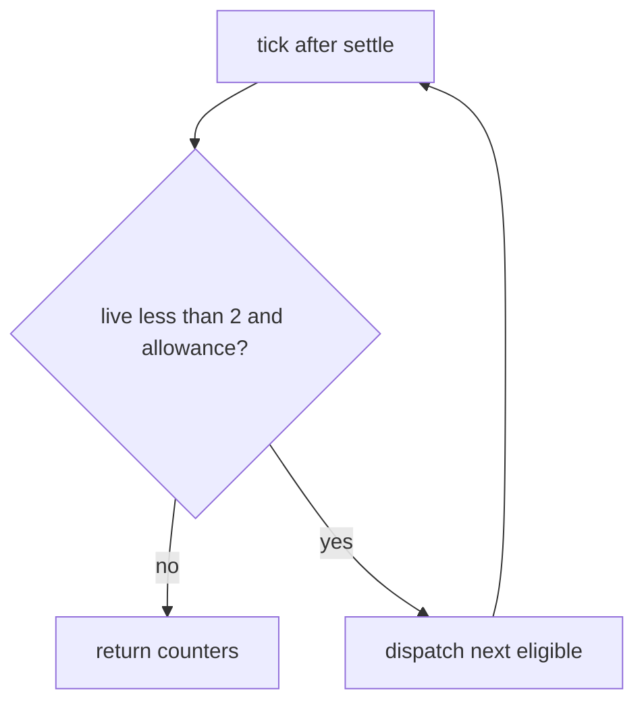

# FR-A: Copilot concurrent slot cap 2

Repo: `SimonBarnett/bobiverse`. Theme vision: `docs/vision.md` (dual Copilot pack).

## Goal

While Copilot coding-agent allowance remains, Jeeves `copilot_dispatch.tick`
keeps up to **two** live Copilot tasks (fill empty slots; never a third while
two are live).

## Success

| id | metric | target | how measured | fail-when |
|----|--------|--------|--------------|-----------|
| S1 | Concurrent live jobs | With allowance and ≥2 eligible rows, one `tick` (or successive fill in one tick) leaves 2 jobs in `copilot-jobs.json` | `pytest jeeves/tests/test_fr*_copilot_concurrent_slots.py` | Still `break`s after 1; or live count becomes 3 |

LOCKED

## Shape

Primary: service

LOCKED

## Stack

`common/scripts/copilot_dispatch.py` (`tick`, `dispatch_row`, `copilot-jobs.json`).

LOCKED

## Architecture

Replace the single successful-dispatch `break` with a loop gated by
`len(live_jobs) < MAX_CONCURRENT_COPILOT` (constant `2`). Keep settle-before-
dispatch and high-priority / give-up gates.

Concurrency gate — why it matters: S1 is entirely this loop bound.

## Screens

No new product UI. Theme mocks: `docs/mocks/copilot-dual-tasks/`.

## Deliverables

- `MAX_CONCURRENT_COPILOT = 2` (or equivalent named constant) in `copilot_dispatch.py`
- `tick` fills until cap or no eligible row
- Hermetic pytest: 2 dispatches with 2 eligible; no 3rd when 2 live; 0 when exhausted

## Testable

- CI: `pytest jeeves/tests/test_fr*_copilot_concurrent_slots.py` (or `common/tests` twin) green on the implement PR
- Fail-when: manual-only Testable; tip without the named pytest module

## Depends-on

Depends-on: (pending digest — stamped on GitHub issue body at file time)

## Out of scope

- Configurable max; digest/tray paint; Weights model picker

## Twin

Related ops note in #9738 (one job per pass today) — concurrency is this FR, not a twin close of #9738.
