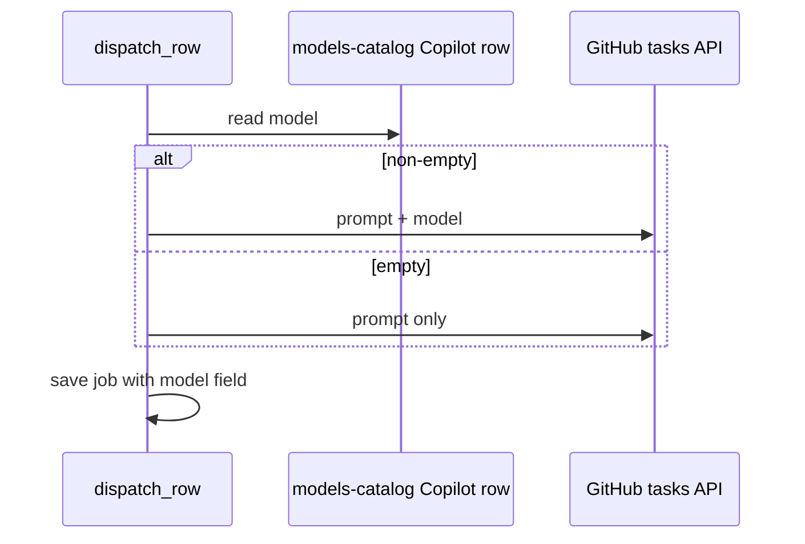

# FR-E: Dispatch sends Weights Copilot model

Repo: `SimonBarnett/bobiverse`. Theme vision: `docs/vision.md`.

## Goal

`copilot_dispatch` reads the Weights Copilot model and includes `model` on the
GitHub tasks POST when set; omits `model` when empty (GitHub auto). Persist the
chosen model on each `copilot-jobs.json` entry for digest/tray.

## Success

| id | metric | target | how measured | fail-when |
|----|--------|--------|--------------|-----------|
| S5 | POST body model | Non-empty Weights model appears in POST JSON; empty omits key; job record stores model | `pytest` `build_task_body` / `dispatch_row` | Always omits when set; sends blank string when empty |

LOCKED

## Shape

Primary: service

LOCKED

## Stack

`common/scripts/copilot_dispatch.py`; read catalog via models_catalog helpers
or digest-home `models-catalog.json` Copilot agent row.

LOCKED

## Architecture

Optional `base_ref` remains out of MVP unless already trivial. Do not require
env `BOB_COPILOT_MODEL` as primary (Weights wins); env may be a documented
override later only if needed.

Dispatch model — why it matters: closes the #9738 gap with the locked Weights source.

## Screens

No new UI (Weights from FR-D; tray from FR-C).

## Deliverables

- `build_task_body(row, model=...)` or catalog lookup includes `model` when non-empty
- Job dict gains `model` / `start_model` at append time
- Pytest: set / unset cases; no secrets in body
- Comment + close #9738 as superseded (Weights source)

## Testable

- CI: pytest asserting POST body with/without `model` and job record persistence
- Fail-when: manual-only Testable

## Depends-on

Depends-on: (pending digest + FR-D; optionally FR-A for shared job record)

## Out of scope

- Changing concurrency cap; tray paint; inventing new webhook
