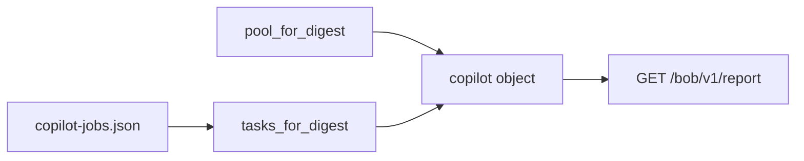

# FR-B: digest.copilot.tasks export

Repo: `SimonBarnett/bobiverse`. Theme vision: `docs/vision.md`.

## Goal

Publish live Copilot jobs under `digest.copilot.tasks` on `GET /bob/v1/report`,
listing model + current task alongside the existing quota pool fields.

## Success

| id | metric | target | how measured | fail-when |
|----|--------|--------|--------------|-----------|
| S2 | Digest task list | `copilot.tasks` has one object per live `copilot-jobs.json` entry with model + working_on (or equivalent); `[]` when idle | `pytest` on `bobreport.build_digest_object` / `_digest_copilot_pool` | Missing `tasks`; inventing `machines.copilot`; leaking secrets |

LOCKED

## Shape

Primary: service

LOCKED

## Stack

`common/scripts/bobreport.py` + `copilot_dispatch` job file readers.

LOCKED

## Architecture

Attach `tasks` to the public Copilot pool object without dropping remaining /
entitlement / reset / fetched_at fields. Source = live jobs file; model from
job record (empty if auto).

Digest attach — why it matters: tray and operators read one wire shape.

## Screens

Mocks: `docs/mocks/copilot-dual-tasks/{home,empty,error}.html`.

## Deliverables

- `copilot.tasks` array on report digest
- Fields at least: `model`/`start_model`, `task`, `repo`, `id`, `working_on`; optional `task_id`/`task_url` matching existing patterns
- Empty list when no live jobs
- Pytest covering populated + empty

## Testable

- CI: named pytest module asserting `build_digest_object(... )["copilot"]["tasks"]` shape
- Fail-when: manual-only Testable

## Depends-on

Depends-on: (pending digest + FR-A — stamped at file time)

## Out of scope

- Tray paint (FR-C); Weights; changing pool quota semantics
