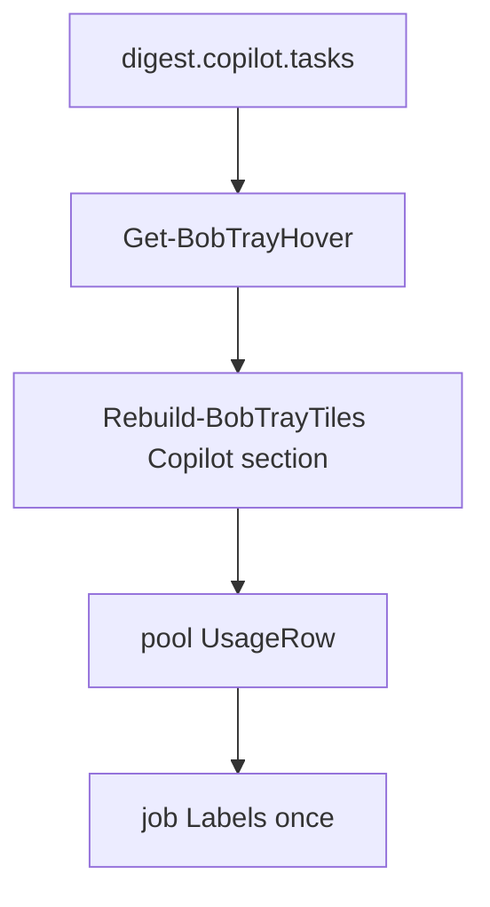

# FR-C: Tray paints Copilot jobs once under pool

Repo: `SimonBarnett/bobiverse`. Theme vision: `docs/vision.md`.

## Goal

TipForm Copilot fuel section shows live job lines **once** under the Copilot
pool usage row (model + current task), reading `digest.copilot.tasks`.

## Success

| id | metric | target | how measured | fail-when |
|----|--------|--------|--------------|-----------|
| S3 | Once under Copilot | After pool UsageRow, job lines render from `copilot.tasks`; not under `machines.*` | `pytest bob/tests/test_fr*_tray_copilot_tasks.py` or hermetic formatter pin | Missing paint; duplicate under machines |

LOCKED

## Shape

Primary: service

LOCKED

## Stack

`bob/tray/tools/Watch-BobTray.ps1`, `Get-BobTrayHover.ps1` / BobBridge hover export.

LOCKED

## Architecture

Reuse machine `worker_lines` tone. Pass task lines from hover into
`Rebuild-BobTrayTiles` Copilot block only.

Tray once — why it matters: operator lock “jobs shown once under pool”.

## Screens

Mocks: `docs/mocks/copilot-dual-tasks/`.

## Deliverables

- Hover exposes Copilot task lines from digest
- TipForm paints them under Copilot family after the pool bar
- No `machines.copilot` synthetic seat for this paint
- Pytest / Pester pin for formatter or Rebuild inputs

## Testable

- CI: `pytest bob/tests/test_fr*_tray_copilot_tasks.py` (or documented tray test path) green
- Fail-when: screenshot-only / manual-only Testable

## Depends-on

Depends-on: (pending digest + FR-B)

## Out of scope

- IRC DIGEST text line; Weights; concurrency logic
