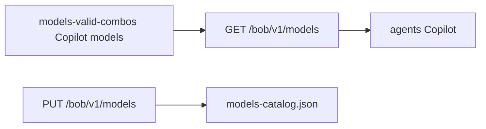

# FR-D: Weights Copilot agent + CLI catalog

Repo: `SimonBarnett/bobiverse`. Theme vision: `docs/vision.md`.

## Goal

Add a **Copilot** agent row and **Copilot** CLI catalog to
`GET`/`PUT /bob/v1/models` so operators pick which GitHub Copilot agent model
runs with Copilot (empty model allowed).

## Success

| id | metric | target | how measured | fail-when |
|----|--------|--------|--------------|-----------|
| S4 | Weights Copilot row | Default agents include Copilot/Copilot; PUT persists model; empty allowed | `pytest` models_catalog GET/PUT | Row missing; empty rejected; other CLIs broken |

LOCKED

## Shape

Primary: service

LOCKED

## Stack

`worker/scripts/models_catalog.py` (+ seed `models-valid-combos`), BobCallback
routes already on `/bob/v1/models`.

LOCKED

## Architecture

Extend `_DEFAULT_ROWS` and `CLI_PUBLIC_KEYS`. Seed known agent-task model ids
(document drift vs GitHub docs). Context/effort stay empty for Copilot.

Weights row — why it matters: operator locked Weights as the picker (not env-only #9738).

## Screens

Existing Weights grid gains one row (theme mocks show TipForm Copilot tasks;
Weights is the models webhook form already in product).

## Deliverables

- Default agent `{"agent":"Copilot","cli":"Copilot","model":"","context":"","effort":""}`
- Public CLI key `Copilot` with seeded model ids (include ops-proven `claude-haiku-4.5` plus current GitHub agent-task ids at implement time)
- GET/PUT round-trip pytest; Grok/Cursor/Opencode unchanged

## Testable

- CI: pytest module covering default Copilot row + PUT round-trip + empty model
- Fail-when: manual-only Testable

## Depends-on

Depends-on: (pending digest)

## Twin

Supersedes env-only approach in #9738 for the **picker surface**; dispatch
wiring is FR-E. Close #9738 when FR-E is filed, citing Weights as locked source.

## Out of scope

- Dispatch POST body (FR-E); concurrency; tray
