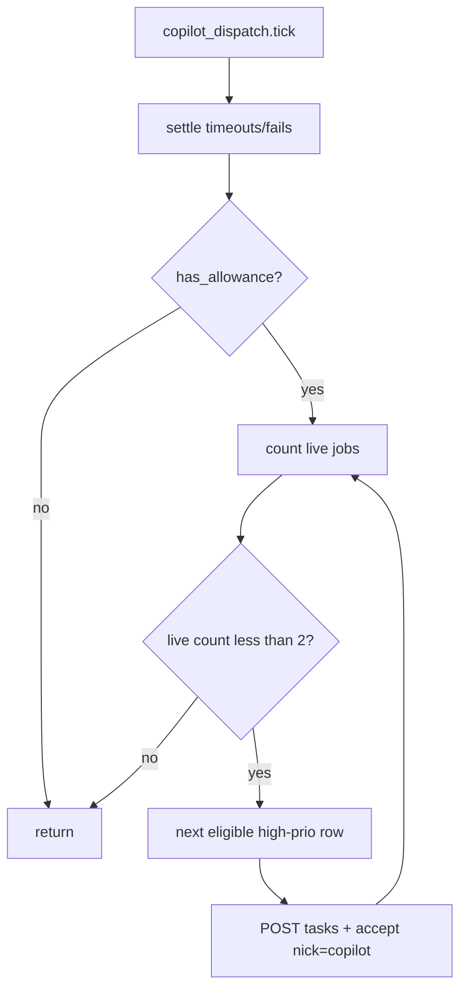
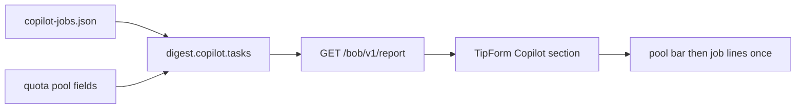
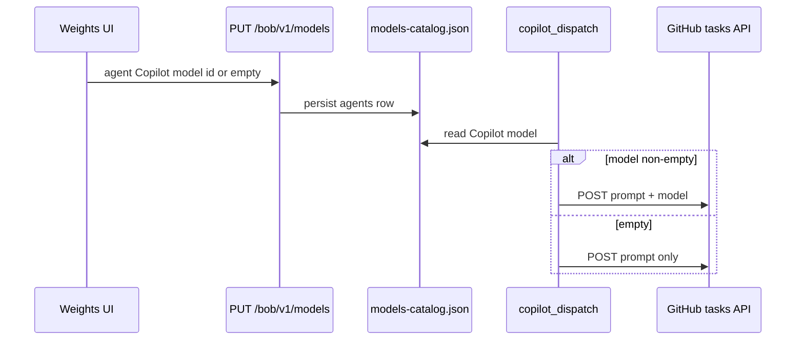

# Vision: Jeeves dual Copilot + Weights model

Skill: `visionary`. Feature request on existing repo `SimonBarnett/bobiverse`.

## Objective

When Copilot coding-agent quota remains, Jeeves keeps up to two live Copilot
cloud-agent tasks; operators see those jobs once under the Copilot pool
(model + current task) on the digest and TipForm; Weights
(`GET`/`PUT /bob/v1/models`) exposes a Copilot row that selects the GitHub
Copilot agent model for task create (empty = omit model / GitHub auto).

LOCKED

## Success

| id | metric | target | how measured | fail-when |
|----|--------|--------|--------------|-----------|
| S1 | Concurrent Copilot live jobs | With allowance and ≥2 eligible high-priority rows, `tick` leaves 2 entries in `copilot-jobs.json` | `pytest jeeves/tests/test_fr*_copilot_concurrent_slots.py` | Still stops at 1; or starts a 3rd while 2 live |
| S2 | Digest Copilot task list | `GET /bob/v1/report` → `copilot.tasks` lists each live job with model + current-task fields; empty list when idle | `pytest` on `bobreport.build_digest_object` / pool export | Tasks missing, duplicated under `machines.*`, or secrets leaked |
| S3 | Tray paints jobs once under Copilot | TipForm Copilot section shows pool usage then job lines; jobs do not appear under machines | `pytest bob/tests/test_fr*_tray_copilot_tasks.py` or hover formatter pin | Jobs only in JSON; or painted twice |
| S4 | Weights Copilot model | GET `/bob/v1/models` includes Copilot agent row; PUT persists model; empty allowed | `pytest` models_catalog GET/PUT | Copilot row absent; empty rejected |
| S5 | Dispatch honors Weights model | Non-empty Copilot model appears in tasks POST JSON; empty omits `model` | `pytest` `build_task_body` / `dispatch_row` | Always omits when set; or sends blank when empty |

LOCKED

## Shape

Primary: service

Hybrid note: TipForm is a consumer of `digest.copilot`; Weights is the
existing `/bob/v1/models` webhook surface.

LOCKED

## Stack

Default: Python Jeeves chair (`common/scripts/copilot_dispatch.py`,
`bobreport.py`), BobCallback models catalog (`worker/scripts/models_catalog.py`),
TipForm PowerShell (`bob/tray`), public `https://bob.ntsa.uk/bob/v1/{report,models}`.

Why: Extends the live Copilot dispatch + digest + Weights path already on
fleet boxes.

Why-not: New microservice; inventing `machines.copilot` roster seats; env-only
`BOB_COPILOT_MODEL` as the sole picker (Weights is the locked operator UI;
open #9738 is absorbed by the Weights slice).

LOCKED

## Architecture

Who talks to what.

Concurrency fill — why it matters: today `tick` breaks after the first
dispatch.

Digest + tray once — why it matters: jobs appear under Copilot pool only.

Weights to dispatch — why it matters: model choice must reach GitHub tasks API.

Trust: no secrets in digest tasks; keep existing Copilot timeout/quota rules
(FR #5201 / #5965).

LOCKED

## Screens

TipForm Copilot section wireframes (no generated PNGs).

| id | file | state |
|----|------|-------|
| M1 | docs/mocks/copilot-dual-tasks/home.html | pool bar + two job lines (model + task) |
| M2 | docs/mocks/copilot-dual-tasks/empty.html | pool only; no job lines |
| M3 | docs/mocks/copilot-dual-tasks/error.html | stale pool; tasks empty |

## Depends-on

Depends-on: (none)

## Out of scope

- Concurrency above 2 / live appliance max setting
- `machines.copilot` ChanServ roster seat
- Changing high-priority allowlist or timeout/quota give-up rules
- IRC shop DIGEST text-line Copilot job summary
- Release / VERSION bump / merge

## Twin / prior art

- Open `SimonBarnett/bobiverse#9738` (env `BOB_COPILOT_MODEL`) — absorbed by
  Weights Copilot row + dispatch model slice; close as superseded when that
  child is filed.
