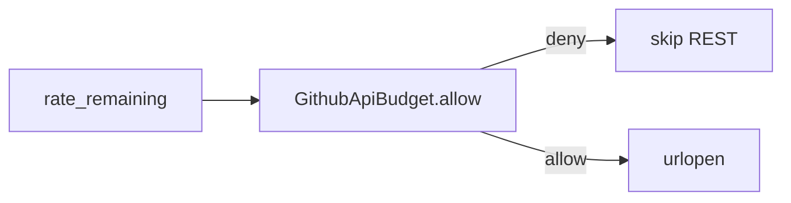

# FR-A: Global GitHub REST pause

**Target:** SimonBarnett/bobiverse  
**Theme:** Jeeves webhook-first job DB  
**Implements:** S4

## Goal

One shared pause when core `X-RateLimit-Remaining` is 0 or below the floor so every chair REST caller stops until reset.

## Deliverables

- Extend `github_api_budget` (or thin wrapper) so merge-on-green, ticket-closure, assign checkers, report purge, copilot tick, webhook-ensure call `allow()` / skip.
- Give `issue_open` the same reset backoff as `pr_exists` (`note_pr_exists_rate` pattern).
- Webhooks + IRC continue to update the job DB while paused.

## Success

| id | metric | target | how measured | fail-when |
|---|---|---|---|---|
| S4 | Shared pause | remaining=0 → zero chair REST | pytest inject remaining=0 | issue_open storms continue |

## Shape

LOCKED

Primary: service

## Stack

`github_api_budget.py`, `gitclaim.py`, `mrb_merge_on_green.py`, `ticket_closure.py`, `chair_health.py`, `bobreport._public_queue`.

## Architecture

Caption: One floor gates all non-essential REST.

## Testable

- CI: `jeeves/tests/test_frXXXX_global_gh_pause.py` — remaining=0 → zero urlopen from assign checker, `process_pending`, ticket poll, `_public_queue` purge, copilot tick.
- Fail-when: any of those still dials; Testable manual-only.

## Depends-on

`Depends-on: #<digest>`

## Out of scope

Per-path counters UI (FR-G); changing floor number product policy beyond existing 500.
