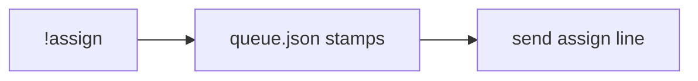

# FR-B: Assign / requeue offline (trust stamps)

**Target:** SimonBarnett/bobiverse  
**Theme:** Jeeves webhook-first job DB  
**Implements:** S5

## Goal

`!assign` and closed-unmerged requeue use stamped `queue.json` / ledger state only — no live `issue_open` / `is_pull` / `pr_exists`.

## Deliverables

- `irc_agent._assign_row_named` passes `None` checkers (or cache-only peek never network).
- `closed_unmerged_ref_skip_reason` uses stamped state from webhooks/resync.
- Refuse only on stamped closed/merged; unknown stamped-open stays offerable.

## Success

| id | metric | target | how measured | fail-when |
|---|---|---|---|---|
| S5 | Offline assign | Boom checkers never dial | pytest assign path | Assign GETs `/issues/N` |

## Shape

LOCKED

Primary: service

## Stack

`irc_agent.py`, `gitclaim.assign_row`, `closed_unmerged_ref_skip_reason`.

## Architecture

Caption: Assign trusts webhook stamps like !bored already does.

## Testable

- CI: extend `test_fr2730_*` / `test_fr3188_*` or `jeeves/tests/test_frXXXX_assign_offline.py` — assign with boom checkers never dials; stamped closed FR refused offline.
- Fail-when: live checker still constructed for assign; Testable manual-only.

## Depends-on

`Depends-on: #<digest>`

## Out of scope

Report purge (FR-C); hourly reconcile content.
