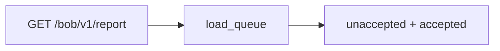

# FR-C: Report GET never calls GitHub

**Target:** SimonBarnett/bobiverse  
**Theme:** Jeeves webhook-first job DB  
**Implements:** S5

## Goal

`GET /bob/v1/report` must not call `github_pr_exists_checker` / purge via REST.

## Deliverables

- Remove live checker from `bobreport._public_queue`.
- Dead-MRB purge only from webhook close/merge + hourly reconcile (existing paths).
- Digest consumers stay read-only against `queue.json`.

## Success

| id | metric | target | how measured | fail-when |
|---|---|---|---|---|
| S5 | Report local | `_public_queue` with boom urlopen still returns | pytest | Report still GETs pulls |

## Shape

LOCKED

Primary: service

## Stack

`bobreport._public_queue`, `gitclaim.purge_dead_mrb_rows` (webhook/resync only).

## Architecture

Caption: Digest read path is local queue only.

## Testable

- CI: `jeeves/tests/test_frXXXX_report_no_github.py` — `_public_queue` with boom `urlopen` still returns queue; no pr_exists network.
- Fail-when: checker still constructed on report; Testable manual-only.

## Depends-on

`Depends-on: #<digest>`

## Out of scope

Assign offline (FR-B); merge-on-green cadence (FR-D).
