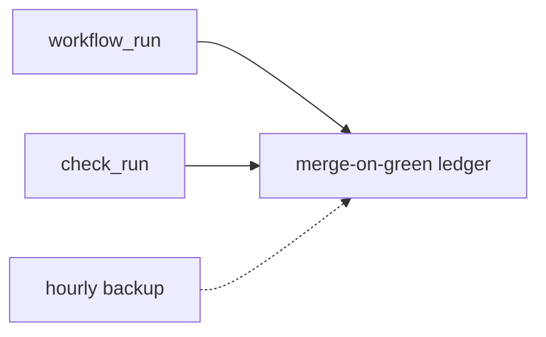

# FR-D: Kill merge-on-green 60s poll (event-first)

**Target:** SimonBarnett/bobiverse  
**Theme:** Jeeves webhook-first job DB  
**Implements:** S2, S3

## Goal

Advance merge-on-green from `workflow_run` / `check_run` webhooks; backup sweep at most hourly (or gap-only).

## Deliverables

- Default `MERGE_ON_GREEN_S` ≥ 3600 (or drive from resync tick).
- After FR-W0, `workflow_run` success/failure advances pending ledger without multi-GET storms.
- Keep `handle_check_run_event` path; seats still never poll CI.
- Document in `jeeves/docs/jeeves-commands.md` chair jobs table.

## Success

| id | metric | target | how measured | fail-when |
|---|---|---|---|---|
| S2 | No 60s poll | 10 min fake clock + healthy hooks → zero mog GETs | chair_health pytest | Still GETs every 60s |
| S3 | Event merge | workflow_run success drives merge/wait | fixture | Poll required to notice green |

## Shape

LOCKED

Primary: service

## Stack

`chair_health.MERGE_ON_GREEN_S`, `mrb_merge_on_green.process_pending`, webhook handlers.

## Architecture

Caption: CI webhooks drive merge; hourly backup only.

## Testable

- CI: `jeeves/tests/test_frXXXX_mog_event_first.py` — healthy webhook stamp + 10 min fake clock → zero merge-on-green GETs; workflow_run success drives merge/wait without poll.
- Fail-when: default interval still 60; Testable manual-only.

## Depends-on

`Depends-on: #<digest>` and FR-W0 (plain Depends-on both after numbers known)

## Out of scope

ticket-closure interval (FR-E); Copilot ticks (FR-F).
