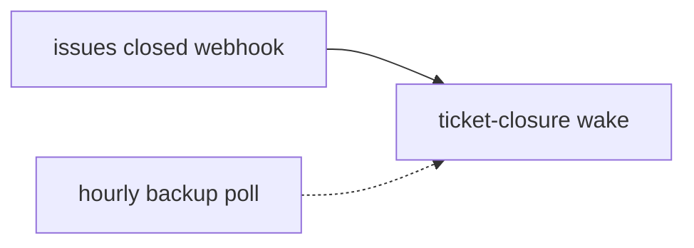

# FR-E: ticket-closure backup = hourly

**Target:** SimonBarnett/bobiverse  
**Theme:** Jeeves webhook-first job DB  
**Implements:** S2

## Goal

Backup close-poll interval matches reconcile (3600s) when webhooks healthy; under pause, skip poll entirely.

## Deliverables

- Default `TICKET_CLOSURE_S` → 3600 (keep env override ≥60).
- Skip `_poll_github_closes` when `GithubApiBudget.in_backoff()`.
- Keep webhook ingest as primary (FR #6405).

## Success

| id | metric | target | how measured | fail-when |
|---|---|---|---|---|
| S2 | Hourly backup | Default interval 3600; backoff skips poll | `pytest jeeves/tests/test_frXXXX_ticket_closure_hourly.py` (+ extend `test_fr6405_ticket_closure_webhook_first.py`) | Default still 900 with hooks up |

## Shape

LOCKED

Primary: service

## Stack

`chair_health.ticket_closure_interval_s`, `ticket_closure.py`, `github_api_budget`.

## Architecture

Caption: Close wake from webhooks; poll is rare backup.

## Testable

- CI: extend `test_fr6405_ticket_closure_webhook_first.py` / `test_frXXXX_ticket_closure_hourly.py` — default interval 3600; backoff skips `_poll_github_closes`.
- Fail-when: still polls every 15m by default; Testable manual-only.

## Depends-on

`Depends-on: #<digest>`

## Out of scope

merge-on-green (FR-D); wake URL transport changes.
