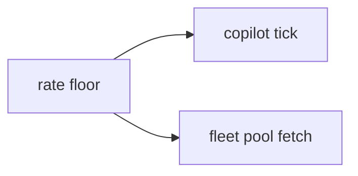

# FR-F: Copilot / fleet / external gh courtesy

**Target:** SimonBarnett/bobiverse  
**Theme:** Jeeves webhook-first job DB  
**Implements:** S4

## Goal

Non-git 60s Copilot/fleet ticks respect the shared rate floor; document that same-token `gh` / Haiku refill must stop when chair remaining=0 (or use another token).

## Deliverables

- Gate `_copilot_tick` / fleet pool fetch on `GithubApiBudget.allow()`.
- Auto-pause when remaining=0 (in addition to existing `BOB_FUEL_COPILOT=0`).
- Short ops note in `jeeves/docs/jeeves-commands.md` + copilot dispatch docs.

## Success

| id | metric | target | how measured | fail-when |
|---|---|---|---|---|
| S4 | Copilot pause | remaining=0 → no agents / copilot_internal GET | pytest | Tick still dials |

## Shape

LOCKED

Primary: service

## Stack

`chair_health._copilot_tick`, `fleet_pool_fetch.py`, `copilot_dispatch.py`, `github_api_budget`.

## Architecture

Caption: Same user token shares one pause with git REST.

## Testable

- CI: `jeeves/tests/test_frXXXX_copilot_rate_pause.py` — remaining=0 → no agents API / `copilot_internal/user` GET/POST from chair tick.
- Fail-when: tick ignores floor; Testable manual-only.

## Depends-on

`Depends-on: #<digest>`

## Out of scope

CCA dual-slot product work (#9744); changing allowance JSON shape beyond pause gate.
