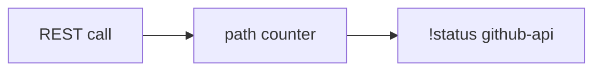

# FR-G: Per-path GH call counters on !status

**Target:** SimonBarnett/bobiverse  
**Theme:** Jeeves webhook-first job DB  
**Implements:** S2

## Goal

Operators can see which chair path burned the GitHub core bucket.

## Deliverables

- Durable counters in budget state: `reconcile`, `mog`, `ticket`, `assign`, `report`, `copilot`, `other`.
- `!status` `github-api:` line shows used + top paths + remaining.
- Counters roll on hour with the existing budget hour key.

## Success

| id | metric | target | how measured | fail-when |
|---|---|---|---|---|
| S2 | Path visibility | Status includes path names after fake calls | pytest status formatter | Opaque used=N only |

## Shape

LOCKED

Primary: service

## Stack

`github_api_budget.py`, `irc_agent` / chair `!status` formatter.

## Architecture

Caption: Budget state records who called.

## Testable

- CI: `jeeves/tests/test_frXXXX_gh_path_counters.py` — after fake calls, status string includes path names; counters roll on hour.
- Fail-when: no path breakdown; Testable manual-only.

## Depends-on

`Depends-on: #<digest>`

## Out of scope

Changing pause semantics (FR-A); external Prometheus.
