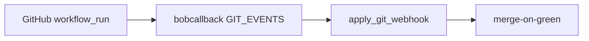

# FR-W0: Accept subscribed workflow_run + pull_request_review

**Target:** SimonBarnett/bobiverse  
**Theme:** Jeeves webhook-first job DB  
**Implements:** S1, S3

## Goal

Stop rejecting GitHub events the hook already subscribes to (`workflow_run`, `pull_request_review`) so CI/review can update the job DB without REST polls.

## Deliverables

- Add `workflow_run` and `pull_request_review` to `bobcallback.GIT_EVENTS`.
- Ensure `apply_git_webhook` handles both (review path exists; add `workflow_run` → merge-on-green handler mirroring `handle_check_run_event`).
- Keep announce lines consistent with other git events.
- Docs one line in `jeeves/docs/webhooks.md`: allow-list matches `New-BobGitWebhook.ps1` events.

## Success

| id | metric | target | how measured | fail-when |
|---|---|---|---|---|
| S1 | Events accepted | Both events → 204 and mutate state | pytest bobcallback + apply | 400 unsupported |

## Shape

LOCKED

Primary: service

## Stack

`bobcallback.GIT_EVENTS`, `bobreport.apply_git_webhook`, `mrb_merge_on_green`.

## Architecture

Caption: Subscribed hook events must pass the HTTP allow-list.

## Testable

- CI: `jeeves/tests/test_frXXXX_git_events_allowlist.py` — POST `workflow_run` and `pull_request_review` → 204; not in unsupported set; workflow_run fixture records/advances merge-on-green without REST.
- Fail-when: still 400 unsupported; Testable manual-only.

## Depends-on

`Depends-on: #<digest>`

## Out of scope

Killing the 60s poll cadence (FR-D); global pause (FR-A).
