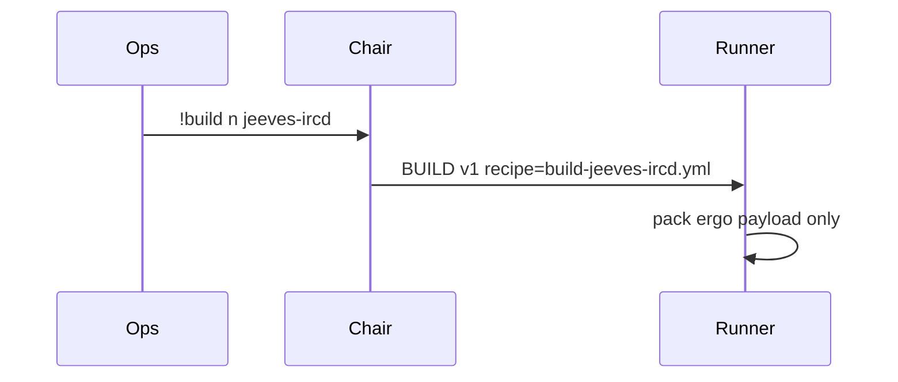

# FR-D: Separate !build recipe for Jeeves IRCD (build-jeeves-ircd.yml)

**Repo:** `SimonBarnett/bobiverse`  
**Date:** 2026-11-24  
**Theme:** docs/feature-request-jeeves-ircd-webhooks-split-2026-11-24.md  
**Depends-on:** digest + FR-C

## Goal

Add `.bobiverse/build-jeeves-ircd.yml` and a `builds-catalog.json` entry so `!build` packs the Ergo/BobIrcd payload only, without rebuilding or embedding `jeeves/www`.

## Success

| id | metric | target | how measured | fail-when |
| --- | --- | --- | --- | --- |
| S1 | Recipe file | `.bobiverse/build-jeeves-ircd.yml` parses; pack produces IRCD/Ergo artifact | `python -m pytest -q jeeves/tests/test_frXXXX_ircd_build_yml.py` | Missing recipe or packs jeeves-*.msi chair omnibus |
| S2 | Catalog | `builds-catalog.json` entry with `yml` path to build-jeeves-ircd.yml | same pytest | No catalog row |
| S3 | No www | Recipe pack does not Copy-Item or assert `jeeves/www` | recipe content pins | Recipe rebuilds webhooks www |

LOCKED

## Shape

Primary: **service**

LOCKED

## Stack

Bobiverse BUILD runner + catalog; flamingo; Fetch-Ergo / Install-BobIrcd; optional consume of FR-C CI artifact on recipe pack path.

LOCKED

## Architecture

LOCKED

## Screens

Stubs: `docs/mocks/jeeves-ircd-webhooks-split/`

## Deliverables

1. `.bobiverse/build-jeeves-ircd.yml` (machine flamingo; IRCD artifacts; no www)
2. `builds-catalog.json` entry
3. `jeeves/tests/test_frXXXX_ircd_build_yml.py`
4. Docs in bobiverse-build / Install-BobIrcd notes

## Testable

- CI: `python -m pytest -q jeeves/tests/test_frXXXX_ircd_build_yml.py`
- Assert catalog `yml` and recipe excludes www rebuild / jeeves chair MSI as the sole product
- Fail-when: recipe missing or embeds www from tree
