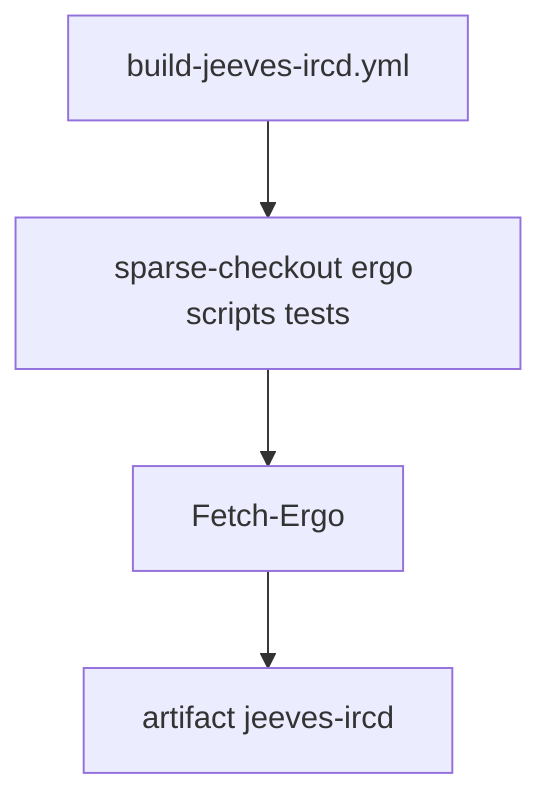

# FR-C: Jeeves IRCD sparse CI (build-jeeves-ircd)

**Repo:** `SimonBarnett/bobiverse`  
**Date:** 2026-11-24  
**Theme:** docs/feature-request-jeeves-ircd-webhooks-split-2026-11-24.md  
**Depends-on:** digest (filed as `#<digest>`)

## Goal

Add `.github/workflows/build-jeeves-ircd.yml` with sparse-checkout that stages the Ergo/BobIrcd payload (`Fetch-Ergo` + `Install-BobIrcd` surface) and uploads a `jeeves-ircd` artifact without packing chair www.

## Success

| id | metric | target | how measured | fail-when |
| --- | --- | --- | --- | --- |
| S1 | Sparse job exists | Workflow sparse-checkouts IRCD roots and uploads `jeeves-ircd` artifact with ergo.exe | `python -m pytest -q jeeves/tests/test_frXXXX_ircd_sparse_ci.py` | No workflow, or full-tree checkout only |
| S2 | No www rebuild | Job does not Copy-Item or pack `jeeves/www` | same pytest | Artifact or steps include www tree rebuild |
| S3 | Path filters | IRCD-only path filters; www-only changes do not run this job | workflow path pins | `jeeves/www/**` in IRCD path filters |

LOCKED

## Shape

Primary: **service**

LOCKED

## Stack

GHA sparse-checkout; `common/scripts/Fetch-Ergo.ps1`; `jeeves/scripts/Install-BobIrcd.ps1`; third_party/ergo cache; pytest pins.

LOCKED

## Architecture

IRCD CI owns Ergo payload only; webhooks and chair stay separate.

LOCKED

## Screens

Stubs: `docs/mocks/jeeves-ircd-webhooks-split/`

## Deliverables

1. New `.github/workflows/build-jeeves-ircd.yml` (sparse-checkout, path filters, artifact upload)
2. Stage script or inline steps producing ergo.exe + seed yaml + Install-BobIrcd.ps1 in artifact
3. `jeeves/tests/test_frXXXX_ircd_sparse_ci.py`
4. Docs: sparse roots + artifact name

## Testable

- CI: `python -m pytest -q jeeves/tests/test_frXXXX_ircd_sparse_ci.py`
- GHA job name: `build-jeeves-ircd`
- Workflow contains `sparse-checkout` and does not list `jeeves/www/**` as a build input for packing www
- Fail-when: IRCD only exists inside omnibus jeeves MSI CI
