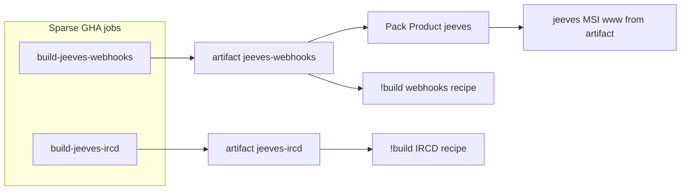
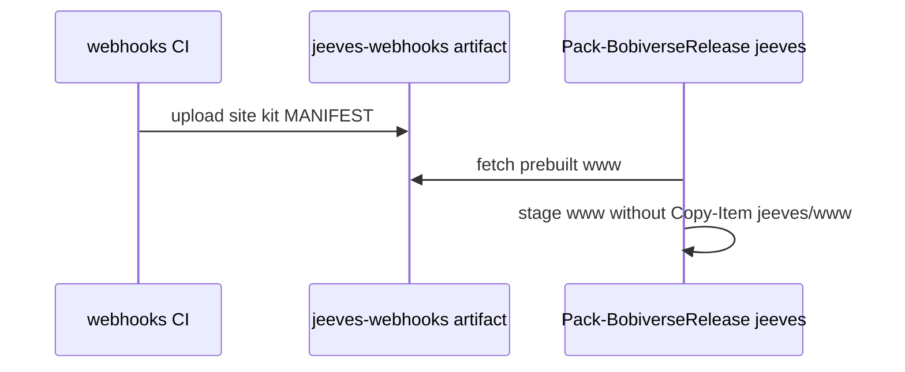

# Feature request: Jeeves IRCD + bob.ntsa.uk webhooks sparse CI + separate !build recipes

**Primary repo:** `SimonBarnett/bobiverse`  
**Date:** 2026-11-24  
**Plan folder:** `bob/plan/work/plan-20261124-181040`  
**Depends-on:** (none) - theme pack; children Depend on digest after filing

## Ultimate objective

Fleet CI and `!build` treat **bob.ntsa.uk webhooks (site kit)** and **Jeeves IRCD (Ergo/BobIrcd)** as independent sparse-built products with their own recipes; the jeeves pack stages the webhooks www artifact and never rebuilds www from the checkout on the release path.

## Success

| id | metric | target | how measured | fail-when |
| --- | --- | --- | --- | --- |
| S1 | Webhooks sparse CI | `build-jeeves-webhooks` uses sparse-checkout limited to www/kit roots; still uploads `jeeves-webhooks` artifact | GHA job `build-jeeves-webhooks` + `python -m pytest -q jeeves/tests/test_frXXXX_webhooks_sparse_ci.py` | Full-tree checkout, or www-only change forces unrelated jeeves service job |
| S2 | Webhooks !build recipe | Catalog entry + `.bobiverse/build-webhooks.yml` packs site-kit artifact only (no jeeves.exe / ergo) | recipe parse pytest + catalog pin | Recipe packs full jeeves MSI or missing catalog `yml` |
| S3 | IRCD sparse CI | New `build-jeeves-ircd` sparse job stages Ergo payload + Install-BobIrcd surface; uploads IRCD artifact | GHA job `build-jeeves-ircd` + `python -m pytest -q jeeves/tests/test_frXXXX_ircd_sparse_ci.py` | IRCD only built inside omnibus jeeves MSI with full checkout |
| S4 | IRCD !build recipe | Catalog entry + `.bobiverse/build-jeeves-ircd.yml` packs IRCD/Ergo artifact only (no www rebuild) | recipe parse pytest + catalog pin | Recipe embeds/rebuilds `jeeves/www` or packs chair MSI |
| S5 | Jeeves pack consumes webhooks artifact | `Pack-BobiverseRelease -Product jeeves` stages `www` from prebuilt webhooks artifact; no unguarded `Copy-Item` from `jeeves\www` on release path | `python -m pytest -q common/tests/test_frXXXX_jeeves_pack_consumes_webhooks_artifact.py` | Pack still copies tree www by default |
| S6 | Docs | Docs list sparse roots, path filters, recipe paths, and Pack artifact params | file-content pins / docs assert tests | Docs still describe omnibus jeeves pack rebuilding www |

LOCKED

## Shape

Primary: **service**

Hybrid note: bob.ntsa.uk webhooks site kit is a **website** delivery artifact consumed by the jeeves pack; live site UI is unchanged by this packaging theme.

LOCKED

## Stack

- GitHub Actions `windows-latest` + `actions/checkout@v4` sparse-checkout
- Existing `jeeves/scripts/jeeves_webhooks_ci.py` + `Install-BobWebhooks.ps1 -SiteKit`
- Existing `Fetch-Ergo.ps1` + `Install-BobIrcd.ps1`
- `Pack-BobiverseRelease.ps1 -Product jeeves` with artifact-dir params/env
- `.bobiverse/build-webhooks.yml` + `.bobiverse/build-jeeves-ircd.yml` in `builds-catalog.json`
- Pytest under `jeeves/tests/` and `common/tests/`
- Recipe machine: flamingo (bobiverse-build docs)

LOCKED

## Architecture

Sparse CI jobs produce artifacts; recipes and Pack consume them.

CI and recipe ownership diagram:

Pack consume path for www:

IRCD recipe/CI never stages `jeeves/www`. Bob-ear MSI stays out of www ownership.

LOCKED

## Screens

No product UI change. Mocks stubs (CI/packaging only):

| id | file | state |
| --- | --- | --- |
| M1 | docs/mocks/jeeves-ircd-webhooks-split/home.html | key |
| M2 | docs/mocks/jeeves-ircd-webhooks-split/empty.html | empty |
| M3 | docs/mocks/jeeves-ircd-webhooks-split/error.html | error |

## Gap vs current

- `build-jeeves-webhooks.yml` has path filters and artifact upload but full-tree checkout (no sparse-checkout)
- No `build-jeeves-ircd.yml`
- Single `.bobiverse/build.yml` packs jeeves+bob+airc; catalog supports non-default `yml` but unused for webhooks/IRCD
- `Pack-BobiverseRelease` Copy-Items `jeeves\www` into jeeves stage (FR #7455)
- Sibling digest #9762 covers tray/status/watcher only; marks separate `.bobiverse` recipes out of scope there

## Anti-omnibus children

| Code | Slice |
| --- | --- |
| FR-A | Webhooks sparse-checkout CI |
| FR-B | `.bobiverse/build-webhooks.yml` + catalog |
| FR-C | IRCD sparse CI workflow + artifact |
| FR-D | `.bobiverse/build-jeeves-ircd.yml` + catalog |
| FR-E | Pack jeeves consumes webhooks artifact (no www rebuild) |

## Out of scope

- Bob-ear MSI embedding or rebuilding webhooks www
- TipForm Status host changes (#9762)
- Live IIS / Cloudflare cutover
- Rebuilding Ergo from source (still Fetch-Ergo)
- Unholding or merging #9762
