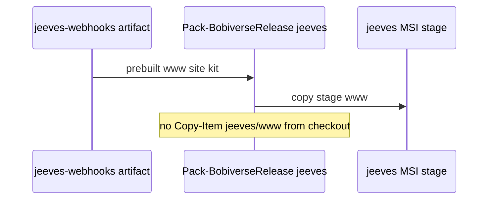

# FR-E: Pack jeeves consumes prebuilt webhooks www artifact (no rebuild)

**Repo:** `SimonBarnett/bobiverse`  
**Date:** 2026-11-24  
**Theme:** docs/feature-request-jeeves-ircd-webhooks-split-2026-11-24.md  
**Depends-on:** digest + FR-A + FR-B

## Goal

`Pack-BobiverseRelease.ps1 -Product jeeves` stages `www` from a prebuilt webhooks artifact input; the release Pack path does not `Copy-Item` from `jeeves\www` in the checkout.

## Success

| id | metric | target | how measured | fail-when |
| --- | --- | --- | --- | --- |
| S1 | No tree rebuild | Release path has no unguarded Copy-Item of `jeeves\www` into stage | `python -m pytest -q common/tests/test_frXXXX_jeeves_pack_consumes_webhooks_artifact.py` | Pack still copies tree www by default |
| S2 | Artifact input | Pack accepts dir/param/env for webhooks artifact and fails loud when missing | pytest fixture dry-pack + script contract | Silent skip or invent rebuild from tree |
| S3 | MSI still ships www | Staged MSI/layout still contains www (FR #7455 ship contract) sourced from artifact | same pytest | www dropped from jeeves product |
| S4 | Docs | Pack / webhooks docs state Pack consumes CI/recipe webhooks artifact | file content | Docs still say Pack copies `jeeves\www` only |

LOCKED

## Shape

Primary: **service**

LOCKED

## Stack

Existing `Pack-BobiverseRelease.ps1`; webhooks artifact from FR-A/FR-B; `build-jeeves-msi.yml` and/or omnibus recipe may pass artifact path; bob-ear product unchanged.

LOCKED

## Architecture

Local Sync/heal may still publish www for operator boxes; that is out of S1 unless the release Pack path is involved.

LOCKED

## Screens

Stubs: `docs/mocks/jeeves-ircd-webhooks-split/`

## Deliverables

1. Pack parameter or env for webhooks artifact root (e.g. `-WebhooksArtifactDir`)
2. Remove/guard release-path `Copy-Item` from `jeeves\www`
3. Fail with named missing www/MANIFEST if input absent
4. Wire `build-jeeves-msi.yml` (and recipe pack if needed) to download/use artifact
5. `common/tests/test_frXXXX_jeeves_pack_consumes_webhooks_artifact.py`
6. Docs updates (`jeeves/docs/webhooks.md` / pack notes)

## Testable

- CI: `python -m pytest -q common/tests/test_frXXXX_jeeves_pack_consumes_webhooks_artifact.py`
- Assert Pack source has no unguarded `jeeves\www` Copy-Item on release path
- Fail-when Pack still rebuilds www from tree by default
