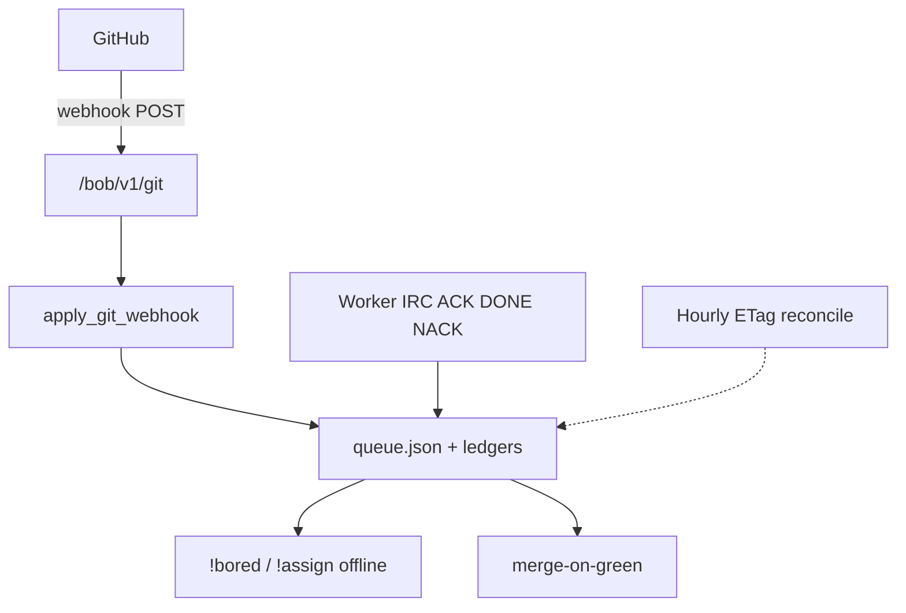
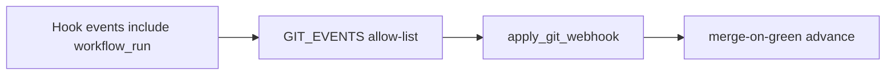

# Feature request: Jeeves webhook-first job DB (stop GH 429s)

**Target repo:** SimonBarnett/bobiverse  
**Plan folder:** `plan/work/plan-20261125-182701`  
**Index:** `docs/fr-index-jeeves-webhook-jobdb-2026-11-25.md`

## Ultimate objective

GitHub pushes job and CI changes to Jeeves; the chair writes them into an internal job DB with worker IRC; REST is ~hourly drift insurance — never a substitute for listening — so the shared 5000/h core bucket stays usable.

## Success

| id | metric | target | how measured | fail-when |
|---|---|---|---|---|
| S1 | Subscribed git events accepted | `workflow_run` + `pull_request_review` return 204 and mutate state | pytest through bobcallback allow-list | 400 unsupported for those events |
| S2 | Steady-state chair core REST | Zero 60s/15m git polls when hooks healthy; ~hourly ETag only | path counters + clock-advance tests | `MERGE_ON_GREEN_S=60` or ticket-closure 900s still GETs |
| S3 | Merge-on-green from events | Pending PR advances on `workflow_run`/`check_run` without GET storm | workflow_run fixture; no urlopen in 5 min fake clock | Still needs 60s poll to notice green |
| S4 | Shared pause | remaining &lt; floor → all chair REST no-op until reset | inject remaining=0 across callers | `issue_open` WARN flood resumes |
| S5 | Offline assign/offer | Closed/open from webhook stamps only | boom checkers never called | Assign dials `/issues/N` |

## Shape

LOCKED

Primary: service

ircJeeves chair + BobCallback `/bob/v1/git`. Mocks: `docs/mocks/jeeves-webhook-jobdb/` (ops flow stubs, no product UI).

## Stack

- `common/scripts/bobcallback.py` — `GIT_EVENTS`
- `common/scripts/bobreport.py` — `apply_git_webhook`
- `common/scripts/mrb_merge_on_green.py` — event handlers + `process_pending`
- `common/scripts/chair_health.py` — cadence (`MERGE_ON_GREEN_S`, `TICKET_CLOSURE_S`, `RESYNC_S`)
- `common/scripts/github_api_budget.py` — shared pause
- `common/scripts/gitclaim.py` / `irc_agent.py` — assign/offer checkers
- `jeeves/tools/monitor/ticket_closure.py` — close wake
- On-disk `queue.json` + ledgers (no new DB product)

## Architecture

Caption: GitHub tells Jeeves; queue is the job DB; hourly REST is drift only.

Caption: FR-W0 opens the door for events already subscribed on the hook.

## Depends-on

Held parent digest; children `Depends-on: #<digest>` only. Hold only on parent.

## Out of scope

Changing GitHub 5000/h product limit; new SQL/Redis store; moving intake `gh_filer` off the user token (separate FR if needed).

## Screens / mocks

`docs/mocks/jeeves-webhook-jobdb/home.html`, `empty.html`, `error.html` (no product UI stubs).

## Anti-omnibus children

| Draft | Title | Success |
|---|---|---|
| FR-W0 | Accept subscribed workflow_run + pull_request_review | S1, S3 |
| FR-A | Global GitHub REST pause | S4 |
| FR-B | Assign / requeue offline | S5 |
| FR-C | Report GET never calls GitHub | S5 |
| FR-D | Kill merge-on-green 60s poll | S2, S3 |
| FR-E | ticket-closure backup hourly | S2 |
| FR-F | Copilot / fleet / external gh courtesy | S4 |
| FR-G | Per-path GH counters on !status | S2 |

## Filed issues

| Draft | Issue | Title |
|---|---|---|
| Digest | #10006 | Digest: Jeeves webhook-first job DB (stop GH 429s) |
| FR-W0 | #10007 | Accept subscribed workflow_run + pull_request_review |
| FR-A | #10008 | Global GitHub REST pause |
| FR-B | #10009 | Assign / requeue offline |
| FR-C | #10010 | Report GET never calls GitHub |
| FR-D | #10011 | Kill merge-on-green 60s poll |
| FR-E | #10012 | ticket-closure backup hourly |
| FR-F | #10013 | Copilot / fleet / external gh courtesy |
| FR-G | #10014 | Per-path GH counters on !status |
