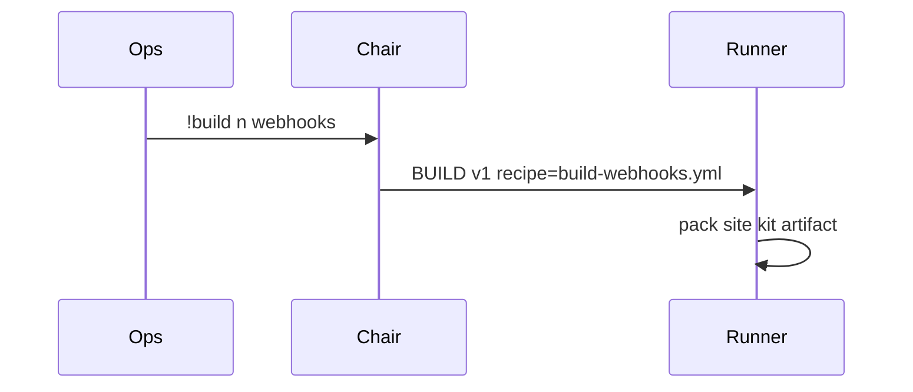

# FR-B: Separate !build recipe for bob.ntsa.uk webhooks (build-webhooks.yml)

**Repo:** `SimonBarnett/bobiverse`  
**Date:** 2026-11-24  
**Theme:** docs/feature-request-jeeves-ircd-webhooks-split-2026-11-24.md  
**Depends-on:** digest + FR-A

## Goal

Add `.bobiverse/build-webhooks.yml` and a `builds-catalog.json` entry so `!build` can pack the webhooks site-kit artifact without building jeeves.exe or Ergo.

## Success

| id | metric | target | how measured | fail-when |
| --- | --- | --- | --- | --- |
| S1 | Recipe file | `.bobiverse/build-webhooks.yml` parses; pack produces site-kit artifact only | `python -m pytest -q jeeves/tests/test_frXXXX_webhooks_build_yml.py` | Missing file or pack invokes full jeeves MSI |
| S2 | Catalog | `builds-catalog.json` lists entry with `yml` path to build-webhooks.yml | same pytest | Catalog still only points at omnibus build.yml |
| S3 | No IRCD/chair | Recipe suites/pack do not require jeeves.exe or ergo.exe | recipe content pins | Recipe stages ergo or jeeves.exe |

LOCKED

## Shape

Primary: **website**

LOCKED

## Stack

Existing bobiverse BUILD runner + catalog `yml` / `recipe=` (FR #8490 / #8770); flamingo recipe machine; site-kit pack via `jeeves_webhooks_ci.py` or thin Pack wrapper.

LOCKED

## Architecture

Catalog points `!build n` at the webhooks recipe; runner packs site kit only.

LOCKED

## Screens

Stubs: `docs/mocks/jeeves-ircd-webhooks-split/`

## Deliverables

1. `.bobiverse/build-webhooks.yml` (machine flamingo; pack site-kit; no jeeves/bob/airc MSI)
2. `builds-catalog.json` entry with `yml: .bobiverse/build-webhooks.yml`
3. `jeeves/tests/test_frXXXX_webhooks_build_yml.py`
4. Docs in bobiverse-build / webhooks notes

## Testable

- CI: `python -m pytest -q jeeves/tests/test_frXXXX_webhooks_build_yml.py`
- Assert catalog `yml` path and recipe pack artifacts exclude jeeves-*.msi / ergo.exe
- Fail-when: recipe missing or packs full jeeves product
