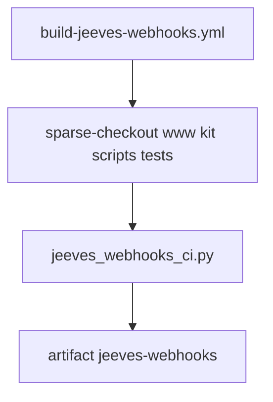

# FR-A: Webhooks sparse-checkout CI (build-jeeves-webhooks)

**Repo:** `SimonBarnett/bobiverse`  
**Date:** 2026-11-24  
**Theme:** docs/feature-request-jeeves-ircd-webhooks-split-2026-11-24.md  
**Depends-on:** digest (filed as `#<digest>`)

## Goal

`build-jeeves-webhooks.yml` sparse-checkouts only the www/site-kit roots needed by `jeeves_webhooks_ci.py` and still uploads the `jeeves-webhooks` artifact.

## Success

| id | metric | target | how measured | fail-when |
| --- | --- | --- | --- | --- |
| S1 | Sparse checkout | Workflow uses `actions/checkout` `sparse-checkout` with www/kit roots | `python -m pytest -q jeeves/tests/test_frXXXX_webhooks_sparse_ci.py` | Full-tree checkout only |
| S2 | Artifact intact | Job still produces `jeeves-webhooks` artifact with MANIFEST.json | same pytest + workflow contract | Artifact missing or site-kit step broken |
| S3 | Path isolation | www-only changes do not require full jeeves service tree in this job | pytest path/sparse pins | Sparse roots include entire `jeeves/**` |

LOCKED

## Shape

Primary: **website**

Reuse repo primary: **service**; this slice delivers the website site-kit CI surface.

LOCKED

## Stack

Existing `build-jeeves-webhooks.yml`, `jeeves_webhooks_ci.py`, `Install-BobWebhooks.ps1 -SiteKit`, GHA sparse-checkout.

LOCKED

## Architecture

Sparse checkout limits the job to site-kit inputs; output artifact is unchanged for consumers.

LOCKED

## Screens

Stubs: `docs/mocks/jeeves-ircd-webhooks-split/` (no live UI change).

## Deliverables

1. Add `sparse-checkout` (and cone/paths) to `.github/workflows/build-jeeves-webhooks.yml`
2. Keep path filters; keep artifact name `jeeves-webhooks` + MANIFEST.json
3. Add `jeeves/tests/test_frXXXX_webhooks_sparse_ci.py` (pin sparse-checkout + roots; keep FR #7465 isolation)
4. Docs note sparse roots beside existing webhooks CI docs

## Testable

- CI: `python -m pytest -q jeeves/tests/test_frXXXX_webhooks_sparse_ci.py`
- GHA job name: `build-jeeves-webhooks`
- Workflow YAML contains `sparse-checkout`
- Fail-when: full-tree checkout only
