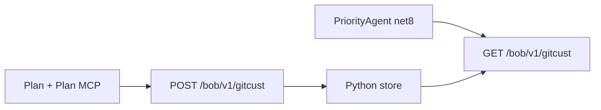

# Feature request: Priority customers via Bob /gitcust (cross-repo)

**Target repos:** SimonBarnett/bobiverse (Python /bob/v1/gitcust) + SimonBarnett/priority-mcp (.NET 8 PriorityAgent). Amend priority-mcp#810.

## Filed issues

| Repo | id | issue | title |
|---|---|---|---|
| bobiverse | epic | #9980 | Digest: Priority /gitcust (cross-repo epic) — **hold** |
| bobiverse | webhook | #9981 | Digest: Bob /gitcust webhook (Python) |
| bobiverse | FR-B1 | #9982 | Python GET+POST /bob/v1/gitcust webhook |
| bobiverse | FR-B2 | #9983 | gitcust store + AI-share scanner |
| bobiverse | FR-B3 | #9984 | gitcust periodic updater |
| priority-mcp | agent | #811 | Digest: PriorityAgent /gitcust (.NET 8) |
| priority-mcp | FR-P1 | #810 | List+ask via /gitcust (rewrite) |
| priority-mcp | FR-P2 | #812 | New subfolder → Plan + Plan MCP + POST |
| priority-mcp | FR-P3 | #813 | New customer → Plan + CredMan + OData + dual POST |
| priority-mcp | FR-P4 | #814 | Hours uses session CredMan username |
| priority-mcp | FR-P5 | #815 | CAST IRON priority-customer-setup POST |
| priority-mcp | FR-P6 | #816 | Docs/UAT |

Hold only on bobiverse #9980. Nested digests #9981 and priority-mcp #811 are unheld.

## Ultimate objective

PriorityAgent lists customers and task folders from Bob GET /bob/v1/gitcust (not GitHub). New customer and new subfolder use Plan mode + Plan skill DAG/MCP (plan.ntsa.uk), POST to /gitcust, CredMan session username for hours.

## Success

| id | metric | target | how measured | fail-when |
|---|---|---|---|---|
| S1 | Source of truth | Customer list from Bob /gitcust only | launcher tests | gh topic scan primary |
| S2 | Tasks + titles | SC/SO/WBS with free-text titles | fixture tests | titles missing |
| S3 | Task optional | Existing / new / root with no subfolder | launcher UX | forced subfolder |
| S4 | New → Plan + DAG | Plan mode + plan.ntsa.uk MCP | launcher tests | worker seat; no MCP |
| S5 | Dual POST new customer | POST customer then POST first subfolder | API/skill tests | single POST only |
| S6 | New customer OData | Medatech cust no. → OData → repo | UAT/mock | no OData |
| S7 | CredMan UX | Enter = no password ask; * if missing or username typed | CredMan UX tests | password on Enter-continue |
| S8 | Hours username | Hours use session CredMan username | hours unit tests | wrong user |
| S9 | Periodic refresh | Interval scanner catch-up | job tests | gh-only updates |
| S10 | .NET 8 client | PriorityAgent stays net8.0; webhook is Python | csproj + webhook path | Framework 4 client; .NET webhook |
| S11 | Connections file | New customer writes OData ZEMG_CUSTCONECT* to C:\passwords\<client>-connections.txt; create dir if missing | setup/UAT tests with temp passwords dir | file missing; secrets in repo/logs; dir not created |

## Shape

LOCKED

Primary: service

Python Bob webhook + .NET 8 PriorityAgent + skills. No product web UI. Stubs: docs/mocks/gitcust/.

## Stack

- bobiverse: Python jeeves /bob/v1/gitcust (GET/POST), store, scanner
- priority-mcp: .NET 8 PriorityAgent, CredMan, OData, Plan MCP https://plan.ntsa.uk/mcp
- Cross-repo Depends-on: priority-mcp → bobiverse digests

## Architecture

Caption: Cross-repo gitcust.

## Depends-on

Held umbrella digest on bobiverse; nested webhook digest; priority-mcp digest Depends-on both. Hold only on umbrella.

## Out of scope

gh primary list; secrets in logs; .NET rewrite of webhooks.

## Screens / mocks

No product web UI. Stubs: docs/mocks/gitcust/home.html, empty.html, error.html.
